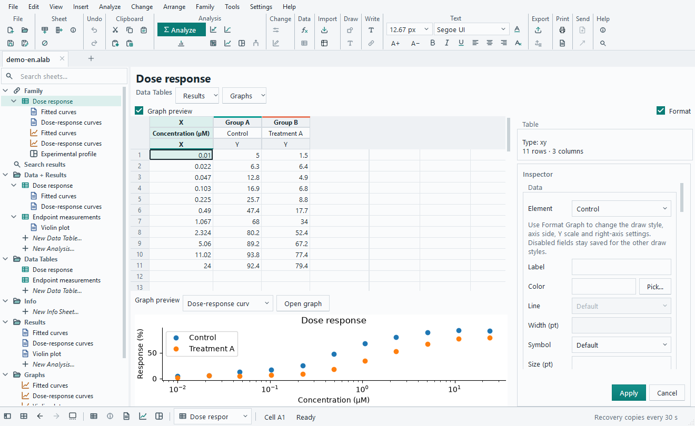
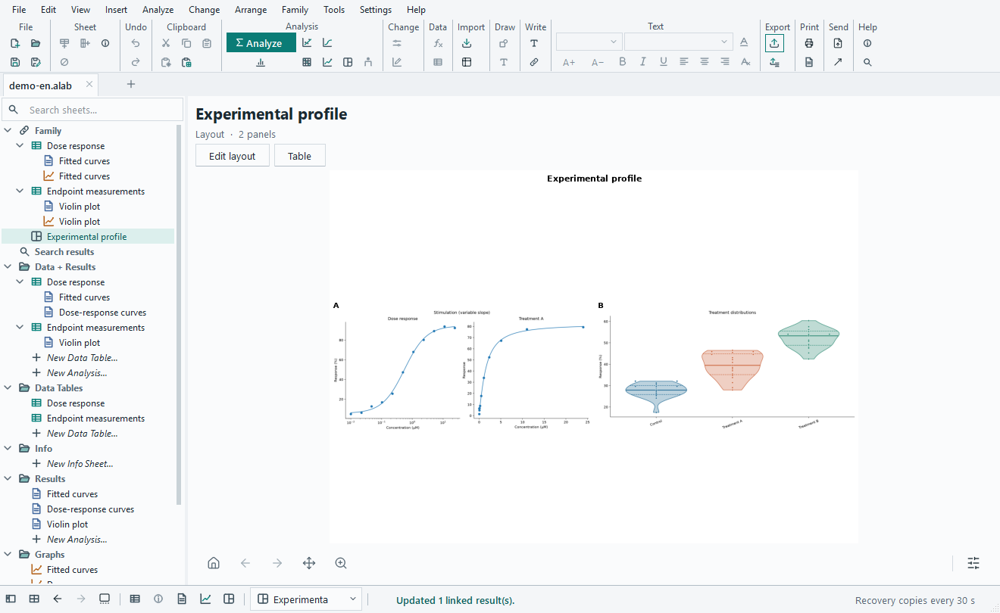
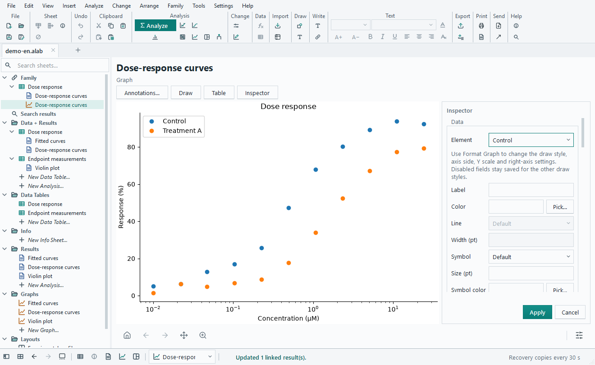
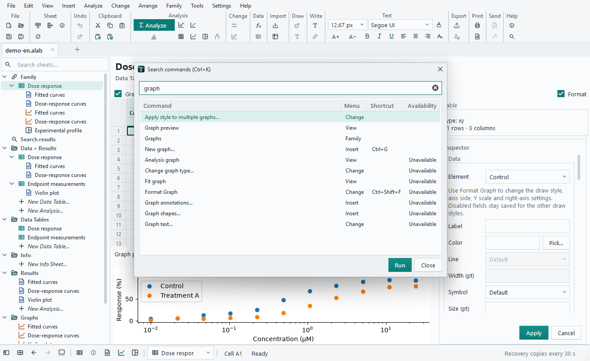

# Trama

**From data to figures, in one project.** Free, open-source statistics and scientific graphing for Windows.

> **BETA.** All published 0.x builds are beta releases: errors and incomplete functionality are possible. A stable release is not available yet.

Trama brings worksheets, statistical analyses and publication-ready graphs together. Paste from Excel, choose a method, polish the figure and keep everything in one `.alab` project. MIT-licensed source code, no account, no telemetry.

**[Download for Windows x64](https://github.com/realfulvio/Trama/releases/latest)** · [Website](https://tramastat.org/en/) · [Features](https://tramastat.org/en/features/) · [What's new](https://tramastat.org/en/whats-new/) · [Italiano](README.md)

Windows 10/11 x64 · Portable, no installation · Italian and English interface

## Try it in three steps

1. **Download** the `Trama-x.y.z-Windows-x64.zip` file from the [releases page](https://github.com/realfulvio/Trama/releases/latest) (not the source archive).
2. **Extract the entire folder**, keep `_internal` next to the executable and run `Trama.exe`. Python is not required.
3. **Work.** Paste your data or import CSV, TSV, TXT and XLSX, choose an analysis, save the `.alab` project and export tables as CSV and figures as SVG, PDF, PNG or TIFF.

Getting started: [docs/getting-started.md](docs/getting-started.md).

## What it looks like

A familiar worksheet with replicates, excluded cells and paste at the active cell. Data, results, graphs and layouts stay linked: change a value and the linked analyses recalculate. The interface is **Classic Qt** (PySide6), built for dense scientific work: results show every digit.

| | |
| --- | --- |
|  |  |
| **Worksheet, analysis and graph** in the same project. | **Layout** with several panels, exportable to SVG and PDF. |
|  |  |
| **Inspector** with a preview before you apply changes. | **Search** for commands and analyses. |

More screenshots: [graph gallery](docs/media/homepage-112/gallery-en.png) · [distributions](docs/media/homepage-112/distribution-en.png) · [start screen](docs/media/homepage-112/startup-en.png). Provenance: [PROVENANCE.md](docs/media/homepage-112/PROVENANCE.md).

## What you can do

| For your work | In Trama |
| --- | --- |
| **Compare experiments** | t tests (including lognormal and TOST equivalence), exact rank tests, ANOVA, repeated measures, mixed models and multiple comparisons. |
| **Fit and compare curves** | 118 catalogued equations, custom and conditional equations, shared-parameter global fits, weighting, AICc comparison, calibration, spline and LOWESS. |
| **Explore complex data** | PCA with biplots, K-means, hierarchical clustering with dendrograms, correlation matrices and heat maps. |
| **Study outcomes and associations** | Kaplan–Meier, Cox and competing risks, ROC curves, Bland–Altman, multiple, logistic and Poisson regression. |
| **Prepare observations** | In-sheet formulas, transformations, baselines, normalization, replicates, data linked to CSV/TSV and Monte Carlo studies with a reproducible seed. |
| **Build the figure** | XY and column graphs, box and violin plots, forest and bubble plots, asymmetric errors, annotations, shapes and multipanel layouts. |

The full map, with the status of each feature, is on the website: [tramastat.org/en/features](https://tramastat.org/en/features/) (searchable). Each version has its notes in [What's new](https://tramastat.org/en/whats-new/) and in the [releases](https://github.com/realfulvio/Trama/releases).

## Limits, stated plainly

- This is a beta: coverage is partial and we do not claim equivalence with other programs. An established package may offer options, formats, support and maturity that Trama does not.
- The portable package is for Windows 10/11 x64 only.
- No clinical validation or regulatory certification. Always verify results; tests demonstrate the cases tried, not every possible use.
- Importing other programs' formats (PZFX, PZF, PZT) works for verified subsets: editability depends on the file. See [compatibility](docs/compatibility.md) before migrating an archive.

## Documentation and development

[Getting started](docs/getting-started.md) · [Features](docs/features.md) · [Classic Qt](docs/qt-migration.md) · [Compatibility](docs/compatibility.md) · [Development](docs/development.md)

[MIT license](LICENSE) · [Third-party credits](THIRD_PARTY_NOTICES.md) · [Legal and validation notes](docs/legal.md)

*Screenshots use synthetic data and are real captures of Trama 0.112.0 on Windows 11. Trama is an independent beta project; Microsoft, Windows and Excel are trademarks of their respective owners, mentioned to identify platforms and workflows.*
