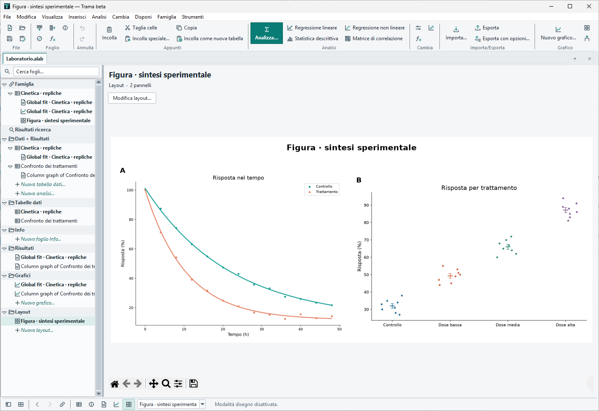

# Trama

**Scientific data, analyses and figures in one Windows workspace.**

**BETA — work in progress.** All published 0.x builds are beta releases: errors and incomplete functionality are possible. The first stable release is not available yet.

Paste from Excel, choose an analysis, format your figure and save the complete project. Trama is an independent project for scientific statistics and figures, with MIT-licensed source code.

**[Download for Windows x64](https://github.com/realfulvio/Trama/releases)** · [Italiano](README.md) · [Getting started](docs/getting-started.md)

Windows 10/11 x64 · Portable application · Italian and English interface

**New in 0.86 beta:** grouped worksheet statistics, moving means and running totals. [What’s new](docs/release-086.md) · [Verification](docs/validation-086.md).

## Data and graph in one workspace

The optional **Modern theme**, available from **Settings → Theme…**, places a linked graph beneath the worksheet and an Inspector beside it. A compact command bar keeps the main actions close at hand; the Standard theme remains available.

*Real screenshot from the Windows 0.73 beta portable. Standard remains the default; theme changes apply at the next launch. [Theme guide](docs/interface-themes.md).*

## From observations to figures

- **Work with familiar worksheets.** Select ranges, paste at the active cell, manage replicate subcolumns and exclude individual cells. Linked analyses update after source edits.
- **Choose the right analysis.** Comparisons and ANOVA, repeated measures and mixed models, linear and nonlinear regression, 118 catalog equations, custom equations and shared-parameter global fits.
- **Explore more.** PCA and clustering, survival and Cox regression, ROC, Bland–Altman, multiple/logistic/Poisson regression, calibration and Monte Carlo studies.
- **Prepare your data.** In-table formulas, transformations, baselines, normalization and replicate processing.
- **Build your figure.** XY and column graphs, box and violin plots, forest and bubble plots, asymmetric errors, annotations, drawing objects and multipanel layouts.

Explore heat-map colours, labels and legends

Custom gradients, cell-value labels and an adjustable legend make experimental matrices easier to read. Settings stay with the project and its exported figures.

*Actual Linux capture with the Standard theme. [Image provenance](docs/media/homepage/PROVENANCE.md).*

## Start in minutes

1. Download the Windows ZIP and extract the **entire folder**.
2. Run `Trama.exe` (`TramaStat.exe` in earlier releases); Python does not need to be installed separately.
3. Create a worksheet or import CSV, TSV or XLSX. Save your project as `.alab`, export tables as CSV and figures as SVG, PDF, PNG or TIFF.

Native SVG/PDF layouts preserve supported vector elements; raster elements remain raster. Legacy PZFX/PZF/PZT import is supported for verified subsets: editability and restoration depend on the file and its contents. **Complete compatibility is not claimed.**

[Features](docs/features.md) · [Compatibility](docs/compatibility.md) · [Development](docs/development.md) · [Release notes](https://github.com/realfulvio/Trama/releases)

[MIT license](LICENSE) · [Third-party credits](THIRD_PARTY_NOTICES.md) · [Legal and validation notes](docs/legal.md)

*Screenshots use synthetic data: the worksheet, layout and Modern workspace were captured on Windows; the heat map on Linux, as labelled. Trama is an independent beta project. No clinical validation or regulatory certification is claimed. The software is provided under the MIT license, subject to applicable law and non-waivable rights.*

