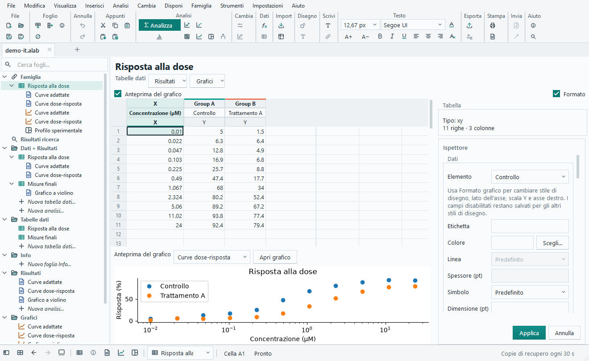
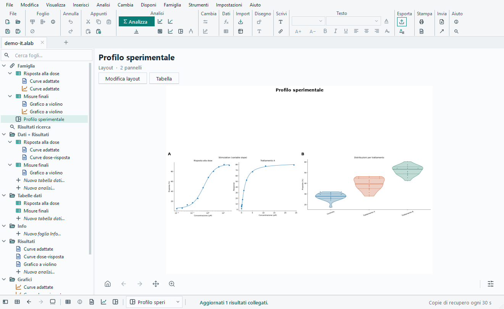
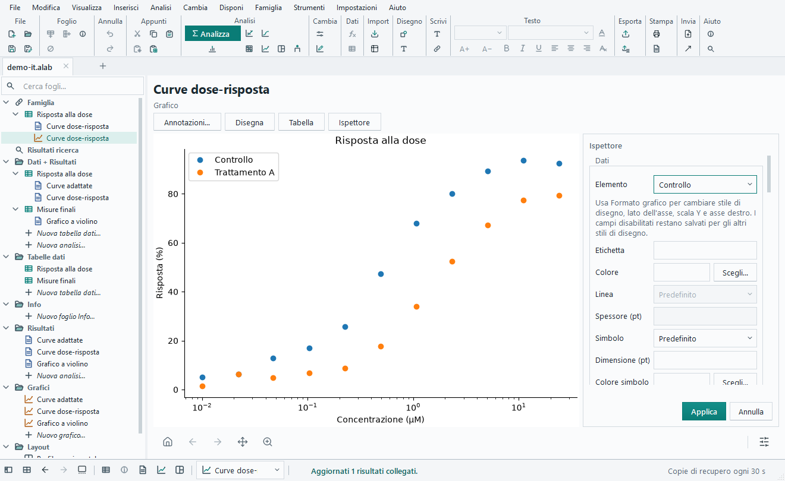
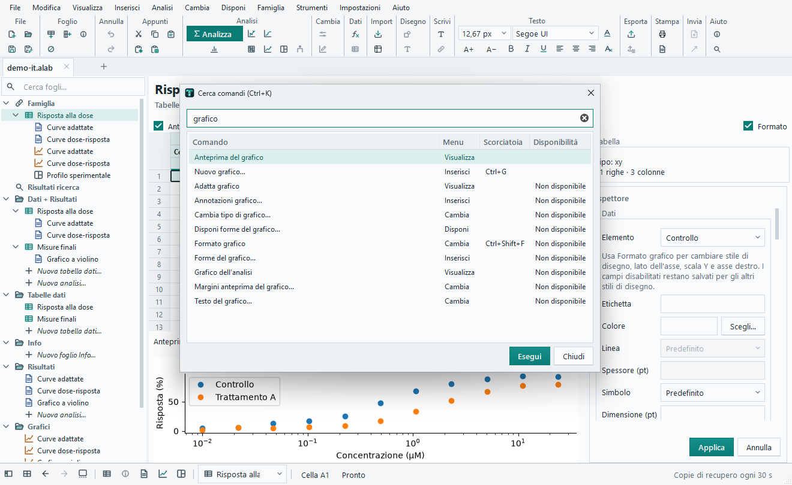

# Trama

**Dai dati alla figura, in un solo progetto.** Statistica e grafici scientifici gratuiti e open source per Windows.

> **BETA.** Le versioni 0.x sono build beta: possono contenere errori e alcune funzioni sono incomplete. Non esiste ancora una versione stabile.

Trama riunisce fogli dati, analisi statistiche e grafici per pubblicazione. Incolli da Excel, scegli il metodo, curi la figura e conservi tutto nello stesso progetto `.alab`. Codice sotto licenza MIT, nessun account, nessuna telemetria.

**[Scarica per Windows x64](https://github.com/realfulvio/Trama/releases/latest)** · [Sito web](https://tramastat.org) · [Funzionalità](https://tramastat.org/funzionalita/) · [Novità](https://tramastat.org/novita/) · [English](README.en.md)

Windows 10/11 a 64 bit · Versione portabile, senza installazione · Interfaccia in italiano e inglese

## Provalo in tre passi

1. **Scarica** lo ZIP `Trama-x.y.z-Windows-x64.zip` dalla pagina delle [versioni](https://github.com/realfulvio/Trama/releases/latest) (non l'archivio del sorgente).
2. **Estrai tutta la cartella**, lascia `_internal` accanto all'eseguibile e apri `Trama.exe`. Python non serve.
3. **Lavora.** Incolla i tuoi dati o importa CSV, TSV, TXT e XLSX, scegli un'analisi, salva il progetto `.alab` ed esporta tabelle in CSV e figure in SVG, PDF, PNG o TIFF.

Guida rapida: [docs/getting-started.md](docs/getting-started.md).

## Come si presenta

Un foglio familiare, con repliche, celle escluse e incolla dalla cella attiva. Dati, risultati, grafici e layout restano collegati: se cambi un valore, le analisi collegate si ricalcolano. L'interfaccia è **Classica Qt** (PySide6), pensata per un uso scientifico denso: i risultati mostrano tutte le cifre.

| | |
| --- | --- |
|  |  |
| **Foglio, analisi e grafico** nello stesso progetto. | **Layout** a più pannelli, esportabile in SVG e PDF. |
|  |  |
| **Inspector** con anteprima prima di applicare le modifiche. | **Ricerca** di comandi e analisi. |

Altre schermate: [galleria dei grafici](docs/media/homepage-112/gallery-it.png) · [distribuzioni](docs/media/homepage-112/distribution-it.png) · [schermata iniziale](docs/media/homepage-112/startup-it.png). Provenienza: [PROVENANCE.md](docs/media/homepage-112/PROVENANCE.md).

## Che cosa puoi fare

| Per il tuo lavoro | In Trama |
| --- | --- |
| **Confrontare esperimenti** | Test t (anche lognormali e di equivalenza TOST), test di rango esatti, ANOVA, misure ripetute, modelli misti e confronti multipli. |
| **Adattare e confrontare curve** | 118 equazioni a catalogo, equazioni personalizzate e condizionali, fit globali con parametri condivisi, pesi, confronto AICc, calibrazione, spline e LOWESS. |
| **Esplorare dati complessi** | PCA con biplot, K-means, clustering gerarchico con dendrogrammi, matrici di correlazione e mappe di calore. |
| **Studiare esiti e associazioni** | Kaplan–Meier, Cox e rischi competitivi, curve ROC, Bland–Altman, regressioni multiple, logistiche e Poisson. |
| **Preparare le osservazioni** | Formule nel foglio, trasformazioni, baseline, normalizzazione, repliche, dati collegati a CSV/TSV e simulazioni Monte Carlo con seme riproducibile. |
| **Comporre la figura** | Grafici XY e a colonne, box e violino, forest e bolle, errori asimmetrici, annotazioni, forme e layout multipannello. |

La mappa completa, con lo stato di ogni funzione, è sul sito: [tramastat.org/funzionalita](https://tramastat.org/funzionalita/) (con ricerca). Ogni versione ha le sue note in [Novità](https://tramastat.org/novita/) e nelle [release](https://github.com/realfulvio/Trama/releases).

## Limiti, scritti chiaramente

- È una beta: la copertura è parziale e non dichiariamo equivalenza con altri programmi. Un pacchetto affermato può offrire opzioni, formati, supporto e maturità che Trama non ha.
- Il pacchetto portabile è solo per Windows 10/11 a 64 bit.
- Nessuna validazione clinica né certificazione regolatoria. Verifica sempre i risultati; i test dimostrano i casi provati, non ogni uso possibile.
- L'importazione di formati di altri programmi (PZFX, PZF, PZT) funziona su sottoinsiemi verificati: l'editabilità dipende dal file. Vedi la [compatibilità](docs/compatibility.md) prima di migrare un archivio.

## Documentazione e sviluppo

[Guida rapida](docs/getting-started.md) · [Funzionalità](docs/features.md) · [Classica Qt](docs/qt-migration.md) · [Compatibilità](docs/compatibility.md) · [Sviluppo](docs/development.md)

[Licenza MIT](LICENSE) · [Crediti e componenti di terze parti](THIRD_PARTY_NOTICES.md) · [Note legali e validazione](docs/legal.md)

*Le schermate usano dati sintetici e sono catture reali di Trama 0.112.0 su Windows 11. Trama è un progetto indipendente in fase beta; Microsoft, Windows ed Excel sono marchi dei rispettivi titolari, citati per identificare piattaforme e flussi di lavoro.*
