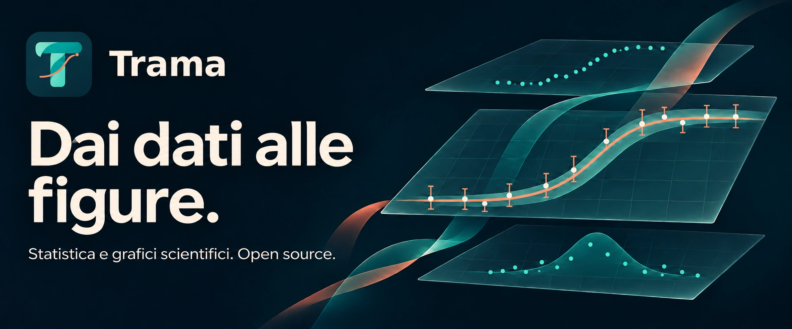
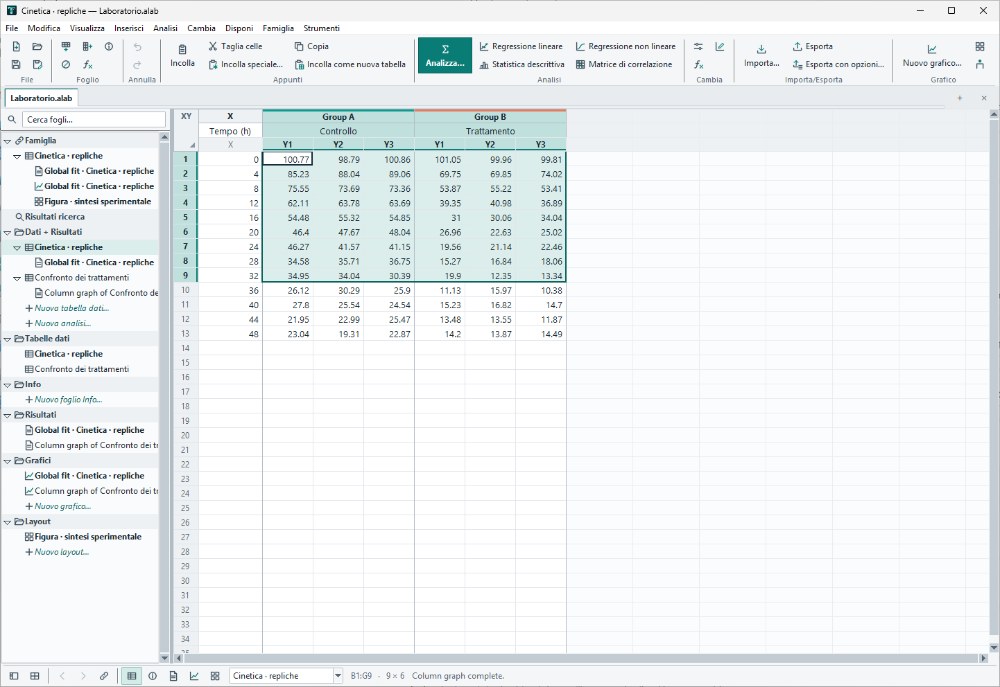
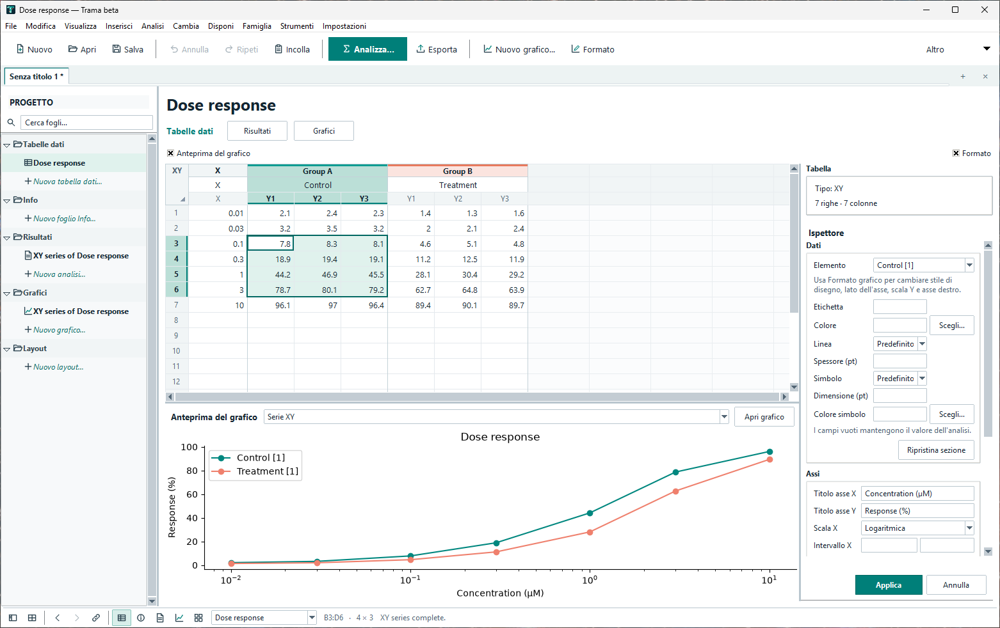
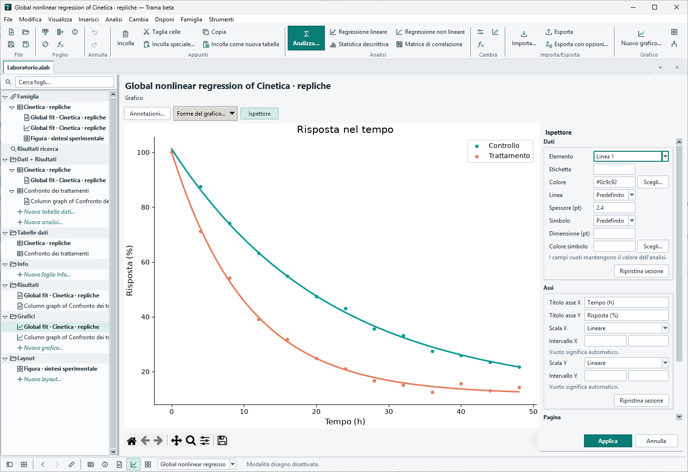
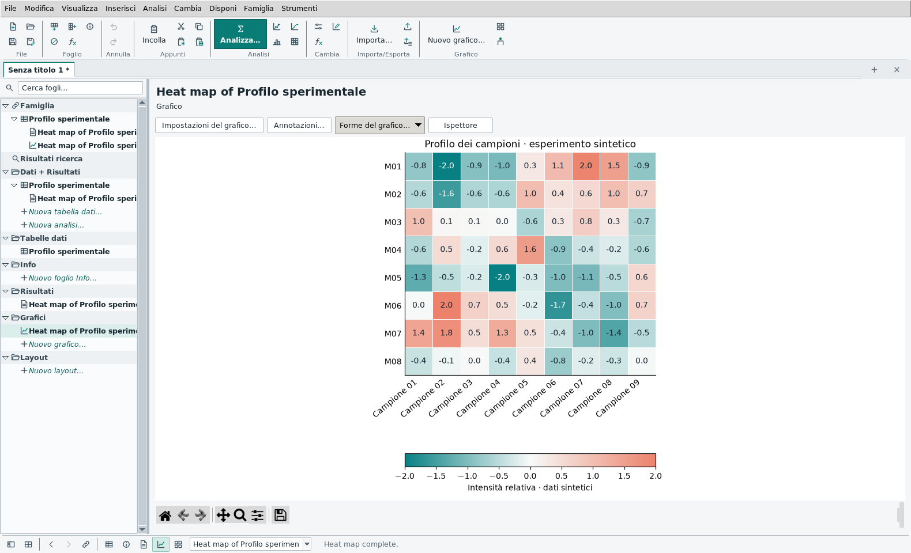
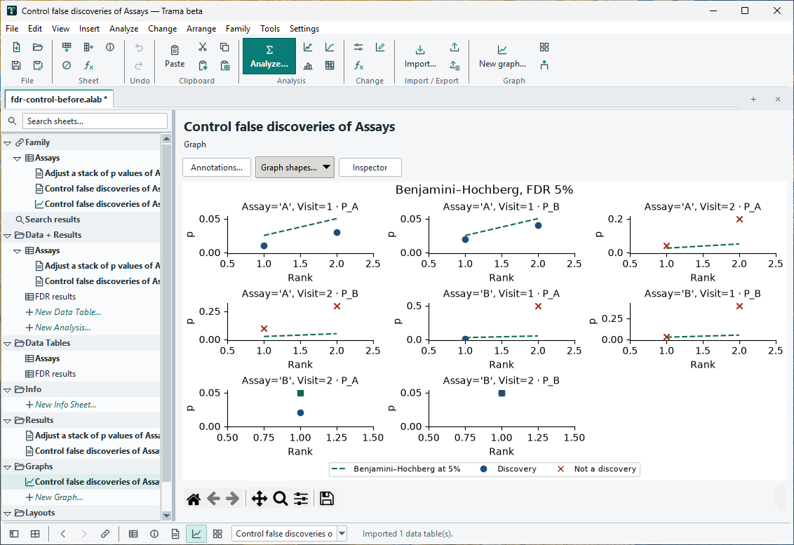

# Trama

**Il tuo laboratorio, dai dati alla figura finale.**

**BETA — progetto in sviluppo.** Le versioni 0.x pubblicate finora sono build beta: possono contenere errori e alcune funzionalità sono ancora incomplete. La prima versione definitiva non è ancora disponibile.

Trama è un'applicazione per Windows che riunisce fogli dati, analisi statistiche e grafici scientifici. Incolla da Excel, scegli il metodo, cura la figura e conserva tutto nello stesso progetto. Un progetto indipendente per la statistica e la grafica scientifica, con codice sotto licenza MIT.

**[Scarica per Windows x64](https://github.com/realfulvio/Trama/releases)** · [Guida rapida](docs/getting-started.md) · [Funzionalità](docs/features.md) · [English](README.en.md)

Windows 10/11 a 64 bit · Versione portabile · Interfaccia italiano / inglese

**Novità 0.79 beta:** usa una tabella di risultati come ingresso di un’altra analisi. Trasformazioni, normalizzazioni, regressioni e grafici a valle si aggiornano insieme. [Guida e limiti](docs/analysis-chains.md) · [Novità](docs/release-079.md) · [Verifiche](docs/validation-079.md).

## Un foglio familiare. Un flusso di lavoro completo.

Seleziona intervalli, gestisci repliche e celle escluse, copia e incolla dalla cella attiva. Dati, risultati, grafici e layout restano collegati: quando modifichi i dati, le analisi collegate si aggiornano.

## Dati e grafico, insieme

Il **Tema Moderno**, opzionale da **Impostazioni → Tema…**, affianca alla griglia un'anteprima del grafico collegato e un ispettore per colori, assi e legenda. Una barra più essenziale dà accesso alle azioni principali; il Tema standard rimane disponibile.

*Schermata reale del portabile Windows 0.73 beta. Il Tema standard rimane quello predefinito; la scelta si applica al prossimo avvio. [Guida ai temi](docs/interface-themes.md).*

## Gli strumenti per andare oltre il foglio di calcolo

| Per il tuo lavoro | In Trama |
| --- | --- |
| **Confrontare esperimenti** | Test t e non parametrici, ANOVA, confronti multipli, misure ripetute e modelli misti. |
| **Adattare e confrontare curve** | Regressioni, 118 equazioni a catalogo, equazioni personalizzate, fit globali con parametri condivisi, calibrazione, spline e LOWESS. |
| **Esplorare dati complessi** | PCA, clustering K-means e gerarchico, dendrogrammi, matrici di correlazione e heat map. |
| **Studiare esiti e associazioni** | Sopravvivenza e Cox, ROC, Bland–Altman, regressioni multiple, logistiche e Poisson. |
| **Preparare le osservazioni** | Formule nel foglio, trasformazioni, baseline, normalizzazione, gestione delle repliche e simulazioni Monte Carlo. |
| **Comporre una figura** | Grafici XY e a colonne, box plot e violini, forest e bubble plot, errori asimmetrici, annotazioni, forme e layout multipannello. |

[Esplora le funzionalità e i limiti](docs/features.md)

## Figure curate, risultati riutilizzabili

Personalizza assi, colori, simboli, legende e annotazioni. Affianca i grafici in un layout ed esporta in **SVG, PDF, PNG o TIFF**. Nei layout nativi, SVG e PDF conservano gli elementi vettoriali dei grafici compatibili; gli elementi raster restano immagini.

Guarda anche l'Inspector del grafico

L'Inspector offre un'anteprima delle modifiche di formattazione prima di applicarle.

Colori, valori e legende nelle heat map

Gradienti personalizzati, etichette dei valori e legenda orientabile aiutano a leggere matrici e profili sperimentali. Le impostazioni restano nel progetto e si ritrovano nell'esportazione.

*Cattura reale su Linux con Tema standard. [Provenienza delle schermate](docs/media/homepage/PROVENANCE.md).*

Nuovo: controllo delle false scoperte e riferimenti sugli assi

Raggruppa i confronti in famiglie, applica BH, BY o BKY e visualizza le decisioni. Nei grafici nativi aggiungi tacche con etichette, linee di riferimento e fasce senza modificare i dati.

[Controllo FDR](docs/fdr-control.md) · [Assi: editor e limiti](docs/axis-guides.md) · [Provenienza](docs/media/fdr-axis/PROVENANCE.md)

## Provalo in tre passi

1. **Apri.** Scarica lo ZIP Windows, estrai tutta la cartella e avvia `Trama.exe` (`TramaStat.exe` nelle release precedenti). Non serve installare Python.
2. **Lavora.** Crea un foglio o importa CSV, TSV e XLSX. Incolla i tuoi dati e scegli un'analisi.
3. **Conserva e condividi.** Salva il progetto `.alab`, esporta i risultati in CSV e le figure nel formato che ti serve.

Il pacchetto portabile include l'ambiente necessario. Il codice MIT consente uso, studio e modifica anche in ambito professionale, alle condizioni della licenza.

**Importazione di progetti legacy.** Trama importa dati e contenuti supportati da PZFX, PZF e PZT. Il recupero di analisi, grafici e layout dipende dal formato e dal contenuto: alcuni elementi sono modificabili, altri sono conservati come viste originali. Consulta la [compatibilità](docs/compatibility.md) prima di migrare un archivio.

---

[Download](https://github.com/realfulvio/Trama/releases) · [Documentazione](docs/features.md) · [Novità delle versioni](https://github.com/realfulvio/Trama/releases) · [Sviluppo](docs/development.md)

[Licenza MIT](LICENSE) · [Crediti e componenti di terze parti](THIRD_PARTY_NOTICES.md) · [Note legali e validazione](docs/legal.md)

*Schermate reali con dati sintetici: foglio, layout e Tema Moderno su Windows; nuova heat map su Linux, come indicato nelle didascalie. L'immagine di apertura è un'illustrazione. Trama è un progetto indipendente in fase beta. Non viene dichiarata una validazione clinica o una certificazione regolatoria.*

