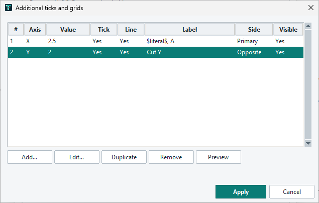

# Additional Ticks, Reference Lines, and Shaded Axis Ranges

Native graphs with numeric primary axes (`linear` or `log`) can display custom axis ticks with literal labels, styled reference lines, and shaded axis bands without altering `dataLim`, autoscale limits, legend entries, or the legacy `reference_lines` behaviour.

## Scope & Domain Rules

- **Supported axes:** Primary numeric `x` and `y` axes on `linear` or `log` scales (including the shared X and left Y axes of dual-Y `XY series` plots and the numeric Y axis of Column/Grouped graphs).
- **Explicitly rejected:** Probability scales (`probability`, `probability %`), categorical axes (e.g. Column X, Heat map, Correlation matrix), and non-native imported preview views. Right twin Y axes on `XY series` are left untouched (`side="opposite"` places the tick/label on the opposite border of the primary axis).
- **Logarithmic domain:** Visible guides (`value > 0`) and visible bands (`lower > 0`) must be strictly positive on a `log` axis; hidden records (`visible=false`) may keep non-positive coordinates without error. Domain errors are rejected before any artist, locator, or axis limit is mutated.

## Canonical Style Schema

Saved graph styles optionally store:

- `axis_guides` (up to `30` per axis, `60` total including hidden):
  - `id` (canonical lowercase UUID), `axis` (`"x"` or `"y"`), `value` (finite float)
  - `tick` (bool, default `false`), `line` (bool, default `true`), `visible` (bool, default `true`; at least one of `tick` or `line` must be `true` when visible)
  - `label` (single-line literal string up to `160` characters, default `""`; rendered with `parse_math=False`)
  - `color` (Matplotlib color string, default `"#657486"`), `width` (`[0.2, 8]`, default `1.0`), `style` (`"-"`, `"--"`, `":"`, `"-."`, default `"--"`)
  - Optional: `label_color` (inherits `color`), `font_size` (`[4, 72]`, default `9`), `side` (`"primary"` or `"opposite"`, default `"primary"`)
- `axis_bands` (up to `12` total):
  - `id` (canonical lowercase UUID), `axis` (`"x"` or `"y"`), `lower` & `upper` (finite floats with `lower < upper` and finite span)
  - `color` (Matplotlib color string), `alpha` (`[0, 1]`, default `0.15`), `hatch` (`""`, `"/"`, `"\\"`, `"|"`, `"-"`, `"+"`, `"x"`, `"."`, `"o"`, default `""`), `visible` (bool, default `true`)

## Dynamic Tick Merging

- Custom primary ticks use dynamic locator/formatter wrappers (`_GuideLocator` / `_GuideFormatter` in `analisi/axis_guides.py`) so zooming, panning, and data recalculation continue updating regular ticks and scientific-notation offsets.
- Coordinate matching uses an 8-ULP tolerance (`abs(a - b) <= 8 * max(ulp(a), ulp(b))`) so very small units (e.g. `1e-100`) work identically to ordinary scales.
- Two visible custom ticks at colliding coordinates on the same axis raise a validation error; reference lines without ticks may share a coordinate with distinct IDs.
- Artist GIDs: `trama-axis-guide:<id>:line`, `trama-axis-guide:<id>:tick`, `trama-axis-guide:<id>:label`, and `trama-axis-band:<id>`.

## Interface & Exports

- **Format Graph → Reference Lines:** keeps the existing `reference_lines` text input intact and adds **Additional ticks and grids…** (`Tacche e griglie aggiuntive…`) and **Shaded ranges…** (`Fasce sugli assi…`).
- **Graph Inspector:** exposes the same transactional editors inside the **Axes** section within the current Inspector draft (two-level Cancel restores parent draft first, then confirmed style; disabled while a calculation is pending).
- **Vector Exports & Layouts:** SVG and PDF exports (both single-figure and multi-panel native layouts) keep lines, literal labels, and hatched/translucent bands vectorized without rasterizing the figure.

## Verification

```bash
TRAMASTAT_SMOKE_ONLY=axis-guides TRAMASTAT_SMOKE_SCREENSHOTS=1 python tramastat.py --smoke /tmp/trama-axis-guides
python -m unittest tests.test_axis_guides tests.test_axis_guides_dialog -v
```

## Windows interface and display limits



Actual 0.78 beta portable capture; [provenance](media/fdr-axis/PROVENANCE.md). The editor was checked at 1024×768 and 1920×1080 desktop resolutions.

Opposite-side labels still belong to the primary axis. In dual-Y plots they share the right margin with the right-Y labels and title and can overlap them; automatic collision avoidance is not implemented. Prefer primary-side labels or provide more space for the figure. The right-Y coordinates and limits are not changed by primary-axis guides.
