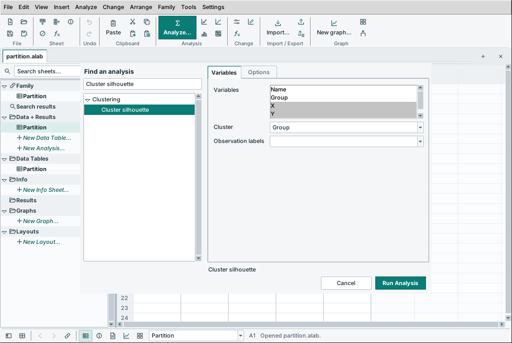
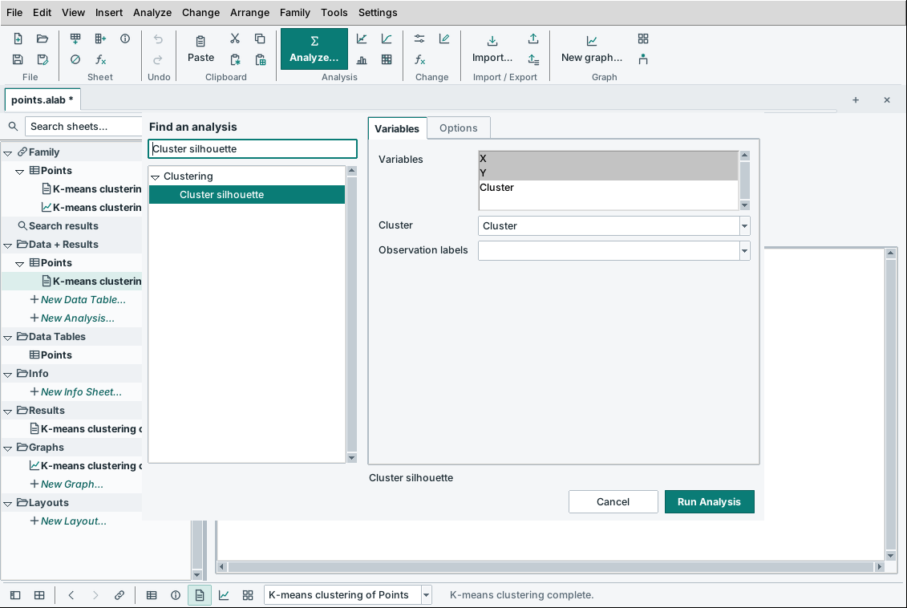
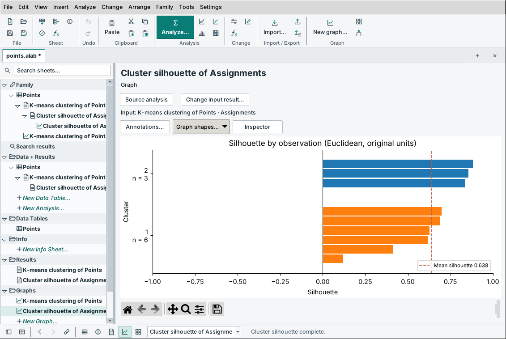
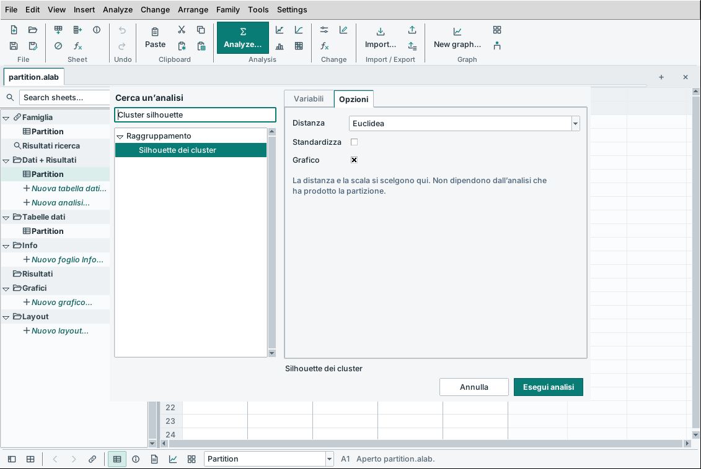
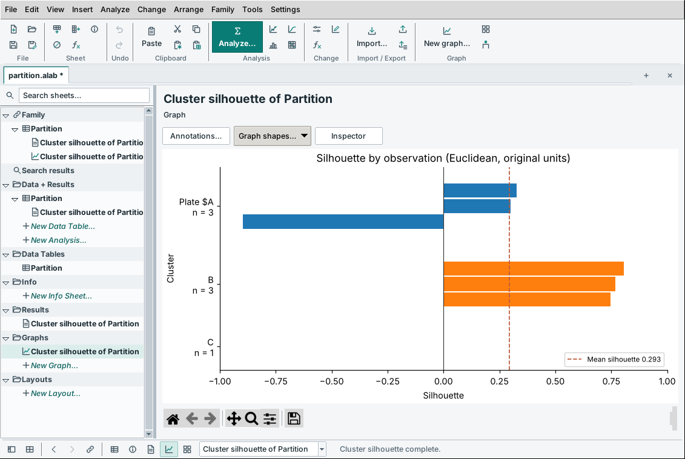
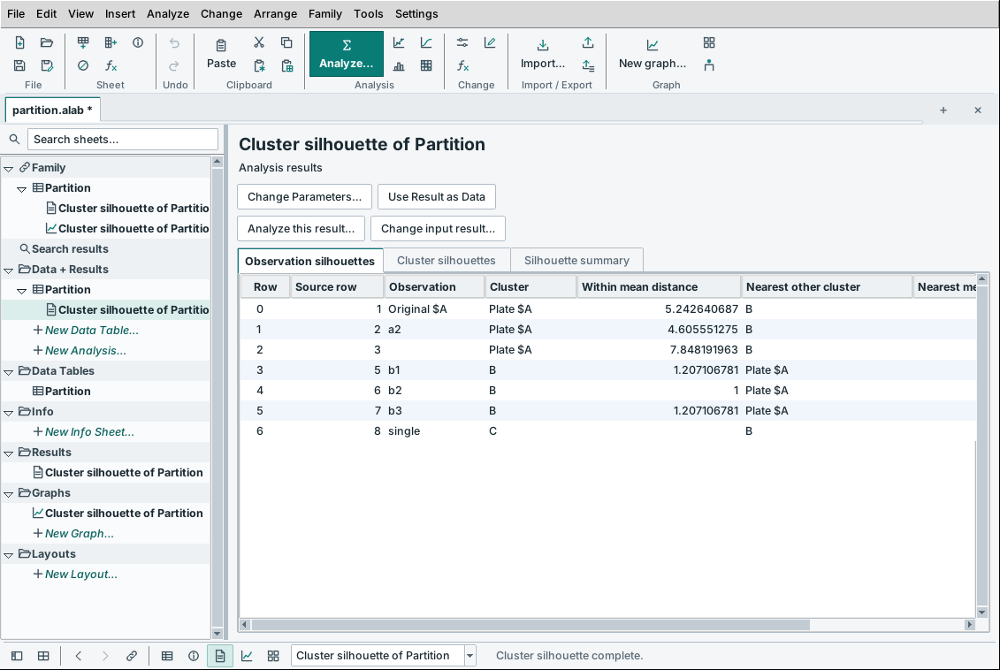

# Silhouette dei cluster

In **Analyze → Clustering → Cluster silhouette** (in italiano **Silhouette dei cluster**) misuri una partizione già assegnata: per ogni osservazione dici quanto è più vicina, in media, ai compagni del proprio gruppo che al gruppo più vicino fra gli altri. L'analisi **non rifà il clustering e non cambia le etichette**: legge la colonna che le indichi, da un normale foglio o dal risultato di un K-means o di un clustering gerarchico.



## Due modi di usarla

**Da un foglio di dati.** La partizione sta in una colonna (testo o numeri): un'assegnazione fatta da altri strumenti, un gruppo sperimentale, un'etichetta di laboratorio. Apri **Analyze → Cluster silhouette**, scegli le colonne numeriche in **Variables**, la colonna dei gruppi in **Cluster** e, se vuoi, i nomi in **Observation labels**. Il selettore propone da solo la colonna evidente (`Cluster`, `Cluster (2)`, `Cluster (assigned)`, poi `Assignments`, `Partition`, `Group`), ma la scelta resta sempre visibile e modificabile.

**Da un risultato collegato.** Apri il risultato di un **K-means** o di un **Hierarchical clustering**, seleziona la scheda **Assignments** (nel gerarchico la tabella delle assegnazioni di riga) e premi **Analyze this result…**. Il dialogo propone la colonna `Cluster` e, come variabili, le altre colonne numeriche della tabella: il nome della colonna è quello effettivo dell'ingresso, anche con più valori di k. L'analisi resta collegata: se cambiano i dati, il k, l'algoritmo o le assegnazioni, a monte si ricalcola il clustering e a valle la silhouette, nell'ordine giusto e sul worker.





La tabella a monte è letta com'è: `Source row` è la posizione 1-based nella tabella **immediatamente a monte** (la scheda Assignments), prima di scartare le righe incomplete.

## Opzioni

Le chiavi della ricetta sono canoniche inglesi in entrambe le lingue; la lingua cambia solo etichette, scelte, note ed errori.

| Chiave canonica | Italiano | Valore iniziale |
| --- | --- | --- |
| `Variables` | Variabili | tutte le colonne numeriche tranne la colonna dei gruppi (da 1 a 32) |
| `Cluster` | Cluster | la colonna evidente, se c'è |
| `Observation labels` | Etichette delle osservazioni | nessuna |
| `Distance` | Distanza | `Euclidean` (*Euclidea*) · `Manhattan` |
| `Standardize` | Standardizza | spento |
| `Graph` | Grafico | acceso |

I tre ruoli di colonna devono essere distinti: la colonna dei gruppi non può essere anche una variabile, e le etichette non possono ripetere né i gruppi né una variabile.



## Metrica e scala sono quelle di questa analisi

**La distanza e la scala si scelgono qui e non dipendono dall'analisi che ha prodotto la partizione.** Un K-means standardizza di solito le colonne (è il suo valore iniziale) e usa la distanza euclidea al quadrato dai centri; un clustering gerarchico usa il suo collegamento e la sua distanza. Nessuna di queste impostazioni viene ereditata: la silhouette usa la distanza che scegli qui, sulla scala che scegli qui, e il riepilogo le riporta entrambe (`Distance`, `Scale`).

- Con **Standardize** spento le distanze sono nelle **unità originali** delle colonne.
- Con **Standardize** acceso ogni colonna ha media 0 e **deviazione standard di popolazione** 1, calcolate sulle righe effettivamente usate. Una colonna costante diventa zero.
- Se il K-means ha lavorato su dati standardizzati ma qui lasci Standardize spento, una colonna con scala molto più grande domina le distanze: i valori possono differire da quanto "vede" il fit. Non è un errore, sono due misure diverse; scegli la scala che vuoi giudicare e dichiarala.

## Calcolo

Per l'osservazione *i* del gruppo *C*: *a*(*i*) è la distanza media dagli **altri** membri di *C*, *b*(*i*) il minimo, fra gli altri gruppi, della distanza media dai loro membri, e

*s*(*i*) = (*b* − *a*) / max(*a*, *b*)   (Rousseeuw 1987).

- Se *a* e *b* sono entrambe zero (punti sovrapposti in gruppi diversi), *s* = 0.
- Un **singleton** ha *s* = 0 e *a* vuota (non c'è nessun altro membro); *b* e il gruppo più vicino si calcolano comunque.
- Con una parità **esatta** fra gruppi rivali vince il primo nell'ordine di prima apparizione fra le righe complete.
- I valori negativi si tengono. Il valore globale è la **media per osservazione**: ogni gruppo pesa per la sua numerosità.
- Righe con un valore mancante o escluso nelle variabili o nella colonna dei gruppi si scartano e si contano (`Dropped rows`). Un valore presente ma non numerico (testo, infinito) in **Variables** è un errore sul campo. Manca il solo nome osservazione: la riga resta, con stringa vuota.
- Le etichette di gruppo sono testo non bianco o numeri finiti. **`1` e `"1"` sono gruppi diversi**: i fogli conservano i valori originali e il grafico distingue didascalie uguali con `(number)` / `(text)`. Nomi con `$` o altri caratteri speciali sono testo letterale.

## Come si legge il segno

| Silhouette | Lettura |
| --- | --- |
| vicina a **+1** | l'osservazione sta molto più vicina al proprio gruppo che a qualunque altro |
| vicina a **0** | sta al confine fra due gruppi (o è un singleton) |
| **negativa** | in media è più vicina a un altro gruppo che al proprio: è probabilmente assegnata male, o i gruppi non sono separati su queste variabili e su questa scala |

Una silhouette negativa è un'informazione, non un errore: `Nearest other cluster` dice verso quale gruppo l'osservazione è attratta e `Nearest mean distance` quanto è lontano.



Nell'esempio il gruppo `Plate $A` ha tre osservazioni: due positive e una negativa (la terza barra, a sinistra dello zero), che è molto più vicina ai punti del gruppo `B`. Il gruppo `C` è un singleton: la sua silhouette è 0 e la barra non si vede.

## Fogli e grafico



| Foglio | Contenuto |
| --- | --- |
| `Observation silhouettes` | `Source row`, `Observation` (vuota senza etichetta), `Cluster`, `Within mean distance`, `Nearest other cluster`, `Nearest mean distance`, `Silhouette`. Ordine di ingresso, precisione piena. |
| `Cluster silhouettes` | `Cluster`, `N`, `Mean silhouette`, `Negative samples`. Ordine di prima apparizione. |
| `Silhouette summary` | Colonna `Value` con `N`, `Clusters`, `Dropped rows`, `Mean silhouette`, `Negative samples`, `Distance`, `Scale`, `Variables`, `Cluster column` e una nota sull'indipendenza dal fit a monte. |

Il grafico è nativo, con barre orizzontali su [−1, 1]: un blocco per gruppo nell'ordine del foglio dei cluster, barre in ordine di silhouette crescente e poi `Source row`, linea a zero, linea tratteggiata della media globale e didascalie di gruppo con la numerosità (`n = 3`). Si apre con l'Inspector, si esporta in SVG, PNG e PDF (anche in un layout) e si salva nel progetto come ogni altro grafico. **Use Result as Data** crea una copia indipendente di ciascun foglio, con le etichette di gruppo originali.

## Budget ed errori

Tutti i controlli avvengono prima di allocare qualunque matrice di distanze, quindi il rifiuto è immediato e senza memoria.

| Limite | Errore |
| --- | --- |
| da 1 a 32 colonne in **Variables** | campo **Variables** |
| righe effettive N ≤ 5 000 e N² · p ≤ 200 000 000 | campo **Variables** |
| numero di gruppi k da 2 a N − 1 | campo **Cluster** |
| con **Graph** acceso, N ≤ 2 000 | campo **Graph** (spegnilo per avere comunque le tabelle) |
| distanze non rappresentabili con questi dati | campo **Variables** |

L'estremo di scala non fa traboccare nulla: le coordinate si dividono per una potenza di due prima di formare le distanze e si riportano poi alla scala originale.

## Annullamento e memoria

Il calcolo gira sul worker a blocchi di righe contro tutti i punti (al massimo 32 MiB di array per blocco, mai un tensore N × N × p). L'evento di annullamento si legge prima di ogni blocco e prima di costruire il risultato: **Cancel calculation** si ferma entro un blocco. Con un'analisi nuova non si registra nulla; con un ricalcolo resta l'ultimo risultato valido. Le misure di tempo, memoria di picco, blocco e latenza di stop si ripetono con `python tests/bench_cluster_silhouette.py`.

## Verifica

```bash
python -m unittest tests.test_cluster_silhouette          # motore, scala estrema, blocchi, cancellazione, grafico
TRAMASTAT_SMOKE_ONLY=cluster-silhouette python tramastat.py --smoke DIR   # desktop reale
python tests/bench_cluster_silhouette.py                  # prestazioni e rifiuti anticipati
```

Fonti: [Rousseeuw, *Silhouettes*](https://doi.org/10.1016/0377-0427(87)90125-7) · [scikit-learn `silhouette_samples`](https://scikit-learn.org/stable/modules/generated/sklearn.metrics.silhouette_samples.html).
