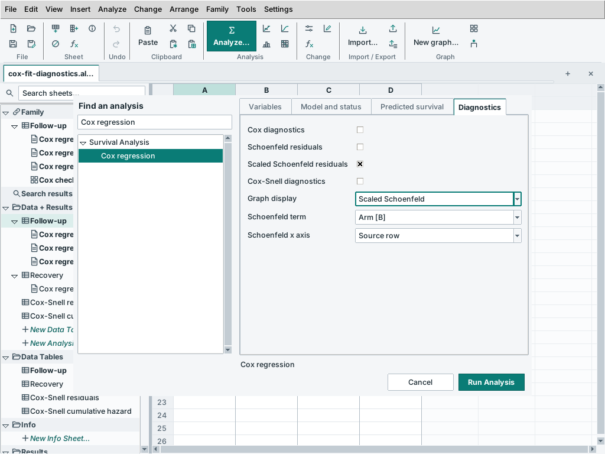
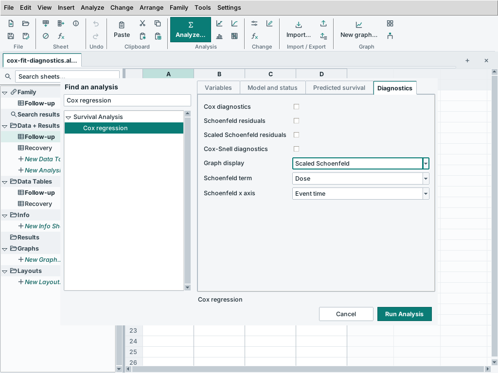
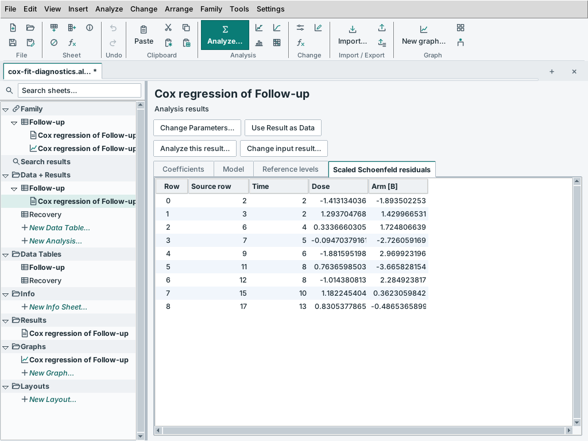
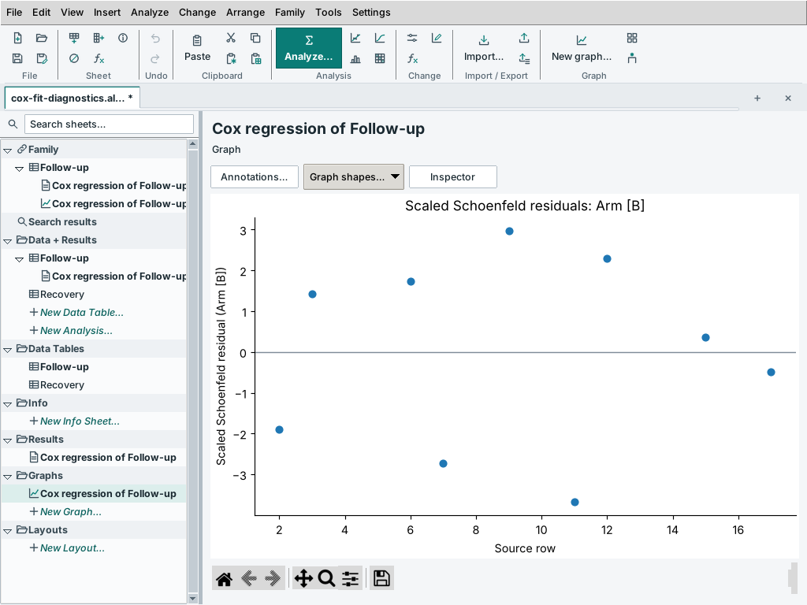
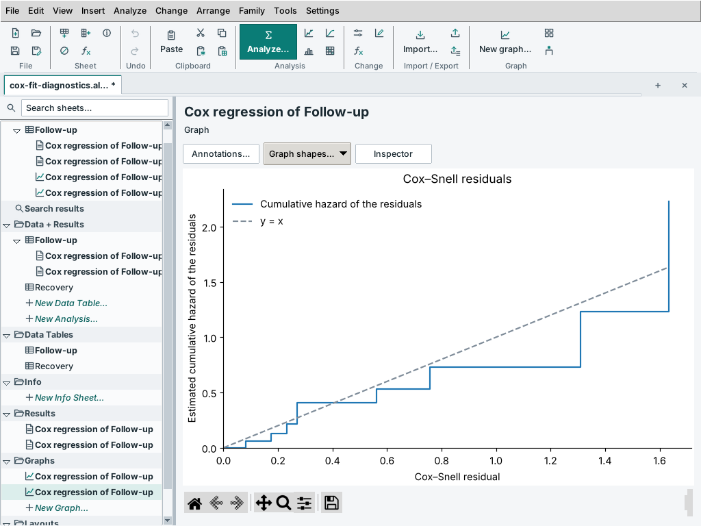
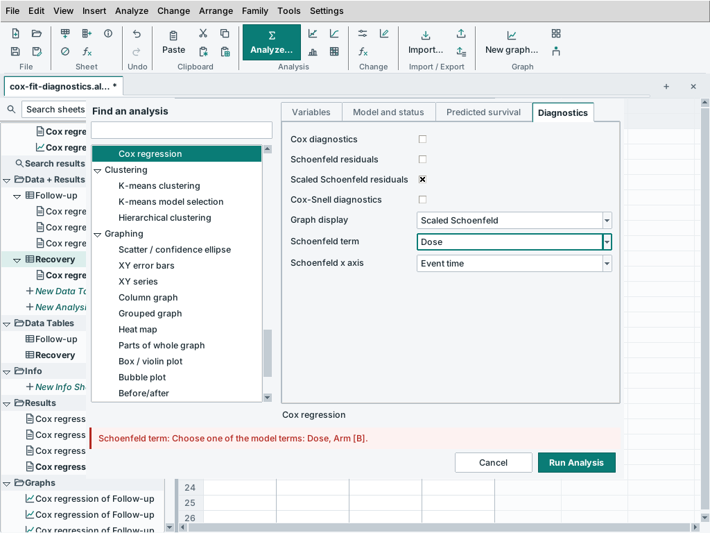
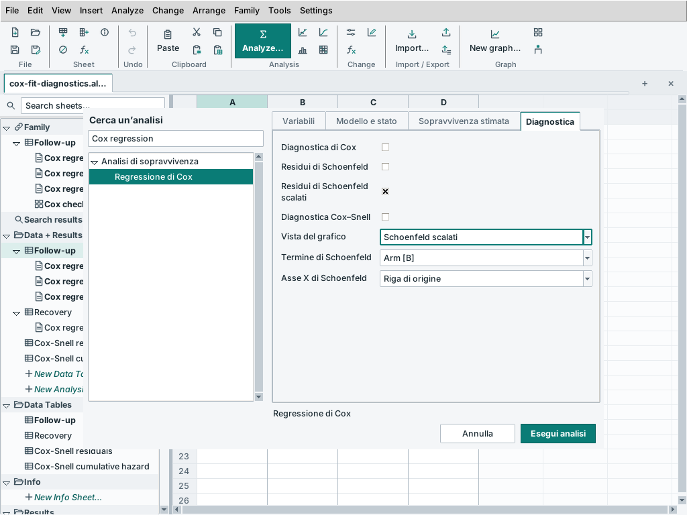
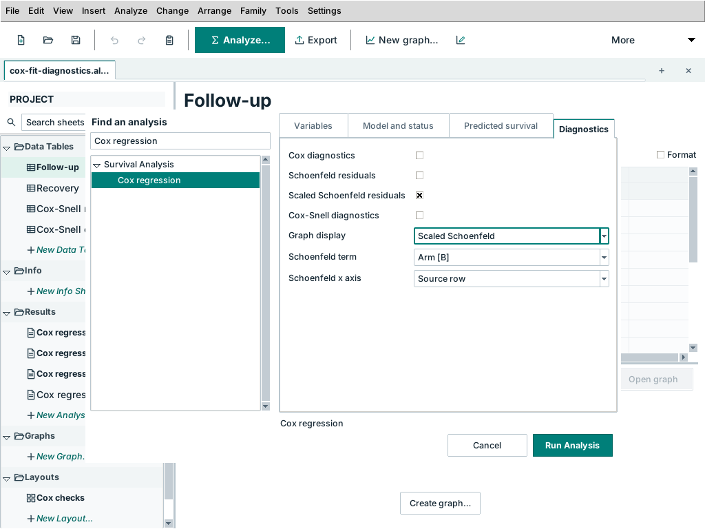
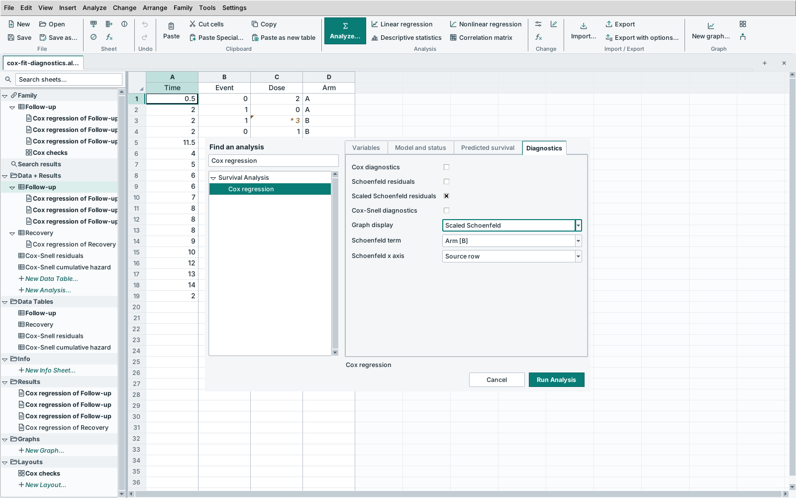

# Regressione di Cox: residui di Schoenfeld scalati e diagnostica Cox–Snell

In **Analyze → Survival Analysis → Cox regression** (in italiano **Analisi di sopravvivenza → Regressione di Cox**) la scheda **Diagnostics** (**Diagnostica**) ha due controlli nuovi: **Scaled Schoenfeld residuals** e **Cox-Snell diagnostics**. Producono fogli e grafici che servono a *guardare* il modello adattato. Non sono test: Trama non calcola nessun p-value dell'ipotesi dei rischi proporzionali e non legge il grafico al posto dell'analista.

Nell'interfaccia Qt, apri **Analizza → Regressione di Cox** e scegli **Diagnostica**. Efron e Breslow supportano entrambi i nuovi output. Con i pari tempo esatti, il dialogo indica quali opzioni disattivare per ottenere le tabelle del modello.

Entrambi gli output usano **la stessa stima** dei coefficienti che Trama già calcola per la tabella dei coefficienti, la sopravvivenza stimata e i residui esistenti: il modello non viene adattato una seconda volta.

## Opzioni

Le chiavi della ricetta sono canoniche inglesi in entrambe le lingue; la lingua cambia solo etichette e messaggi.

| Chiave canonica | Italiano | Valore iniziale |
| --- | --- | --- |
| `Scaled Schoenfeld residuals` | Residui di Schoenfeld scalati | `false` |
| `Cox-Snell diagnostics` | Diagnostica Cox–Snell | `false` |
| `Graph display` | Vista del grafico | `Automatic` |
| `Schoenfeld term` | Termine di Schoenfeld | primo termine del modello |
| `Schoenfeld x axis` | Asse X di Schoenfeld | `Event time` |

`Graph display` ha ora, oltre alle viste già presenti, `Scaled Schoenfeld` (*Schoenfeld scalati*) e `Cox-Snell plot` (*Grafico Cox–Snell*). `Schoenfeld x axis` vale `Event time` (*Tempo dell'evento*) o `Source row` (*Riga di origine*). Nella ricetta restano i valori inglesi.

- **Termine e asse X seguono la vista che viene disegnata**, anche con `Automatic`. Con la vista dei Schoenfeld scalati sono visibili **Schoenfeld term** e **Schoenfeld x axis**; con i Schoenfeld grezzi solo il termine; con Cox–Snell nessuno dei due. Un errore su un campo non ancora visibile lo mostra e vi porta la tastiera.
- **Con `Automatic`** vale la priorità di sempre (curve di sopravvivenza stimate, poi devianza, poi Schoenfeld grezzi) e dopo di loro i Schoenfeld scalati e poi Cox–Snell: attivare un output nuovo non cambia il grafico di una ricetta che già ne mostrava uno.
- **Una vista scelta senza il suo controllo** (per esempio `Scaled Schoenfeld` con la casella spenta) è un errore sul campo **Graph display**: «Attiva Residui di Schoenfeld scalati per mostrare schoenfeld scalati.» Il dialogo resta aperto.
- **Con i due controlli spenti** (o senza le chiavi, come nelle ricette salvate prima) l'analisi è **identica a bit** a quella della versione precedente: stessi fogli, stesso ordine, stessi numeri, stesso grafico.

## Calcolo

### Residui di Schoenfeld scalati

Si parte dal residuo di Schoenfeld grezzo **rᵢ** di ogni evento, quello del foglio **Schoenfeld residuals** (una riga per evento, una colonna per termine del modello, con lo stesso trattamento dei legami scelto per l'adattamento). Il residuo scalato è

> **sᵢ\* = m · (rᵢᵀ V)**

dove **m** è il numero di eventi usati nell'adattamento e **V** la matrice di covarianza dei coefficienti che la stessa stima ha restituito (stimatore *naive*, dall'informazione del metodo dei legami scelto). **Non si somma β**: i residui scalati restano centrati intorno a zero. Righe, ordine, **Source row** e **Time** sono quelli del foglio dei residui grezzi.

### Residui di Cox–Snell

Per ogni osservazione usata nell'adattamento

> **rᵢ = Ĥ₀(tᵢ) · exp(xᵢ β̂)**

con Ĥ₀ la funzione di rischio cumulativo di base di **Breslow**, la stessa che Trama disegna per la sopravvivenza stimata con qualunque metodo dei legami (anche con Efron). È il valore di **Expected events** del foglio dei residui di Cox. Se è già acceso, Cox–Snell lo riusa e i due fogli coincidono bit a bit; altrimenti lo calcola con lo stesso risultato.

Se Cox ha ragione, i residui si comportano come tempi censurati da destra di una distribuzione esponenziale di parametro 1. Il foglio **Cox-Snell cumulative hazard** stima la funzione di rischio cumulativo di questi residui con Nelson–Aalen: per ogni residuo distinto *u*, **At risk** conta i residui ≥ *u*, **Events** e **Censored** dividono le osservazioni con residuo *u*, e il salto *Events / At risk* si somma al totale precedente. Il calcolo è una scansione ordinata con conteggi per valore distinto (*O*(*n* log *n*)), non un confronto di ogni riga con ogni altra.

Se Ĥ₀ e l'esponenziale dei predittori escono dall'intervallo rappresentabile (predittori molto lontani da zero) il prodotto viene formato in scala logaritmica, così resta calcolabile finché il suo valore lo è.

## Fogli aggiunti

Si accodano ai fogli già presenti, in questo ordine, in inglese come gli altri risultati Cox. I fogli non attivati non compaiono.

| Foglio | Contenuto |
| --- | --- |
| `Scaled Schoenfeld residuals` | `Source row, Time` e una colonna per termine del modello, una riga per evento. |
| `Cox-Snell residuals` | `Source row, Time, Event, Cox-Snell residual`, una riga per osservazione usata nell'adattamento. |
| `Cox-Snell cumulative hazard` | `Residual, At risk, Events, Censored, Cumulative hazard`, una riga per residuo distinto. |

Ordine completo: coefficienti, modello, livelli di riferimento, **Baseline survival**, **Predicted survival**, **Cox residuals**, **Schoenfeld residuals**, **Scaled Schoenfeld residuals**, **Cox-Snell residuals**, **Cox-Snell cumulative hazard**.

Le righe con un predittore, il tempo o l'evento mancanti o esclusi non entrano nell'adattamento e quindi nemmeno qui. **Source row** conserva l'indice della tabella, anche se è non consecutivo. «Usa il risultato come dati» copia i due fogli Cox–Snell come tabelle; i valori vengono dalla tabella, non da un ricalcolo.

## Grafici

- **Scaled Schoenfeld** disegna **soltanto punti**: i residui scalati di un termine contro il tempo dell'evento o la riga di origine, con una linea guida a *y* = 0. Nessuna curva liscia, nessuna banda, nessun test. Il termine è `Schoenfeld term`; per un predittore categorico è la colonna *dummy* (per esempio `Arm [B]`). Con `Source row` l'asse X ha tacche intere.
- **Cox-Snell plot** disegna la stima del rischio cumulativo dei residui su scala lineare come **curva a gradini** che parte da (0, 0), e la diagonale tratteggiata *y* = *x* dal punto (0, 0) all'ultimo residuo.

I grafici sono figure Matplotlib come le altre: Format Graph e Graph Inspector li modificano, entrano nei layout, e si esportano in PNG, SVG e PDF. Il titolo e le etichette restano inglesi in tutte le lingue.

## Come leggerli, e i loro limiti

- Nei Schoenfeld scalati una nube di punti senza andamento intorno a zero è coerente con un effetto costante nel tempo; un andamento sistematico fa pensare a un effetto che cambia. **Il grafico non lo decide**: serve giudizio, soprattutto con pochi eventi, dove i punti sono pochi e rumorosi.
- Con Cox–Snell la curva vicina alla diagonale è coerente con un buon adattamento complessivo. Con molta censura la coda a destra è instabile, e il grafico dipende da come è stimata la base di Breslow.
- **Non c'è un test dell'ipotesi dei rischi proporzionali**, nessun lisciamento, nessuna banda di confidenza. La covarianza usata per scalare è quella *naive* (non robusta) della stessa stima.
- **Centratura.** Spostare un predittore continuo di una costante non cambia i residui scalati né quelli di Cox–Snell (il prodotto *H*₀ · exp(η) è invariante). Cambia solo la rappresentazione numerica: con predittori molto lontani da zero, o scale estreme, la covarianza può non essere finita e il residuo può sottopassare lo zero; in quel caso l'errore invita a centrare o riscalare.
- **Dimensioni.** Non c'è un limite diverso dalle dimensioni della tabella. Il costo dei Schoenfeld scalati è dominato dal calcolo dei residui grezzi, che già c'era; vedi le misure sotto.

## Errori

Ogni errore dei due output nomina il controllo da correggere, lo mostra e vi porta la tastiera. Nessun risultato parziale: un valore che non si può calcolare non viene sostituito da zero.

| Controllo | Quando |
| --- | --- |
| `Scaled Schoenfeld residuals` | la covarianza dei coefficienti non è finita o ha una varianza non positiva (collinearità, separazione completa, scale estreme); i residui scalati non sono finiti per questi dati |
| `Cox-Snell diagnostics` | un residuo non è finito, oppure è troppo piccolo per essere rappresentato (zero in una riga a o dopo il primo evento) |
| `Graph display` | una vista senza il suo controllo acceso |
| `Schoenfeld term` | il termine non è fra quelli del modello |
| `Schoenfeld x axis` | valore diverso da `Event time` e `Source row` |

Se un adattamento non converge o la design non ha rango (livelli con una sola riga, separazione) l'errore resta quello della regressione di Cox di sempre, senza campo, e il risultato non è calcolato. Se una **modifica dei dati** rende impossibile solo un controllo nuovo, per esempio un termine che non esiste più perché il livello è sparito, il dialogo si riapre sul campo, l'ultimo risultato buono resta visibile con la nota di risultato non aggiornato e l'analisi si può correggere.

## Italiano

La lingua cambia etichette, scelte e messaggi; i valori nella ricetta restano canonici.

## Tema Modern e finestra larga

## Misure

Tabella sintetica di 10.000 righe, 7.000 eventi circa, cinque termini (quattro continui e un fattore a tre livelli, sei colonne di disegno), Efron. Un processo per caso, container a 4 core, CPython 3.12.3, NumPy 2.5.4, SciPy 1.18.1, statsmodels 0.15.0, pandas 3.1.1, Matplotlib 3.11.2.

| Caso | Adattamenti (`PHReg.fit`) | Righe dei fogli nuovi | Punti disegnati | Tempo | Memoria di picco |
| --- | --- | --- | --- | --- | --- |
| Solo adattamento (base) | 1 | — | — | 2,2–2,4 s | 188 MB |
| Solo adattamento (questa versione) | 1 | — | — | 1,6–2,8 s | 188 MB |
| Schoenfeld scalati | 1 | 6.993 | 6.993 (grafico) | 2,8–3,3 s | 188 MB |
| Cox–Snell | 1 | 10.000 + 9.999 | 9.999 (grafico) | 2,5–3,2 s | 188 MB |
| Tutti gli output, anche i Schoenfeld grezzi e la devianza | 1 | 6.993 + 6.993 + 10.000 + 9.999 | 9.999 (grafico) | 2,6–2,9 s | 188 MB |

- **Un solo adattamento** in ogni caso, verificato contando le chiamate a `PHReg.fit`.
- **Il costo aggiunto è piccolo e dentro il rumore** fra ripetizioni (circa ±0,5 s): Cox–Snell aggiunge una scansione ordinata (circa 0,2 s) e i Schoenfeld scalati un prodotto matriciale. Il tempo dei Schoenfeld, grezzi o scalati, è dominato dal calcolo dei residui grezzi che già esisteva e non è stato toccato.
- **La memoria di picco** del processo non cresce rispetto al solo adattamento (188 MB, di cui 175 MB già occupati dopo gli import e la tabella).
- Con 10.000 tempi distinti il grafico Cox–Snell ha 9.999 gradini: la curva si disegna senza campionare. Non è stato introdotto un limite di righe.

## Verifiche

Ambiente: container Linux, CPython 3.12.3, Tk 8.6, Xvfb. Gli smoke guidano i widget con eventi generati: non sono clic con il puntatore nativo. **Windows e DPI reale non sono stati provati.**

| Verifica | Esito |
| --- | --- |
| Verifier del pacchetto sul ramo (7 controlli: oracolo Breslow/Efron, ricette vecchie invariate, tabelle, grafico dei Schoenfeld scalati, diagonale Cox–Snell) | 7/7 PASS (la base: 3/7) |
| `test_candidate_contract.py` del pacchetto | OK (sulla base: fallisce) |
| Test nuovi `tests.test_cox_fit_diagnostics` e `tests.test_cox_fit_diagnostics_dialog` | 38 + 7 OK |
| Suite completa, un modulo per processo (`unittest discover` insieme va in segmentation fault in `focus_force` di Tk anche sulla base) | 2.775 test in 235 moduli; l'unico modulo che fallisce è `test_formula_windows` (1 FAIL + 1 ERROR), identico sulla base |
| Ricette Cox già esistenti (9, con legami Breslow/Efron, profili, devianza, Schoenfeld, grafico dei Schoenfeld) | fogli, ordine, valori e geometria della figura identici a bit rispetto alla base |
| Smoke mirato `cox-fit-diagnostics`, tema Standard e Modern, schermo 1024×768 e 1920×1080 (con la fase 1600×1000 sul secondo) | PASS, 20–26 s |
| Smoke completo `tramastat.py --smoke`, 1920×1080 | PASS in 1019 s (la base: 999 s) |

Lo smoke mirato guida: errore di vista scelta prima della casella, termine dummy e asse `Source row`, asse `Event time`, Cox–Snell con salti e diagonale, tutti gli output insieme, esclusione di una cella e modifica di un tempo, rinomina di un livello con ripresa dal worker (dialogo riaperto sul campo, risultato non aggiornato, fallimento senza campo senza risultato parziale), Inspector (applica e annulla), «Usa il risultato come dati», layout in PDF, salvataggio e riapertura a partire dal grafico, ricetta salvata prima delle chiavi nuove, e il dialogo in italiano.
