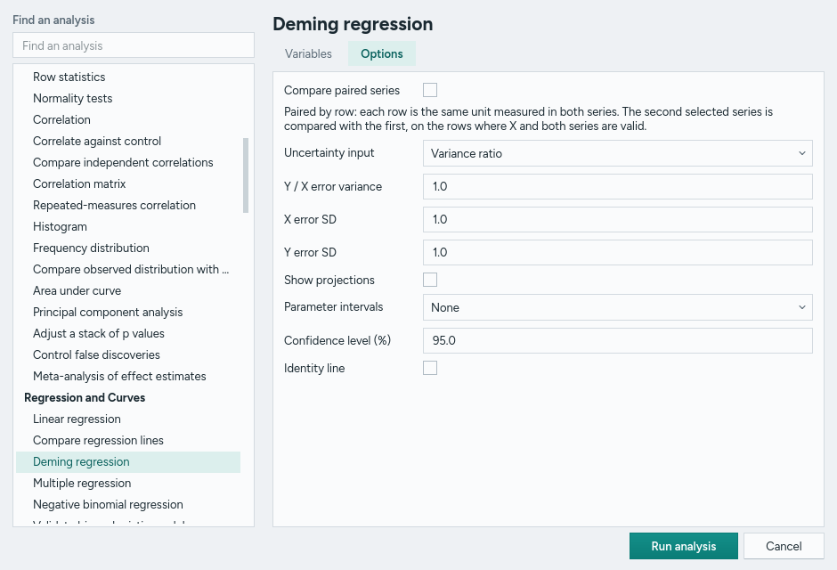
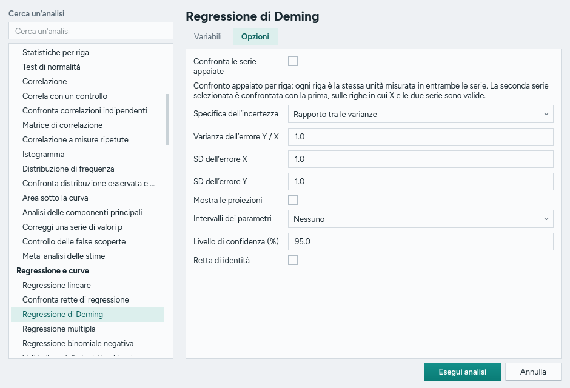
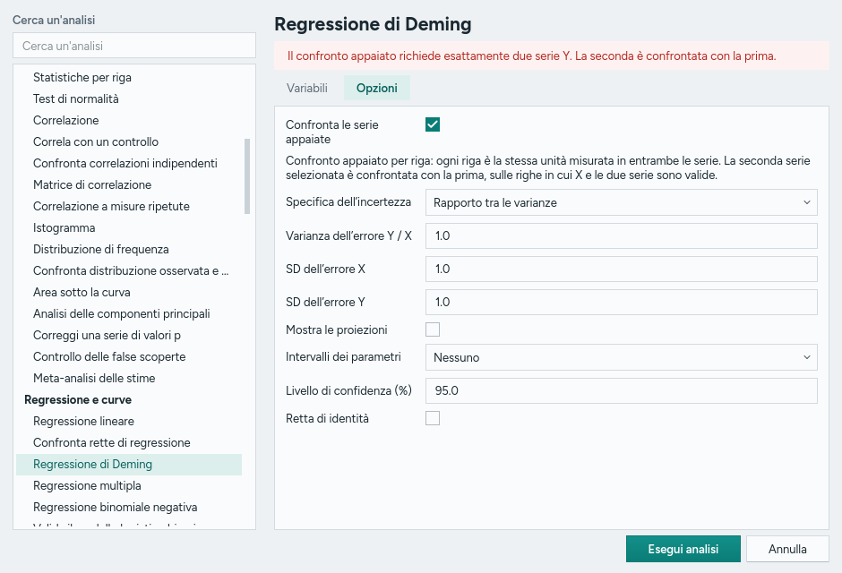
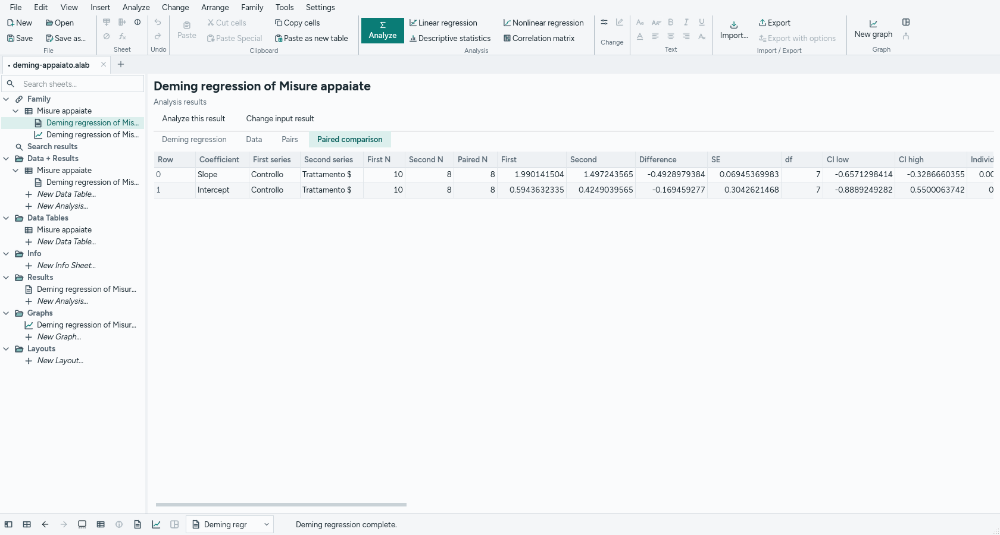

# Confronto appaiato di due rette Deming

In **Analizza → Regressione di Deming**, la pagina **Opzioni** di Qt ha la casella **Confronta le serie appaiate** (`Compare paired series`). È spenta se non la accendi. Il dialogo dice che il confronto è appaiato per riga: ogni riga è la stessa unità misurata in entrambe le serie, e la seconda serie selezionata è confrontata con la prima.

Servono esattamente due serie in **Serie Y**, con la stessa colonna X. Con una serie sola, o con tre, il dialogo resta aperto e il messaggio nomina il campo. Un rapporto di varianza, una SD o un livello di confidenza non finiti restano nel dialogo.

La ricetta tiene la chiave inglese `Compare paired series`. Una ricetta vecchia, o la casella spenta in una ricetta che non l’aveva, non scrive la chiave e non aggiunge fogli. I fogli `Deming regression`, `Data` e `Pairs` di ogni serie restano calcolati sulle coppie complete di quella serie.

## Il foglio

Con l’opzione accesa compare `Paired comparison`, una riga per la pendenza e una per l’intercetta. Le intestazioni restano in inglese, come gli altri fogli di Deming. Ci sono il nome delle due serie, quante coppie usa ciascuna serie da sola, quante righe entrano nel confronto, i due coefficienti calcolati su quelle righe, la differenza (seconda meno prima), l’errore standard, i gradi di libertà, l’intervallo, il valore p e una nota.

Il confronto usa solo le righe in cui X e le due serie sono tutti valori validi, dopo le esclusioni. Per questo una serie può avere 10 coppie, l’altra 8, e il confronto 8: i tre conteggi sono sul foglio.

Per ogni coefficiente la stima è il fit di Deming sull’intero campione appaiato. L’errore standard viene dalle n differenze leave-one-out, togliendo ogni volta la stessa riga da entrambi i fit, con la formula già usata per l’intervallo di una serie:

√[(n−1)/n · Σ(Δᵢ − media delle Δᵢ)²]

L’intervallo è simmetrico e il valore p è bilaterale, con una t di Student a n−1 gradi di libertà, al livello di confidenza dell’analisi. Sul foglio la procedura si chiama **Approximate jackknife (t)**. I due valori p sono individuali: la colonna `p note` dice che non sono aggiustati fra i due coefficienti.

Servono almeno 6 righe appaiate. Se il fit appaiato non è definito, se un fit leave-one-out è degenere, se l’errore standard è zero o se le righe appaiate superano 100000 (`JACKKNIFE_LIMIT`), restano i coefficienti che si possono calcolare e l’inferenza mancante resta vuota, con il motivo in `Status`. I fogli delle singole serie restano, quando quei fit sono validi. Una serie che da sola non si può adattare ferma ancora l’analisi su `Y series`, come prima.

L’intercetta è il valore a X = 0. Se 0 è fuori dalle X appaiate, `Status` della riga Intercept lo dice.

Il rapporto di varianza è quello già scelto, anche quando arriva dalle SD note: λ = (SD errore Y / SD errore X)². Il campo del rapporto di varianza, in quel modo, non entra nel confronto. Scambiare l’ordine delle due serie cambia il segno delle stime e scambia, cambiando segno, gli estremi dell’intervallo; l’errore standard e il valore p restano.

La figura non cambia: ogni serie tiene la propria retta, disegnata sulle proprie coppie.

## Esempio

`tests/data/deming-paired/deming-appaiato.alab` ha la tabella **Misure appaiate**: X da 1 a 10, `Controllo` su tutte e dieci le righe, `Trattamento $` vuoto su U9 ed escluso su U10. Senza l’opzione i conteggi sono 10 e 8. Con l’opzione, rapporto di varianza 1 e confidenza 95%, il confronto usa le righe U1–U8. L’intercetta è estrapolata, perché quelle X vanno da 1 a 8. I numeri sono in `tests/data/deming-paired/oracolo.json`; `oracolo.py` li ricalcola con una SVD e n rifit, e non entra nel programma. Il calcolo pubblicato usa `leave_one_out_coefficients`.

[deming-paired-confronto.alab](examples/deming-paired-confronto.alab) conserva la ricetta con l’opzione accesa. Aprendolo, Trama ricalcola il foglio.

La nota, in inglese e in italiano, sta in cima alle opzioni. Con una sola serie il dialogo resta aperto.

Il foglio `Paired comparison` sul progetto di esempio, con la finestra a 1680×900. Si vedono i conteggi 10, 8 e 8, la differenza seconda meno prima, l’errore standard, i gradi di libertà e l’intervallo. Il valore p inizia a destra; `Status` scorre ancora. L’intercetta, a X = 0, è fuori dalle X appaiate 1…8.

La verifica su questa macchina è in [validation-deming-paired.md](validation-deming-paired.md).
