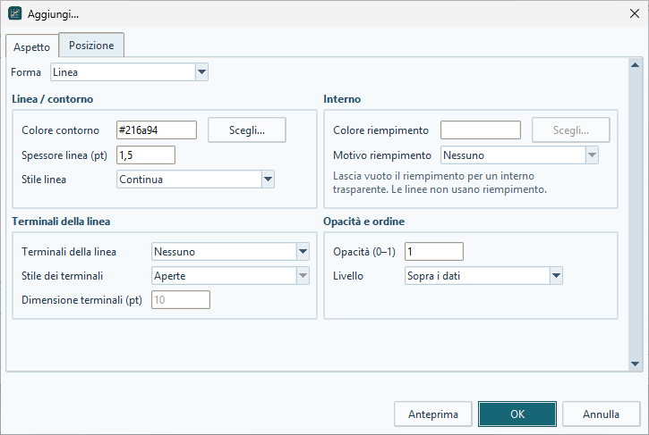
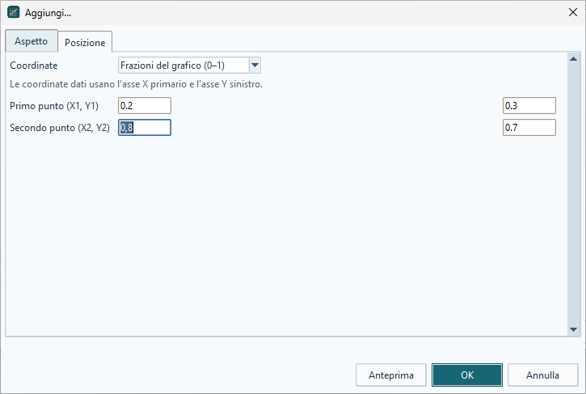

# Compact object editor — 0.66.0

The native object editor separates appearance from numeric positioning while retaining the existing canonical shape records. Projects saved by 0.65 retain their behavior; no new shape keys or statistical options are introduced.

Appearance now groups line/border, interior, line endings and opacity/order. Position contains coordinates and the primary-axis explanation. Each page scrolls independently while Preview/OK/Cancel stay outside the body. Validation selects the page containing the invalid field before scrolling and assigning focus. The existing field, binding and canonical recipe contracts are preserved. No statistical model, renderer, importer or saved shape schema changes.

## Current verification

- Linux: 1,475 unit tests, no skips, and complete real-app smoke PASS. Cross-page field errors, old shape editors, arrows/patterns, caps and canvas workflows pass.
- Windows source GUI: 25 targeted real-Tk tests and dedicated real-app smoke PASS. The bounded runner uses independent standard-output/error redirection: the earlier PowerShell pipeline did not produce a completion marker. No product code change was needed between those runner attempts. EN/IT field errors select the correct page and focus, preview/cancel keeps recipes and dirty state unchanged, and native window geometry stays within 1024×768. This is source GUI acceptance, not a portable-EXE test.
- Each published portable release requires the full Windows suite, original-reference and handoff-verifier checks, build/package and complete smoke of the extracted EXE, including the page/focus check. The release notes and SHA256SUMS identify the accepted archive.
- Import support covers specific PZF/PZT features. The editor preserves the existing primary-axis and imported-drawing restrictions.

## Windows source GUI captures

These images come from the final source preflight on Windows, after the component color/style adjustment. They document the editor layout; portable acceptance is checked separately for each release.

