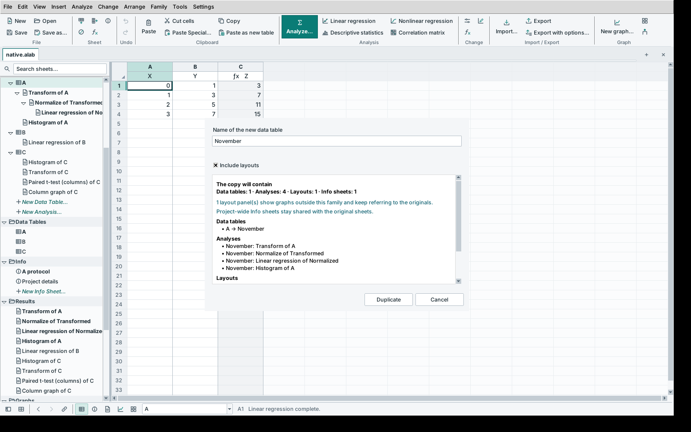
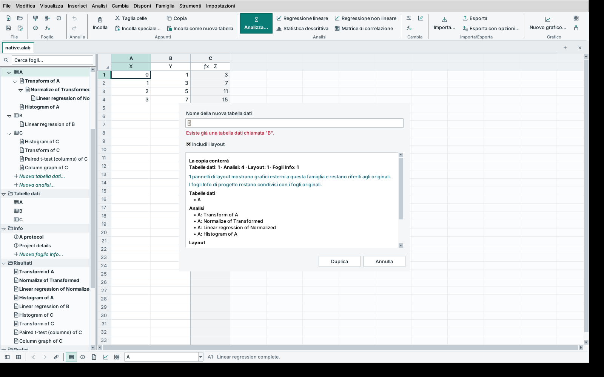

# Famiglie di esperimenti

Una **famiglia** è l’insieme dei fogli che dipendono tra loro: una tabella dati, le sue analisi, le analisi che usano i loro risultati, i confronti statistici disegnati sui grafici, i layout che li mostrano e i fogli Info che alimentano le formule. Due comandi, nel menu **Famiglia**, nel menu contestuale del navigatore e nel menu **Fogli collegati**, la trattano come un’unità.

## Duplica famiglia…

Parte da una tabella dati, un risultato, un grafico, un layout, un layout recuperato supportato o un foglio Info collegato. Un foglio Info di progetto, da solo, non identifica una famiglia di dati: il programma lo spiega e non crea copie ambigue.

| Partenza | Cosa viene copiato |
|---|---|
| Tabella dati | tutte le sue analisi, i discendenti collegati, gli antenati necessari, i dati proprietari di questi nodi e gli Info collegati |
| Risultato | l’analisi, quelle che la usano e gli antenati necessari |
| Grafico | l’analisi che lo produce, i suoi antenati e le analisi che forniscono i confronti statistici; non le altre analisi della tabella |
| Layout | tutti i pannelli e i dati necessari; il layout è sempre incluso, non gli altri layout |
| Layout recuperato | i grafici identificabili dei pannelli e i collegamenti supportati |
| Info collegato | la famiglia della tabella a cui è collegato |

**Includi i layout** copia i layout che contengono i grafici selezionati. I pannelli di quei layout che mostrano grafici estranei restano riferiti agli originali: l’anteprima lo dichiara con il numero dei pannelli.

**Nomi.** Partendo dai dati si sceglie il nome della nuova tabella; se il nome originale compare per intero in un altro foglio copiato viene sostituito. Partendo da altri fogli si scrive un prefisso letterale (`Repeat ` conserva lo spazio finale) che viene anteposto. Una collisione generata diventa `nome (2)`, `nome (3)`…, senza sovrascrivere. Un nome di tabella già occupato è un errore sotto il campo. Limiti: nomi di 160 caratteri al massimo, una sola riga, niente caratteri di controllo né surrogati; prefisso da 1 a 80 caratteri. I nomi delle colonne, delle analisi e delle tabelle dei risultati non cambiano.

**Indipendenza.** Le copie hanno nuovi identificatori; i collegamenti tra analisi, le sorgenti dei confronti statistici, gli stili dei grafici e i pannelli dei layout puntano alle copie e gli slot vengono compattati. Un riferimento già interrotto resta interrotto, in modo esplicito. Dati, attributi, formule, esclusioni, opzioni e stili sono copie profonde: modificare la copia non cambia l’originale. Le ricette di importazione non selezionate non vengono reinserite.

**Info.** Gli Info collegati vengono copiati, con note formattate identiche, e collegati alle nuove tabelle: una formula `INFO("Scale")` legge il valore della copia. Gli Info di progetto restano condivisi (l’anteprima lo dice). Eccezione: se l’unico Info è di progetto e la famiglia copre tutte le tabelle, ogni tabella copiata riceve uno snapshot locale; cambiarlo non tocca l’originale né le altre copie.

**Transazione.** Anteprima e Annulla non aggiungono nulla e non rendono il progetto modificato. Nomi, dipendenze e budget (256 tabelle, 128 layout, 500 Info, 65.536 nodi di analisi, senza un limite separato per una catena) sono validati prima di applicare. La copia gira sul worker e viene applicata nel thread dell’interfaccia solo quando è completa; **Annulla calcolo** scarta tutto. Durante un calcolo il comando è rifiutato con un messaggio. I risultati della copia non vengono mai presi dalla cache dell’originale: si calcolano all’apertura e un modello che fallisce resta non calcolato.

## Nomi persistenti delle analisi

Ogni analisi può avere un nome proprio, letterale e non tradotto (non vuoto, una riga, al massimo 1.024 caratteri), conservato nel `.alab` accanto alle opzioni e mai passato al motore statistico. Senza nome vale quello di sempre. La chiave `analysis_labels` è facoltativa e il formato del progetto non cambia: un progetto senza collegamenti resta in formato 2. Una build precedente ignora il nome senza alterare dati o calcoli. Nomi malformati vengono rifiutati prima di toccare il progetto o sovrascrivere un file. Con un prefisso, le analisi copiate prendono il nome visualizzato più il prefisso.

## Salva famiglia come…

Scrive la famiglia in un `.alab` autonomo, con la scelta di includere i layout e un’anteprima. Con i layout vengono portati anche gli altri pannelli di quei layout e tutti i loro antenati; senza layout solo la famiglia necessaria. Le costanti di progetto lette dalle formule e gli Info pertinenti sono inclusi e indicati. Il file si riapre da solo. Il progetto corrente non cambia (percorso, selezione, ricette, cronologia, modificato). Il percorso del progetto corrente, anche tramite collegamenti simbolici, è rifiutato; annullare la scelta del file non scrive nulla; un errore conserva un file preesistente (scrittura atomica).

[Provenienza delle schermate](media/experiment-families/PROVENANCE.md).

## English quick start

**Duplicate family…** (Family menu, Linked sheets popup, navigator context menu) copies a data table, result, graph, layout, supported recovered layout or linked Info sheet with everything it depends on and everything that depends on it, as an independent family: new identities, remapped result inputs and comparison sources, deep-copied data, formulas, exclusions, options and styles. From data you name the new table; from other sheets you type a literal prefix. A name already in use is an error under the field. A project-wide Info sheet stays shared, except when it is the only Info sheet and the family covers every table: each copied table then gets a local snapshot. Preview and Cancel add nothing; the copy runs on the worker and is applied whole, or not at all. Copies are calculated when opened.

Analyses can carry a persistent literal name, stored in an optional `analysis_labels` key of the `.alab` file (format unchanged) and never sent to the statistical engine.

**Save family as…** writes the family (optionally with its layouts, the other panels they show and everything those need, plus the project-wide constants the formulas read) as a standalone `.alab`. The current project is not changed, its own path is refused, cancelling writes nothing and a failed write keeps an existing file.

## Limiti e prove

Non sono prove di Windows né di uso manuale con mouse e tastiera: gli smoke pilotano i widget Tk veri, in inglese e italiano, con Tema Standard e Moderno, sotto Xvfb. I budget sono limiti di validazione del formato, non una promessa di prestazioni a quella dimensione. **Duplica solo grafico** (una copia che aggiunge un’altra analisi) è un comando diverso e non è incluso.
