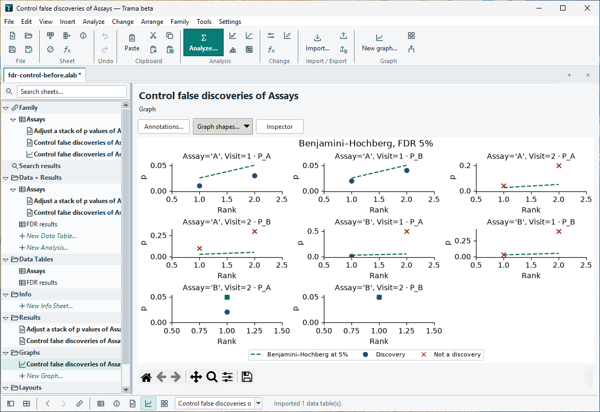

# Controllo delle false scoperte

`Control false discoveries` sta in Data Exploration and Summary, subito dopo `Adjust a stack of p values`. Il metodo già presente non cambia: `operations.adjust_p` resta il confronto di Holm, Bonferroni, FDR di Benjamini–Hochberg e Holm–Šídák su una sola colonna.

## Cosa non afferma

Il FDR è la quota attesa di false scoperte fra le ipotesi rifiutate, non la probabilità di errore di una singola ipotesi. Una scoperta non dice che l'ipotesi sia falsa. L'assenza di una scoperta non dice che sia vera. Trama non verifica se le ipotesi siano indipendenti.

I p aggiustati BH e BY non dipendono dal livello richiesto e possono essere confrontati con un altro livello. I p aggiustati BKY a due stadi dipendono invece dall’FDR scelto e vanno ricalcolati quando questo cambia. La decisione di scoperta usa sempre il livello richiesto. Il foglio Settings distingue esplicitamente i due casi.

La distinzione è documentata anche nelle note di [statsmodels multipletests](https://www.statsmodels.org/stable/generated/statsmodels.stats.multitest.multipletests.html) e di [fdrcorrection_twostage](https://www.statsmodels.org/stable/generated/statsmodels.stats.multitest.fdrcorrection_twostage.html).

## Procedura

Il livello inserito è una percentuale. Il calcolo riceve una volta sola la frazione `q = livello / 100`. Il confronto è inclusivo: dopo l'ordinamento stabile si prende il rango massimo `i` con `p(i) <= alpha * i / m` e si rifiutano tutti i ranghi fino a `i`. La soglia del singolo rango non decide da sola. Due p uguali condividono il valore aggiustato e la decisione.

- `Benjamini–Hochberg`: `alpha = q`.
- `Benjamini–Yekutieli`: `alpha = q / Hm`, con `Hm` somma di `1/j`.
- `Two-stage Benjamini–Krieger–Yekutieli`: uno stadio adattivo, senza iterare fino a un punto fisso. `q1 = q / (1 + q)`, `R1` sono i rifiuti BH a `q1`, `m0 = m - R1`. Se `0 < R1 < m`, il secondo stadio usa `q2 = q1 * m / m0`. Se `R1` è 0 o `m`, la procedura si ferma e non divide per `m0`. `m0` non è `m` meno le scoperte finali.

## Famiglie e dati

Si scelgono da 1 a 24 colonne p distinte e da 0 a 4 colonne di famiglia. Senza colonne di famiglia il gruppo è `All rows`. `Each column separately` fa una famiglia per gruppo e colonna. `Pool selected columns` riunisce le colonne selezionate; in quel foglio la variabile è `Pooled`.

Un p valido è un numero finito in `[0, 1]`, inclusi 0 e 1. Testo non vuoto, booleani, infiniti e valori fuori intervallo sono un errore sul campo `p columns`, anche sulla riga che poi non entrerebbe nel test. Vuoto, spazi, `None` e NaN sono p mancanti. Per la famiglia, vuoto e spazi sono mancanti; il testo `NA` è un livello. Intero `1` e testo `"1"` restano livelli distinti. La famiglia mancante prevale sul p mancante. Una cella mancante non entra in `m` e non viene trattata come `p = 1`.

`Source row` è la posizione originale nella tabella, da 1, prima di filtri e ordinamenti. Non è l'indice di pandas. L'indice non viene scritto nel progetto. Le righe con lo stesso indice non si perdono e non si duplicano. L'ordine è: gruppi alla prima comparsa, colonne nell'ordine scelto, riga originale; le famiglie mancanti in coda.

Limiti, prima di allocare il grafico: 200.000 p usati, 200 famiglie non vuote, 12 famiglie nel grafico. Oltre 12 famiglie il campo `Show diagnostic plot` è un errore, senza taglio silenzioso. Una famiglia vuota compare nel riepilogo con la ragione `No used p values` e la procedura non viene chiamata. Se nessun p è usabile restano le tabelle, con lo stato e la spiegazione, e senza figura.

## Fogli e grafico

I nomi dei fogli e i token di stato restano inglesi, così il ricalcolo in inglese e in italiano produce le stesse tabelle. `FDR results` ha una riga per cella selezionata. `Discovery` è vero o falso solo per i p usati. `FDR families` riporta metodo, `q` come frazione, `m` e le scoperte; per BKY anche `R1`, `m0` e i due stadi. `Settings` registra il confronto inclusivo, i limiti e le note. La nota su `m0` compare solo per BKY.

Il grafico diagnostico esiste solo se richiesto e se c'è almeno una famiglia non vuota. Un pannello per famiglia, scala lineare, `p = 0` resta 0. I marcatori distinguono le scoperte anche senza il colore. Il controllo dei campi avviene nel dialogo; l'aggiustamento e la figura girano sul worker.

Se una modifica ai dati rende il calcolo non valido, il dialogo si riapre sul campo da correggere. Annullando si conserva l'ultimo risultato riuscito, marcato come precedente: export e Use Result as Data restano bloccati fino a un ricalcolo valido. Il ricalcolo manuale segue lo stesso recupero. Un tentativo fallito di cambiare soltanto le opzioni conserva invece l'analisi confermata dei dati originali.

## Esempio sintetico

Cinque righe, colonna `P` = 0,01, 0,03, 0,04, 0,2 e un p mancante, famiglia `G` = a, a, b, b, b. Con Benjamini–Hochberg al 5% e colonne separate, le righe originali sono 1…5. I p aggiustati dei primi quattro sono 0,02, 0,03, 0,08 e 0,2. Le scoperte sono sì, sì, no, no. L'ultima riga è `Missing p` e non ha figura.

I numeri congelati in `tests/data/fdr_control/families.json` sono sintetici. Non sono dati di terzi.

## Nell’applicazione Windows

Cattura reale del portabile Windows0.78beta; dati sintetici. [Provenienza](media/fdr-axis/PROVENANCE.md).
