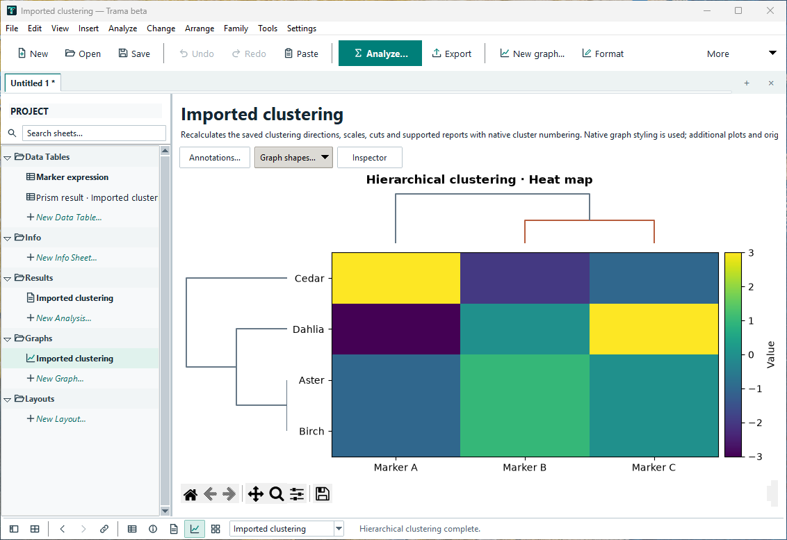

# Editable clustering imports

Supported hierarchical analyses in `.prism` and `.prismt` ZIP projects can reopen as native **Hierarchical clustering** analyses. They remain connected to their imported source worksheet.

The converter restores row, column or combined clustering, supported column and row transforms, cluster counts or an uncut tree, and observation labels using the saved column identifiers. Supported saved transforms are None, Center and Standardize; complete and group-average linkage with Euclidean distance are recognized. Standardization uses the sample standard deviation; columns are transformed before rows.

Selected scaled-data, distance-matrix, merge map and cophenetic reports are restored, including full or lower-triangle matrix display. When a saved heat map is the only supported graph selection, the native result contains the heat map with its row and column trees. When a saved dendrogram is also selected, it is the primary native figure. Additional saved plots remain available only where their stored views can be imported.

Enable **Output → Merge map** to see one table per clustering direction with the one-based merge order, two child labels and the cophenetic distance at which they join. A child displayed as **Cluster 3** refers to the third merge in that report. Children are ordered by the last source observation in each child. The numeric **Merges** sheet and the dendrogram retain their existing ordering. The optional report recalculates with the analysis, so equal distances can produce a different merge sequence in a recomputed tree.

## Working with an imported analysis

1. Open the imported analysis or graph in the project navigator.
2. Use **Change parameters** to edit clustering direction, transforms, cuts or output options.
3. Edit or exclude a source cell. The native result recalculates from the current complete observations.
4. Save the project as `.alab` to retain the editable recipe, native graph style and exclusions.

Saved result snapshots remain independent of the native calculation and keep their original values. They can be useful for reviewing the imported project after source edits.

## Limits

The native figure uses Trama's graph presentation. It does not reproduce every original color, label placement or drawing object. The importer does not promise a native graph for every stored view, and it reports unavailable views. Additional saved cut methods, linkages or distances that the converter does not recognize stay as saved content where available; they are not silently replaced with another analysis.

These additions concern supported hierarchical analysis metadata in ZIP project files. They do not add general binary-project recipe restoration or external-format save support.

## Native Windows preview

Unedited capture of the Windows 0.80 beta portable, optional Modern theme, 96 DPI. Source data are synthetic. The native graph uses Trama styling; the saved result snapshot is retained separately. Accepted application source: `74a5d75dff56bde4f2088afa6064033678db8e9e`.
