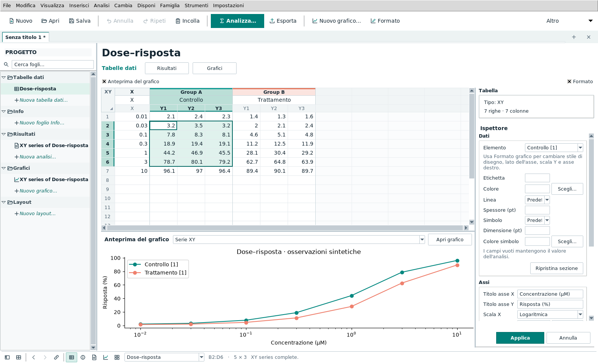
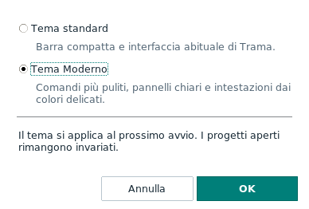

# Interface themes

**Settings → Theme…** offers **Standard theme** and **Modern theme**. In Italian the choices are **Tema standard** and **Tema Moderno**. The same chooser is reachable from the start page.

Standard is the default for existing installations. Modern uses a single command bar, lighter surfaces, teal selection, larger page headings and coloured group headers. Less common commands remain available in the grouped **More** menu and the existing application menus. Narrow windows retain labels on Analyze, then show other commands as icons with their original tooltips.

Choose a theme and confirm with OK. The preference applies at the next start; open worksheets, active edits, running calculations and project content are not rebuilt. Cancel, Escape and closing the dialog preserve the previous preference. If saving fails, the dialog remains open with the error. Language and unrelated preferences are preserved by the atomic write. Invalid or unknown theme values fall back to Standard.

This preference affects the application shell, not the appearance of exported figures. It is stored locally, outside `.alab` files. Modern also places an optional linked graph preview below the data grid. The right pane combines read-only table information with the existing graph Inspector. Choose between linked graphs, resize the panes, hide the preview or open the complete graph sheet. On narrow windows the right pane starts collapsed. The preview does not start an analysis implicitly; a deferred graph offers Calculate.

The preview owns a separate Figure copy. Resizing it and previewing a style never resize or edit the source figure. Apply commits the style; Cancel, leaving the worksheet, switching graphs or hiding the preview discard an unconfirmed draft. Save and export use the existing Apply/Discard/Cancel decision. Edits and exclusions update the linked preview after recalculation; an unsuccessful calculation clears it unless the analysis deliberately retains its previous result; in that case the preview displays the same stale-result warning as the result sheet. The original figure remains the export source.

The modern navigator avoids duplicate Family and Data + Results sections. Search results appear only while searching. The original commands remain accessible from the menus and navigation bar.

## Validation

The assembled 0.73 candidate passes **2,241 tests on Linux and 2,241 on native Windows**, with no skips. Complete Linux GUI regressions pass in Standard and Modern; the complete Windows portable regression also passes. Dedicated native Modern checks cover 1024×768 and 1920×1080 at 96 DPI, both interface languages, preview/discard/apply, invalid logarithmic limits, editing/exclusion/undo, project reopen/recalculation, preference Cancel/OK and CSV/PNG/SVG/PDF exports.

Artifact provenance and the final work-area smoke repeat are recorded in the [0.73 validation report](validation-073.md). Native 125/150% system scaling was not tested; Linux captures and Tk scaling do not prove it.

## Actual application screenshots (Linux)

