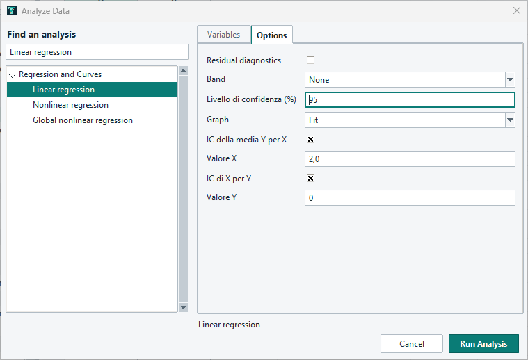
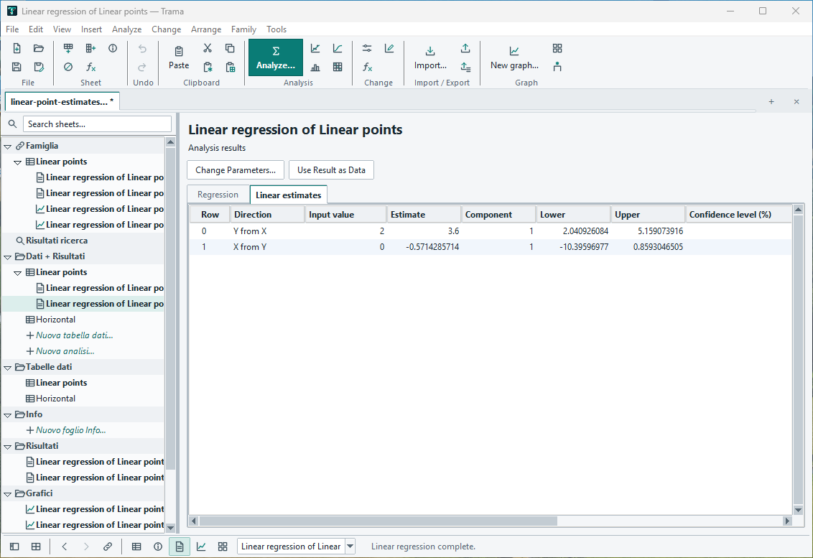
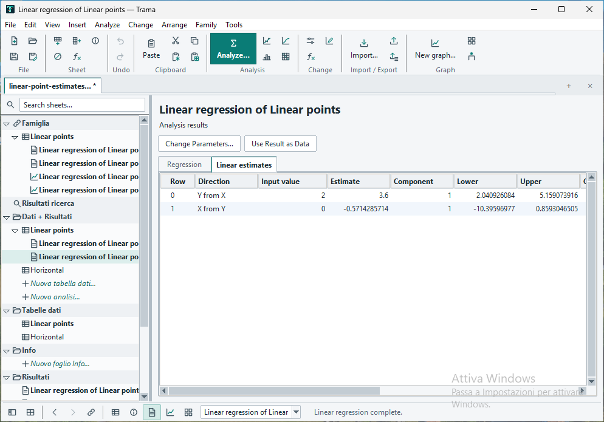

# Stime puntuali nella regressione lineare

Nella regressione lineare puoi ora richiedere due risultati facoltativi:

- **Y confidence interval at X / IC della media Y per X:** specifica la X e ottieni la risposta media stimata con il suo intervallo di confidenza.
- **X confidence interval at Y / IC di X per Y:** specifica la Y e ottieni la X corrispondente con il suo insieme di confidenza. Con Y=0 si ottengono l'intercetta X e il suo intervallo asimmetrico.

Il livello di confidenza è configurabile e parte dal 95%. Il foglio **Linear estimates** indica direzione, valore richiesto, stima, componenti, limiti, livello e note. I valori sono nello stesso sistema di unità delle colonne sorgenti. Una virgola decimale è accettata nei campi numerici.

Le due opzioni sono inizialmente spente: le ricette precedenti mantengono i propri fogli, valori e grafici. L'attivazione aggiunge il foglio delle stime; non ricalcola un secondo modello e non modifica il grafico. Dati modificati o esclusi aggiornano le stime come gli altri risultati collegati. Ricetta e impostazioni restano canoniche anche passando fra italiano e inglese.

## Significato degli intervalli

Questi sono intervalli puntuali della **risposta media**, non intervalli di predizione di una nuova osservazione e non intervalli simultanei per una famiglia di richieste. Per Y a X fissata si usa la distribuzione t con N−2 gradi di libertà.

Per X a Y fissata si inverte la banda di confidenza della risposta media su tutta la retta reale. L'intervallo può essere asimmetrico, diviso in due intervalli illimitati, una semiretta, l'intera retta o vuoto. Il foglio mantiene ogni componente e i limiti infiniti; non trasforma questi casi in un intervallo finito. Una retta orizzontale non ha una stima inversa unica: la stima resta vuota e il foglio spiega il motivo, conservando l'insieme di confidenza.

È possibile estrapolare fuori dall'intervallo X osservato; il risultato lo segnala. I limiti inversi non vengono tagliati sull'intervallo dei dati. Il calcolo usa coordinate centrate, scale adatte al valore richiesto e radici quadratiche stabili. Norme e rapporti sono calcolati evitando prodotti intermedi troppo piccoli: questo è necessario anche su Windows, dove `longdouble` ha la precisione di `float64`.

## Origine e verifica

I test sono in `tests/test_linear_point_estimates.py`. Lo smoke dedicato guida i dialoghi veri, verifica errori e correzioni nello stesso dialogo, i campi EN/IT, il ricalcolo, salvataggio e riapertura, CSV/PNG/SVG/PDF e Use Result as Data. Si avvia con `TRAMASTAT_SMOKE_ONLY=linear-estimates` e `tramastat.py --smoke <cartella-di-prova>`; è incluso anche nello smoke completo. Il collaudo Windows usa la nuova UI della PR #80. Versione, merge e release restano separati.

## Anteprima Windows

Le immagini provengono dal portabile candidato sulla UI A, con Segoe UI, scala applicazione 1.0 e display 1920×1200. Il dialogo misurato è 757×486 pixel. Il test controlla che rientri in 1024×768, ma questa cattura non è una prova di una sessione Windows con risoluzione impostata a 1024×768, né di DPI di sistema 125/150%. La prova Linux usa Xvfb 1024×768. La build resta privata e non è una nuova release.

## Stabilità delle unità in0.71

Il kernel storico poteva perdere R², p e SE quando il prodotto delle varianze X/Y andava fuori dall'intervallo numerico. La0.71 conserva il percorso ordinario e usa un fit normalizzato quando le unità rendono pericolosi i prodotti intermedi. Coefficienti e SE tornano nelle unità originali con rapporti di esponenti; risultati finali non rappresentabili danno un errore esplicito. I test verificano invarianti di scala con riferimento indipendente. Le vecchie registrazioni di collaudo del prototipo0.70 restano documentazione storica; la verifica della release0.71 è separata.

Un successivo collaudo dedicato ha impostato realmente la VM Windows a **1024×768**, eseguito lo stesso portabile e ripristinato la risoluzione iniziale 1920×1200. L'esito è PASS con Segoe UI e scala applicazione1.0; la [registrazione del ripristino](media/linear-point-estimates/resolution-acceptance.json) conserva prima, durante e dopo.

