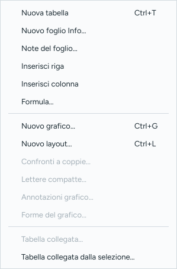
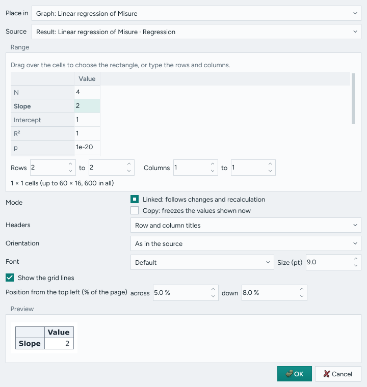
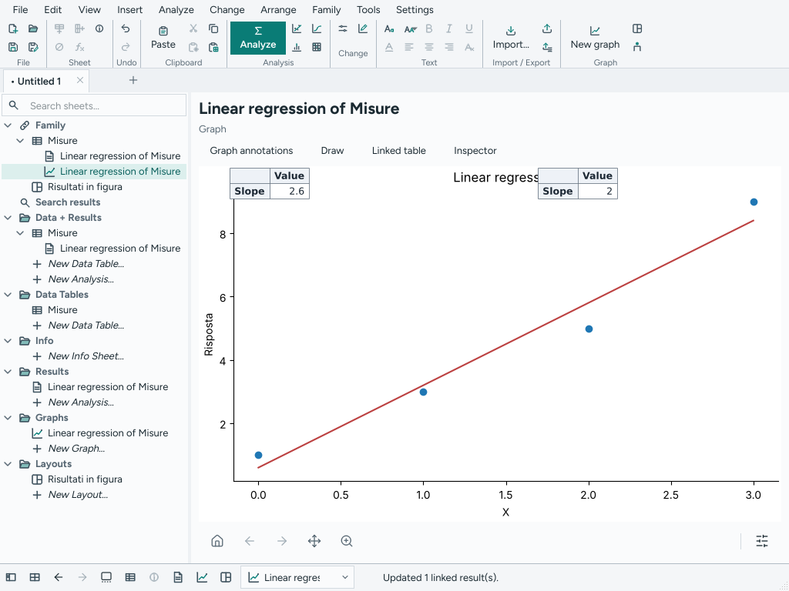
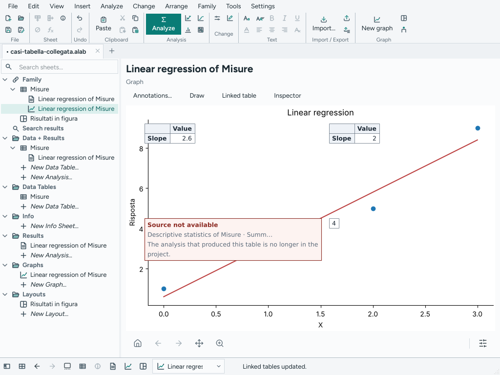
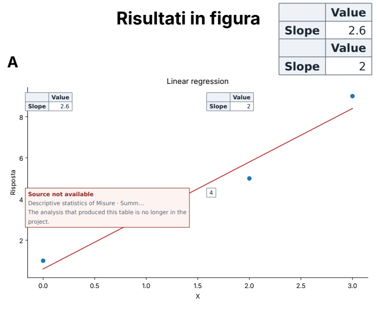

# Linked tables: worksheet and result cells as a table on a graph or a layout

**Insert → Linked table…** (Italian: *Inserisci → Tabella collegata…*) puts a small table on a native graph or on a layout page. The numbers come from a worksheet or from a result table of the **same project**, either as a **Linked** table (it follows the data and the recalculation) or as a **Copy** (the values shown now, frozen). The table is part of the figure: the canvas, the layout that contains the graph, PNG, PDF, SVG and the multi-sheet PDF all draw the same object, with the text as text and the rules as lines.



## Commands

| Command (IT) | What it does |
|---|---|
| Linked table… (*Tabella collegata…*) | The tables of the selected graph or layout: **Add…**, **Edit…**, **Remove**, with the state of each. Also the *Linked table* button of the graph and layout pages |
| Linked table from selection… (*Tabella collegata dalla selezione…*) | Takes the cells selected on a worksheet or on a result table as the range, and asks where to put the table (any native graph or layout) |

*Linked table…* is on for a native graph (not for the legacy imported ones) and for a layout; the selection command is on when cells of a worksheet or of a result table are selected. On a result table the first column (the row titles) is not a value: select value cells.



## The window

- **Place in** (only for the selection command): the graph or layout that receives the table.
- **Source**: a worksheet (*Foglio dati*) or a table of a result (*Risultato*) of the project.
- **Range**: drag over the cells of the preview, or type the first and last row and column; the two stay in step. The rectangle is at most 60 rows × 16 columns and 600 cells; a larger one is refused, with the reason, **before any cell is read or any artist is created**, so choosing a whole column never builds thousands of objects. The preview of the source shows the first 200 rows and 40 columns. A single cell is a table.
- **Mode**: *Linked* or *Copy*.
- **Headers**: row and column titles, only one of the two, or none. **Orientation**: as in the source, or rows and columns swapped. **Font** (default, sans serif, serif, monospace) and **size** (5–24 pt). **Grid lines**. **Position**: the top left corner as a percentage of the page. A table that would stick out of the page is moved back onto it instead of being cut.
- **Preview**: the table as it will be drawn.

Editing a table keeps its source and range unless *Choose the source and range again* is ticked, so a table whose source has gone can still be moved or restyled, or given a new source.

## Linked and Copy

| | Linked | Copy |
|---|---|---|
| Holds | a reference to the source | the text of the cells at insertion (and a label saying where they came from) |
| After an edit of the data | follows it | keeps its numbers |
| Source removed | an explicit state | unaffected |
| Saved | yes, the reference | yes, the values |

Both are saved in the project. A linked table **never runs an analysis**: it reads the result the analysis already has, so a result that is not calculated yet shows *Source not calculated yet* until the analysis is calculated the usual way.



In the example the slope of the regression of `Misure` is 2; after B4 goes from 7 to 9 the linked cell reads 2.6 and the copy still 2, on the graph, on the layout, in the PNG, the SVG, the PDF and the multi-sheet PDF.

## What a linked table is bound to

The project says exactly which source a table reads, and never guesses another one:

- **Worksheet range**: the title of the sheet, the **identity of each row** (the worksheet row identities that already survive inserted and deleted rows, so a table keeps its rows when rows are added above them) and the **names of the columns**. Renaming a sheet follows (the records are rewritten with it); renaming or deleting a column that the table uses is a state, not a guess.
- **Result range**: the identity of the **analysis** (its recipe, not its number in the list: the unique id the project already gives it and that Save writes), the **key of the result table** and the **row and column keys**. Removing and recreating an analysis with the same recipe gives a different analysis: the table stays *not available* and does not move onto it.

### States

When the source cannot be read the table is drawn as a small framed card, in the language the program is showing, and the window lists the same state:

| State | Meaning |
|---|---|
| Source not available (*missing*) | the worksheet, analysis, result table, row or column is not in the project |
| Source is ambiguous (*ambiguous*) | the source has more than one row or column with that name |
| Source is empty (*empty*) | no rows or no columns |
| Source changed (*changed*) | a result that had a given number of rows now has another |
| Source has an error (*error*) | the analysis failed |
| Source not calculated yet (*pending*) | the analysis has no result yet |

The card has the reason in a line. Fixing the source (undo, a calculation that works again) turns the table back into its numbers by itself; a *Copy* is never affected.



## Where tables live

- On a **graph**: the tables are part of the graph's style (`linked_tables`), so they follow the graph: Duplicate sheet copies them with the graph, and *Duplicate family* remaps the analyses they read to the copies. Applying a table is **one Undo step** (and so is a change of its look, its position or its removal).
- On a **layout page**: they belong to the layout (`tables`), above the panels, and they do **not** change the panels, their boxes or the arrangement.
- A graph with tables inside a layout draws its tables once (with the panel); a table placed on the layout draws once on the page. Analysis templates list the tables as drawings left out (*Linked tables*), the same way annotations are; *Repeat analysis on other sheets* leaves them behind, since a table reads the sheet or result it was made for.
- Data, cache and error state are different things: the record is saved, the values read for a drawing and the state are never stored.



## Storage

One optional key in the style of a graph (`linked_tables`, list) and one in a layout (`tables`, list); the project file also writes `analysis_ids` for a worksheet table whose analyses are read by a linked table, so the identity of an analysis is the same after reopening. Projects without any linked table open and save as before: no key is written.

```json
{"id": "6f1c0c0e-…", "mode": "linked", "position": [0.05, 0.08], "size": 9, "headers": "both",
 "orientation": "normal", "grid": true, "origin": "Regression of Misure · Slope",
 "source": {"kind": "result", "analysis": "…", "table": "Regression", "by": "keys",
            "rows": ["Slope"], "columns": ["Value"]}}
```

`mode` `copy` has `values` (`rows`, `columns`, `cells`) instead of `source`. Reading is validated: a malformed id (a canonical lowercase UUID), mode, position (0–1), size (5–24), headers, orientation, font, source (kinds, repeated rows or columns, a range over the limit) or more than 12 tables per graph or layout make the file refuse to open instead of drawing something wrong.

## Vector drawing

One container artist per table holds Text, Rectangle and Line2D children in points, so PDF and SVG keep the text as text (`2.6` can be found and copied) and the rules as paths. In the multi-sheet PDF and the single PDF of a layout the tables of the page are an overlay form above the panels, so the vector panels stay untouched; in the SVG they are the group `layout-tables`, and the tables of a graph inside a layout are the groups `panel<N>-tramastat-table-<id>`.

## What it costs

`python -m tests.bench_linked_tables` (Linux, offscreen, 4 cores, idle machine): a 50 000 × 21 sheet and a graph with the **12 largest tables allowed** (60 × 10 cells each, 747 artists per table at most, 8 964 in all; a table is usually a few cells).

| Step | Time |
|---|---|
| Preview of the source for the dialog (200 × 40 cells) | 8 ms |
| Refuse a whole column (50 000 rows) | 0 ms, before any read |
| Record of one 60 × 10 range | 0.1–0.2 ms |
| Apply the 12 maximal tables (resolve + draw) | 1.1–1.4 s (about 100 ms each) |
| Edit a cell outside the tables | 25 ms (no table is redrawn) |
| Update with nothing changed | 12–17 ms |
| Edit a cell inside the tables | 1.2 s (all 12 resolved and redrawn) |
| Reference: export the layout page without tables, PDF | 1.7 s |
| Export the page with the 12 maximal tables in the graph and 4 on the page: PDF / SVG / PNG | 9.6 s / 4.6 s / 9.4 s |

The cost follows the text of the tables (about 0.5 s of export per maximal table, 670 text objects); one table of a few cells is not measurable. A table redraws only when its record, the values it reads, the scale or the page size change (the signature of the last drawing is kept), so an edit that does not touch a table costs only the check.

## Tests

```
python -m unittest tests.test_linked_tables tests.test_qt_linked_tables -v
python -m trama_qt.linked_table_smoke OUT [--lang en|it] [--theme light|dark]   # real window, screenshots, .alab
TRAMASTAT_SMOKE_ONLY=qt-linked-tables python tramastat.py --smoke OUT           # the four language/theme combinations
python -m tests.bench_linked_tables
```

Windows was **not** exercised: the screenshots come from Linux (Xvfb 1024 × 768 and 150 % emulated with `QT_SCALE_FACTOR=1.5`, which is not a native DPI setting).

## Not done

- A table cannot be dragged on the canvas: position is a field of the window (percentages of the page).
- A table reads a worksheet or a result table; a range of another project, or of a table that is not shown, is not offered.
- No automatic refresh of a *Copy*: that is what *Linked* is for. To freeze a linked table, make a new one with *Copy*, or edit it, tick *Choose the source and range again* and pick *Copy*.
