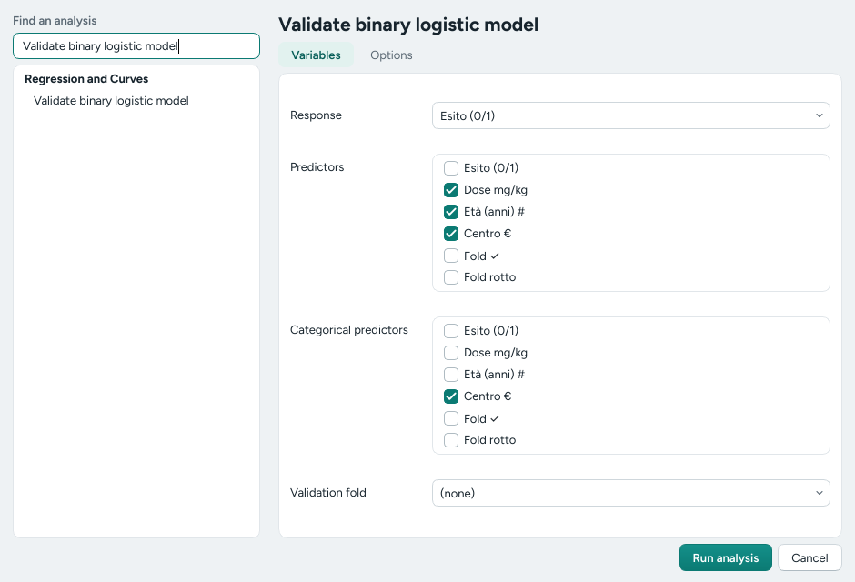
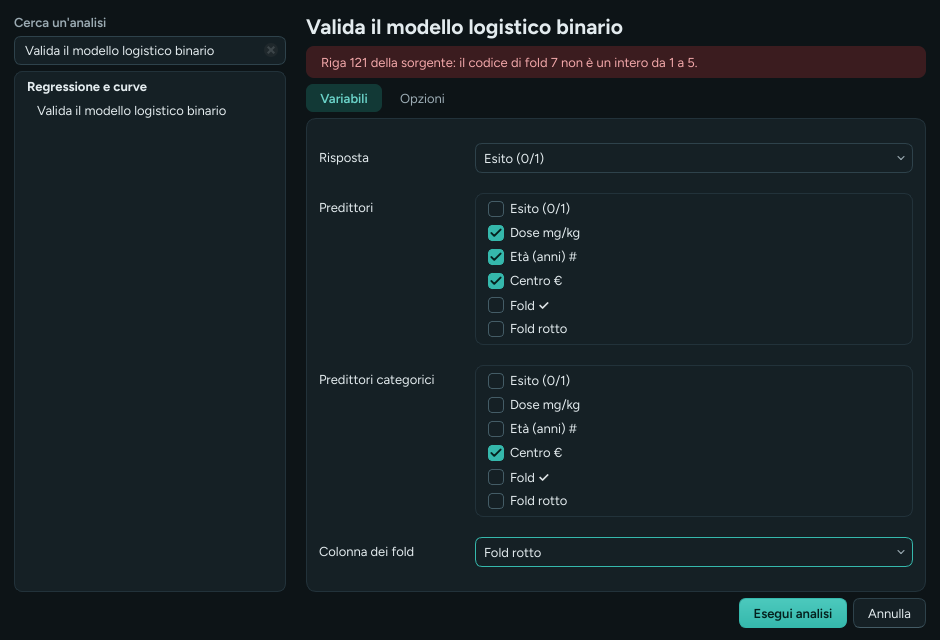
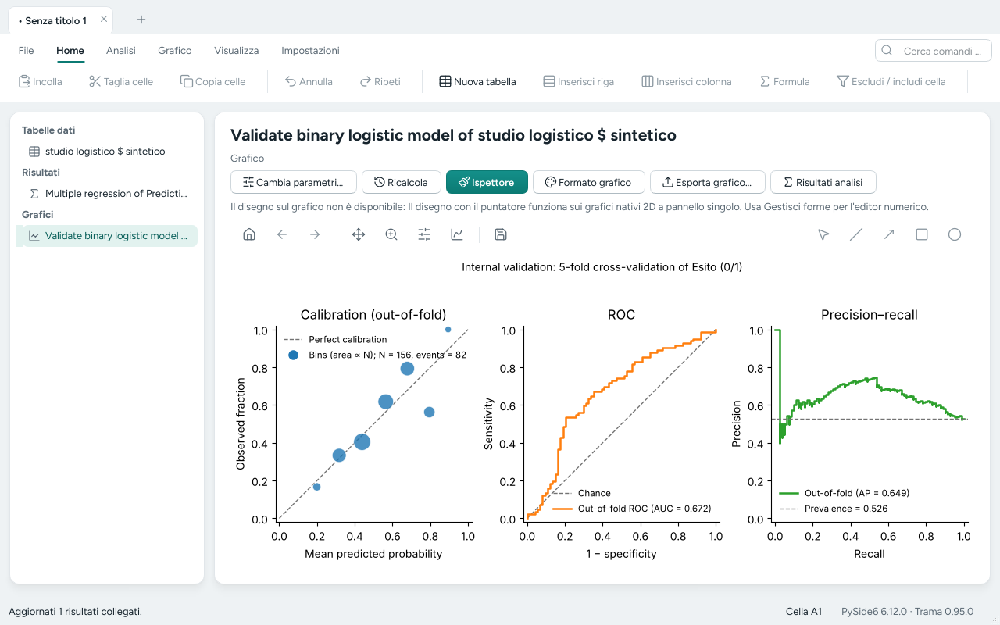

# Validazione del modello logistico binario

**Valida il modello logistico binario** (in inglese *Validate binary logistic model*) stima come predice un modello logistico righe che non ha visto durante il fit. La trovi in **Analizza → Regressione e curve**, subito dopo la regressione multipla. La famiglia Logistica della **Regressione multipla**, con diagnostiche e profili, descrive il fit su tutte le righe (*in-sample*). Questa analisi invece ripete il fit in una **validazione incrociata a K fold** e valuta solo le probabilità fuori campione: discriminazione (AUC ROC, precisione media) e calibrazione (Brier, log loss, classi di calibrazione).

È una **validazione interna**: stima come si comporta la procedura di modellazione su questo foglio. Non sostituisce una validazione esterna su dati indipendenti. Per lo stesso motivo l'analisi non riporta intervalli di confidenza: le predizioni fuori campione condividono le righe di addestramento e non sono osservazioni indipendenti.

## Opzioni

| Campo | Predefinito | Valori ammessi |
| --- | --- | --- |
| **Risposta** | colonna scelta | 0 o 1; servono entrambi gli esiti |
| **Predittori** | colonne scelte | colonne diverse dalla risposta; al massimo 32 coefficienti dopo l'espansione delle categorie, intercetta compresa |
| **Predittori categorici** | nessuno | sottoinsieme dei predittori, da 2 a 100 livelli ciascuno |
| **Numero di fold** | 5 | intero da 2 a 20 |
| **Seme casuale** | 0 | intero da 0 a 4294967295; usato solo nella ripartizione automatica |
| **Colonna dei fold** | nessuna | facoltativa: codici interi da 1 al numero di fold |
| **Soglia** | 0,5 | numero da 0 a 1; la classe prevista è positiva quando p ≥ soglia |
| **Classi di calibrazione** | 10 | intero da 3 a 20 |
| **Vista del grafico** | Calibrazione | Calibrazione, ROC, Precisione–richiamo o Tutti i pannelli |

Il progetto salva le opzioni con i nomi e i valori inglesi (*Folds*, *Seed*, *Validation fold*, *Threshold*, *Calibration bins*, *Graph view*), quindi una ricetta si riapre uguale in qualunque lingua. Nel dialogo puoi scrivere la virgola decimale. Una colonna dei fold vuota si salva come `null`.

I controlli su opzioni, colonne, codici dei fold, numero di righe per esito, limiti e livelli delle categorie avvengono quando premi **Esegui analisi**, prima di qualsiasi fit. L'errore compare nel dialogo sul campo da correggere.

## Righe e fold

Una riga è **utilizzabile** quando la risposta vale 0 o 1, ogni predittore numerico è un numero finito e ogni predittore categorico ha un valore. Le righe escluse dal foglio arrivano all'analisi come celle vuote. Le altre righe restano nel foglio **Predictions** con stato *Incomplete*, senza fold né previsione. **Source row** è la posizione della riga nel foglio, contando da 1, come la vede l'analisi.

- **Ripartizione automatica** (nessuna colonna dei fold): un generatore `Generator(PCG64(seme))` permuta le righe utilizzabili con esito 0 nell'ordine del foglio e le distribuisce a giro nei fold 1…K, partendo dal fold 1. Poi fa lo stesso, con lo stesso generatore, per le righe con esito 1, di nuovo dal fold 1. Ogni esito deve avere almeno K righe utilizzabili. Stesso seme, stessi fold.
- **Colonna dei fold**: ogni riga utilizzabile deve avere un codice intero da 1 a K. Ogni fold deve comparire e le sue righe di test devono contenere entrambi gli esiti.

## Come funziona

Ogni fold stima il modello solo sulle sue righe di addestramento, con lo stesso fit binomiale (IRLS, al massimo 100 iterazioni) della famiglia Logistica della regressione multipla. Anche la codifica delle categorie viene dalle righe di addestramento: livelli ordinati come testo, il primo è il riferimento. La stessa codifica si applica poi alle righe di test. I coefficienti stimati sull'intera tabella non vengono mai usati per prevedere righe di test.

Un fold che non si può stimare ferma l'analisi con un errore che nomina il fold e il campo da cambiare. Trama non stampa mai un punteggio complessivo calcolato su una parte dei fold. Le cause si distinguono in questo ordine, sulle righe di addestramento del fold:

1. **Livello assente**: un livello di una categoria compare nelle righe di test ma non in quelle di addestramento. Il controllo avviene già nel dialogo, per tutti i fold.
2. **Separazione** (completa o quasi completa): un programma lineare cerca una direzione b, con |b_j| ≤ 1 sulle colonne standardizzate, tale che (2y − 1)·Xb ≥ 0 su ogni riga e > 0 su almeno una. Una tale direzione esiste esattamente quando la stima di massima verosimiglianza non esiste. Se un livello di una categoria ha un solo esito fra le righe di addestramento, l'errore nomina quel livello.
3. **Mancata convergenza**: nessuna separazione, ma l'IRLS non converge in 100 iterazioni, statsmodels segnala una predizione perfetta, un passo è singolare o un coefficiente non è finito.
4. **Mal condizionamento**: il fit converge, ma l'informazione di Fisher X'WX sulle colonne standardizzate ha un numero di condizione superiore a 10¹⁰.

Le metriche usano tutte le predizioni fuori campione insieme, mai la media delle aree dei fold:

- **Brier score**: media di (p − y)².
- **Log loss**: media di logaddexp(0, z) − y·z, con z il logit fuori campione. Resta finita ed esatta anche per probabilità vicinissime a 0 o 1.
- **ROC AUC**: probabilità di Mann–Whitney con mezzo punto ai pareggi.
- **Average precision**: somma degli incrementi di richiamo per la precisione a ogni soglia distinta, dalla più alta, senza trapezi.
- **TN, FP, FN, TP**: matrice di confusione con classe positiva quando p ≥ soglia.

AUC e precisione media ordinano le righe per logit. Due righe con probabilità entrambe arrotondate a 1 restano quindi ordinate. Per ricalcolare le metriche dal foglio esportato usa la colonna **Logit**.

## Risultati

I fogli dei risultati hanno nomi e colonne inglesi fissi, come nelle altre analisi:

- **Validation**: una riga con disegno della validazione, N, eventi, prevalenza, Brier score, Log loss, ROC AUC, Average precision, soglia, TN, FP, FN, TP, sensibilità e specificità.
- **Predictions**: una riga per ogni riga del foglio, nell'ordine del foglio, con Source row, Fold, Observed, Logit, Probability, Predicted e Status. Puoi usarlo come ingresso di un'altra analisi con **Analizza questo risultato…**, per esempio una regressione multipla logistica di Observed su Logit per la pendenza di ricalibrazione.
- **Folds**: per ogni fold, righe ed eventi di addestramento e di test, Brier score, log loss e iterazioni del fit.
- **Calibration**: per ogni classe, estremi, numero di righe, eventi, probabilità media prevista e frazione osservata. Le classi hanno la stessa ampiezza su [0, 1], sono chiuse a sinistra e l'ultima è chiusa anche a destra, quindi p = 1 entra nell'ultima. Le classi vuote restano nella tabella.
- **Confusion matrix**: esito osservato sulle righe, classe prevista sulle colonne, con i totali.
- **Fold coefficients**: i coefficienti stimati da ciascun fold.
- **Settings**: tipo di validazione, ripartizione, seme, soglia, classi, coefficienti, righe usate e incomplete, regole delle metriche e dei fit falliti.

Il grafico di calibrazione traccia la diagonale e i punti delle classi popolate, con area proporzionale a N. La legenda riporta N ed eventi. Con **Vista del grafico** puoi passare a ROC, a precisione–richiamo (con la prevalenza come riferimento) o a tutti e tre i pannelli. Il grafico si esporta come gli altri: PNG, SVG e PDF sono provati nello smoke dedicato.

Le classi sbilanciate restano come sono: niente pesi e niente ricampionamento. Con eventi rari guarda insieme calibrazione e precisione media, oltre all'AUC.

## Limiti

- Fino a 50.000 righe utilizzabili, 32 coefficienti dopo l'espansione delle categorie e 20 fold. Il rango del modello si controlla prima del calcolo.
- Il calcolo resta sul worker della finestra. Il pulsante **Annulla calcolo** interrompe fra un fold e l'altro e conserva la ricetta e il risultato precedenti. Su 20.000 righe e 10 fold il pool multicore non dava guadagno e non garantiva risultati identici bit per bit, quindi non si usa.

## Esempio

`docs/examples/Validazione-Logistica.alab` contiene 160 righe sintetiche con nomi di colonna con spazi e simboli e quattro righe incomplete (5, 40, 70, 100). La ricetta usa Dose, Età e Centro (categorico), 5 fold automatici con seme 2026, soglia 0,4 e 8 classi. Una regressione multipla logistica collegata legge il foglio Predictions. La colonna *Fold rotto* contiene un codice 7 alla riga 121: sceglierla come colonna dei fold mostra l'errore nel dialogo.

## Riferimenti

- Brier G. W. (1950). Verification of forecasts expressed in terms of probability. *Monthly Weather Review* 78(1): 1–3. [doi:10.1175/1520-0493(1950)078<0001:VOFEIT>2.0.CO;2](https://doi.org/10.1175/1520-0493(1950)078%3C0001:VOFEIT%3E2.0.CO;2)
- Van Calster B. e altri (2019). Calibration: the Achilles heel of predictive analytics. *BMC Medicine* 17: 230. [doi:10.1186/s12916-019-1466-7](https://doi.org/10.1186/S12916-019-1466-7)
- Albert A., Anderson J. A. (1984). On the existence of maximum likelihood estimates in logistic regression models. *Biometrika* 71(1): 1–10.
