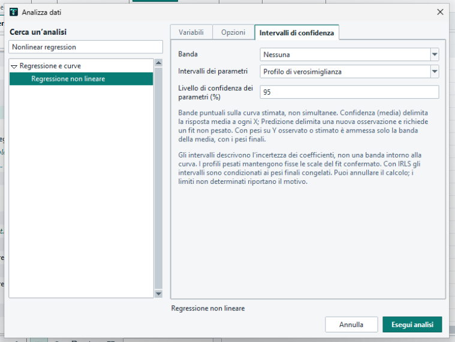
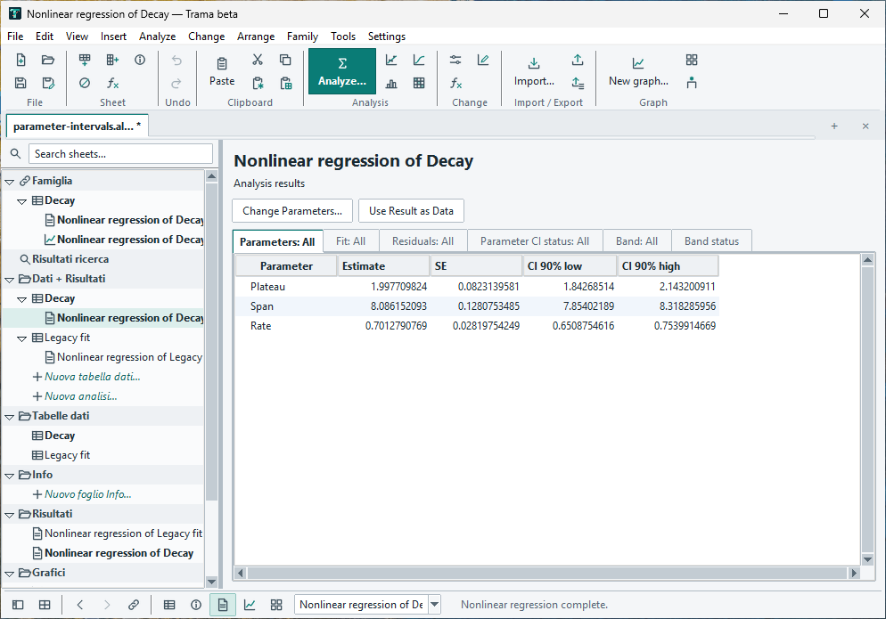

# Intervalli dei parametri nei fit non lineari

In **Analyze → Nonlinear regression → Confidence intervals**, scegli il metodo degli intervalli e il livello di confidenza dei parametri. Queste opzioni sono distinte dal livello delle bande intorno alla curva.

- **Symmetric (Wald)** usa la covarianza e i gradi di libertà del fit confermato. Il livello predefinito del 95% conserva i risultati delle ricette precedenti.
- **Profile likelihood** ristima gli altri coefficienti per ogni valore provato del parametro di interesse, mantenendo le scale residue del fit confermato. Può produrre limiti asimmetrici; non sostituisce le stime puntuali né modifica la curva stimata.

Per il profilo, Trama inverte il test extra-sum-of-squares con un parametro fissato: il limite soddisfa `SS_profile = SS_min × (1 + F(level; 1, df)/df)`, con `df = N − p`. Nei fit pesati, SS è la somma dei quadrati dei residui divisi per le scale confermate; i pesi non vengono ristimati durante il profilo. La somma dei quadrati e i gradi di libertà si riferiscono allo stesso fit indipendente. È un intervallo marginale per ciascun coefficiente, non una regione simultanea per tutti i coefficienti. L’inferenza non lineare è approssimata e presuppone errori, dopo l’eventuale divisione per le scale, indipendenti gaussiani con varianza comune.

## Risultati

Il foglio **Parameters** mantiene stima e SE e indica il livello nei nomi delle colonne dei limiti. Per il profilo e per livelli Wald diversi dal 95%, **Parameter CI status** aggiunge metodo, livello, gradi di libertà, stato e motivo di ciascun estremo.

- **Profile root**: un estremo numerico trovato dall'inversione del test.
- **Parameter bound**: l'insieme di confidenza raggiunge un vincolo del modello; quel valore non è una radice del test.
- **Unavailable**: il limite non è stato determinato, con motivo esplicito. Non viene sostituito con Wald né dichiarato infinito soltanto perché la ricerca non ha trovato una radice.

Cambiare i dati o escludere una cella ricalcola stime e intervalli. Metodo e livelli si salvano nel progetto `.alab` con valori canonici, indipendenti dalla lingua dell'interfaccia. Il calcolo del profilo avviene sul worker ed è annullabile: annullare una modifica conserva l'ultimo risultato completato.

## Limiti della beta

Sono supportati **Unweighted**, una colonna di SD relative positive, **1/abs(Y)**, **1/Y²**, **1/abs(Yfit)** e **1/Yfit²**. Le SD sono precisioni relative, non varianze assolute note. Cambiare la loro unità comune non cambia gli intervalli.

I pesi osservati restano quelli delle Y usate; con IRLS vengono conservate esattamente le scale dell’ultimo refit accettato. Non vengono ricostruite dal rapporto fra residui, che sarebbe indefinito dove un residuo è zero, né ricalcolate dalla curva per ciascun tentativo. Per i fit pesati il foglio degli stati aggiunge **Weighting** e **Inference**. **Final frozen weights** identifica l’inferenza condizionata ai pesi finali IRLS: l’incertezza dei pesi non viene propagata.

Con le SD inserite, un valore invalido in una riga completa dà errore sul campo SD column; con i pesi osservati, Y=0 dà errore sul campo Weighting. Le righe incomplete o escluse non entrano in questi controlli. I profili possono essere calcolati anche quando non è possibile una banda della curva: sono usi diversi delle SD.

Restano necessari gradi di libertà residui positivi, dispersione residua misurabile e incertezza finita e non nulla dei coefficienti. Le ricette con profili pesati richiedono la 0.75 o successiva per essere ricalcolate.

La ricerca segue la soluzione locale attorno al fit confermato; non enumera tutte le eventuali soluzioni disgiunte di un modello non identificabile. Se durante la ricerca si trova un fit sensibilmente migliore, l'intervallo viene segnalato come non disponibile: occorre prima affinare il fit puntuale.

Per mantenere il lavoro limitato, sono supportate fino a 5.000 osservazioni complete e 8 parametri per fit. Tutti i gruppi e tutte le risposte della stessa richiesta condividono un budget di 20.000 valutazioni residue e 10 milioni di valori, con 32 espansioni per lato. Il raggiungimento di un limite di lavoro è riportato negli stati.

Le prove indipendenti confrontano il caso lineare con gli intervalli t OLS, il tasso di decadimento con un profilo a coefficienti lineari eliminati analiticamente e il punto medio di un 4PL con minimi quadrati separabili. Coprono anche gruppi, risposte multiple, cambi di unità, vincoli, annullamento e mancata convergenza. Questi controlli non rendono esatto un intervallo approssimato in ogni problema scientifico.

[Funzionalità](features.md) · [Compatibilità](compatibility.md)
