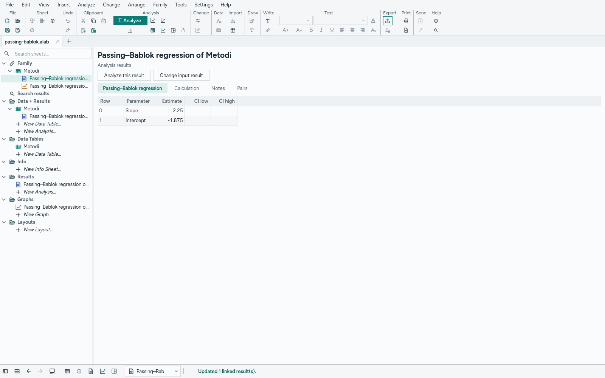
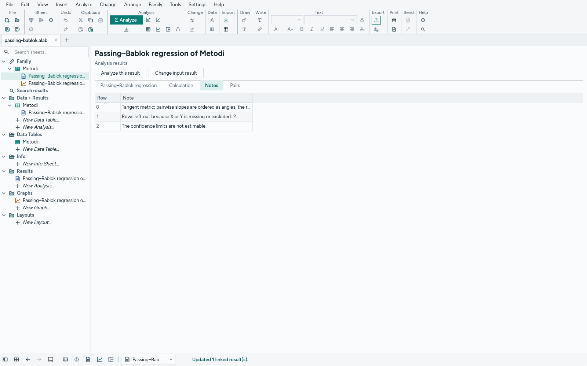
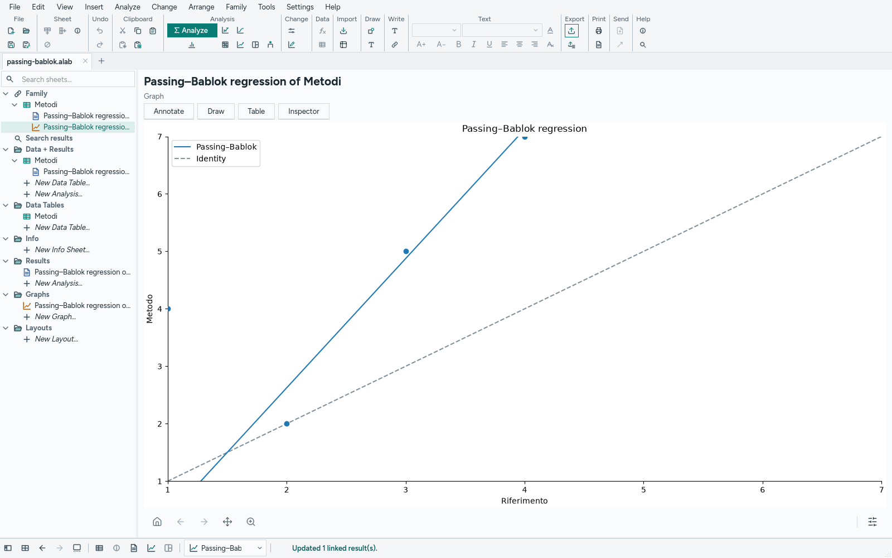
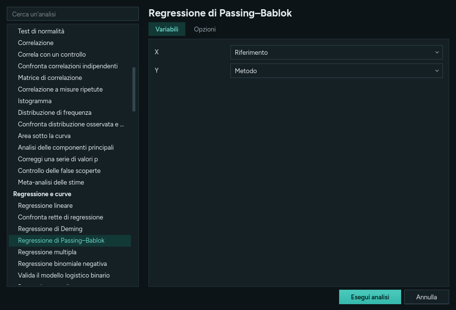
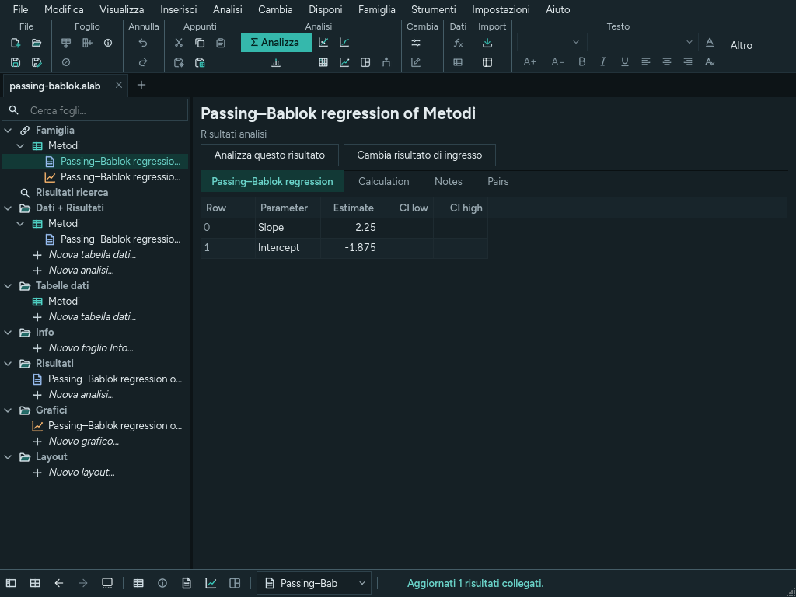
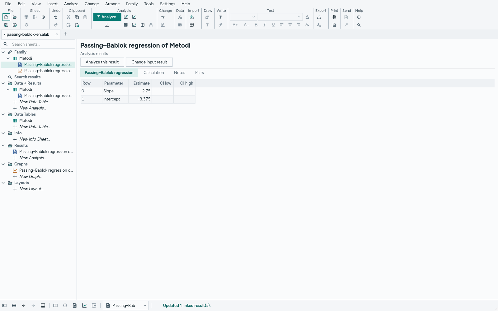
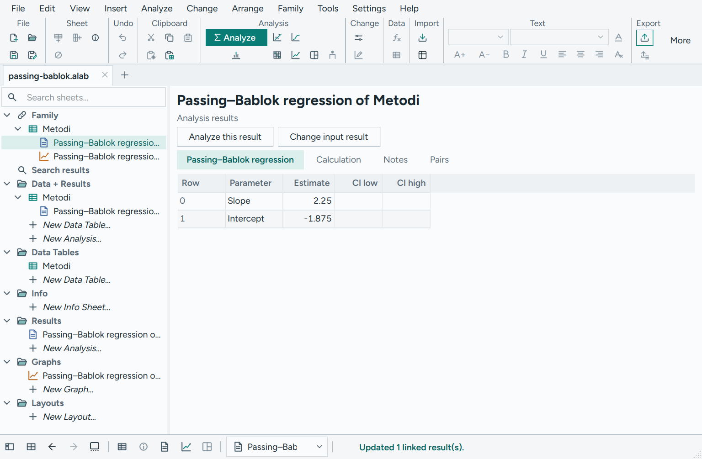

# Regressione di Passing–Bablok

In **Analizza → Regressione e curve → Regressione di Passing–Bablok** si scelgono la colonna di riferimento **X** e la colonna di confronto **Y**. Il metodo sta subito dopo la regressione di Deming. La finestra classica non lo elenca fra i comandi nuovi: un progetto già salvato con questo metodo lo mostra ancora, se è l’analisi corrente. La barra di Qt non cambia.

La ricetta tiene le chiavi inglesi `X`, `Y`, `Confidence level (%)` e `Identity line`. Il livello parte da 95 e la retta di identità è spenta. Scambiare le due colonne cambia la retta e resta scritto nel progetto.

## Il calcolo

La procedura è quella classica di Passing–Bablok con **metrica tangente**, la stessa di `mcreg` nel pacchetto R mcr 1.3.3.1 con `method.reg = "PaBa"`, `method.ci = "analytical"` e `slope.measure = "tangent"`.

Per ogni coppia di righe si calcola la pendenza. Due valori di X che differiscono meno di una parte su 10¹², in senso relativo, contano come X ripetuta: la pendenza è verticale e resta nel conteggio. Due punti identici non producono una pendenza. Una pendenza esattamente −1 resta nella graduatoria. Le pendenze si ordinano come angoli. Se la tau di Kendall è positiva o nulla, lo spostamento di rango è il numero di angoli ≤ −π/4 più il numero di angoli < −π/4. Se la tau è negativa, lo spostamento ha il segno opposto e conta gli angoli dalla parte di +π/4. Con un conteggio spostato pari, la pendenza è la media delle due pendenze centrali, non la tangente dell’angolo medio. L’intercetta è la mediana di Y − bX. L’estremo basso dell’intercetta usa la pendenza alta, e l’estremo alto usa la pendenza bassa.

L’ampiezza dell’intervallo è l’arrotondamento, metà lontano da zero, di `qnorm(1 − α/2) · √[n(n−1)(2n+5)/18]`, con α = 1 − livello/100. Se uno dei due estremi della pendenza non cade dentro le pendenze utilizzabili, il foglio lascia vuoti entrambi gli estremi, della pendenza e dell’intercetta, e le note dicono che i limiti non sono stimabili. Le stime restano.

Servono almeno tre coppie finite. Righe con X o Y mancante, o con una cella esclusa, non entrano nel fit: il loro numero è in `Calculation` e nelle note. Se X e Y non variano entrambe, i punti restano sul grafico e la nota dice che il fit non è definito.

mcr si ferma se un valore è negativo. La formula delle pendenze non lo richiede, quindi un valore negativo viene adattato e la nota nomina la differenza con mcr 1.3.3.1.

Prima di allocare le pendenze il calcolo rifiuta un campione che ne richiederebbe almeno 2 000 000. Duemila coppie ne chiedono 1 999 000 e passano; 2001 coppie si fermano sul campo X, senza costruire l’elenco. L’annullamento, prima di quella allocazione, non scrive un risultato.

## I fogli e il grafico

Le intestazioni restano in inglese.

`Passing–Bablok regression` ha due righe, Slope e Intercept, con stima, estremo basso e estremo alto. `Calculation` riporta le coppie valide, le righe lasciate fuori, le pendenze usate, quelle sotto −1, quelle uguali a −1, quelle fra −1 e 0, le pendenze verticali, le coppie identiche omesse, lo spostamento di rango, la tau di Kendall, il segno della correlazione, il livello, il nome dell’intervallo e la procedura. `Notes` ripete la procedura e aggiunge solo ciò che il campione ha davvero scartato o non ha potuto stimare. `Pairs` usa i nomi delle due colonne.

Il grafico disegna le coppie e la retta. Con `Identity line` accesa aggiunge la bisettrice tratteggiata. L’esportazione della figura è PNG, SVG e PDF, come per gli altri grafici di analisi.

## Esempio

[passing-bablok.alab](examples/passing-bablok.alab) ha la tabella **Metodi**. U1–U4 sono (1, 4), (2, 2), (3, 5), (4, 7). U5 ha X = 5 e Y vuota. U6 è (6, 20) con la Y esclusa. La ricetta usa X = Riferimento, Y = Metodo, livello 95 e la retta di identità. Le quattro coppie valide danno pendenza 2,25 e intercetta −1,875. I limiti, con quattro coppie, non sono stimabili. Le note contano due righe lasciate fuori.

Gli stessi due campioni, la retta perfetta y = 2x + 1 e questo spostamento di rango, sono in `tests/data/passing-bablok/casi.json`. Il controllo a frazioni è in `tests/test_passing_bablok.py` e non entra nel programma.

Il foglio, a 1600×1000, tema chiaro. Pendenza 2,25 e intercetta −1,875. I limiti, con quattro coppie, restano vuoti.

Le note contano le due righe lasciate fuori e dicono che i limiti non sono stimabili. La prima riga, la procedura, continua nella cella.

Il grafico ha le quattro coppie, la retta e la bisettrice.

In italiano il metodo sta subito dopo Deming. X è Riferimento e Y è Metodo.

A 1024×768, tema scuro, le stesse stime restano leggibili.

Dopo aver portato la Y di U1 da 4 a 8 il foglio ricalcolato ha pendenza 2,75 e intercetta −3,375.

La stessa finestra a scala 1,5 emulata (`QT_SCALE_FACTOR=1.5`, piattaforma xcb). L’area utile era 1280×689, quindi l’altezza richiesta 768 è stata disegnata a 670.

La verifica su questa macchina è in [validation-passing-bablok.md](validation-passing-bablok.md).
