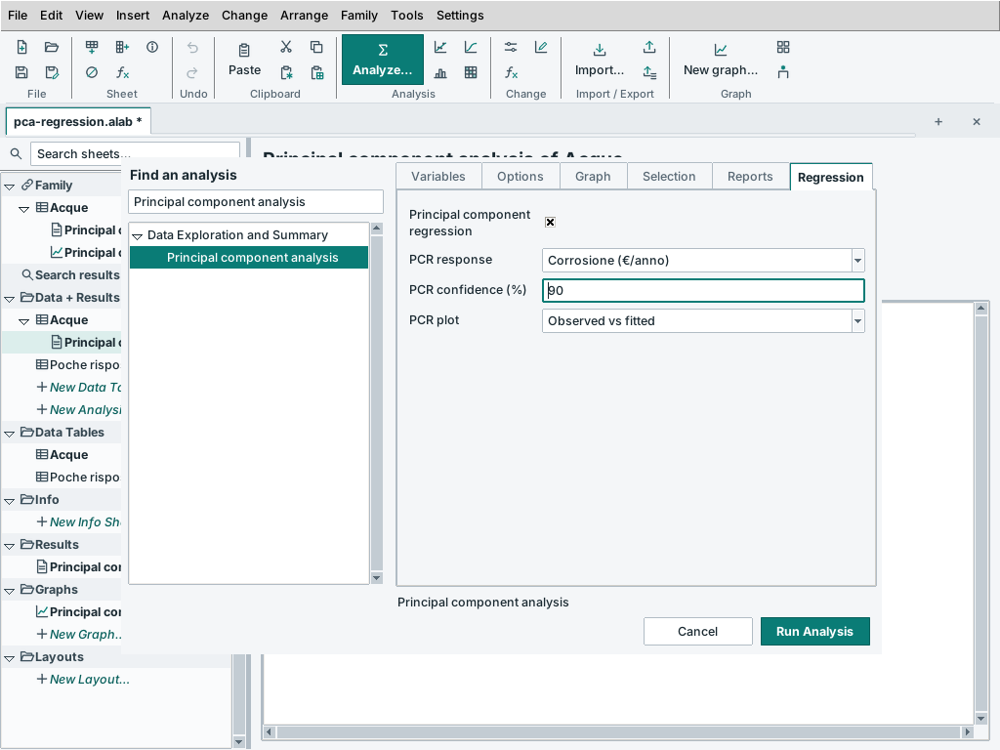
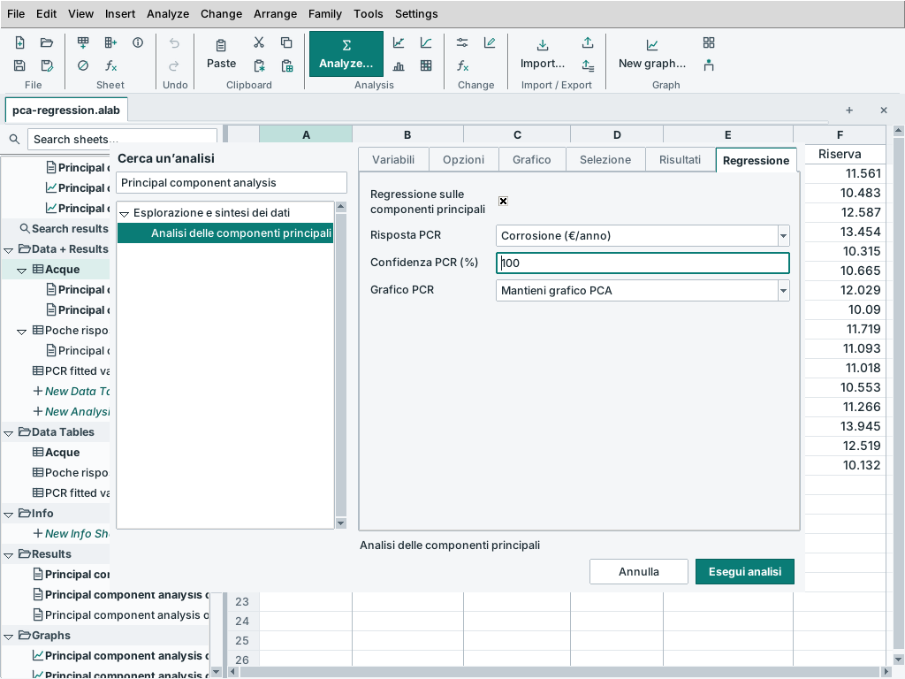
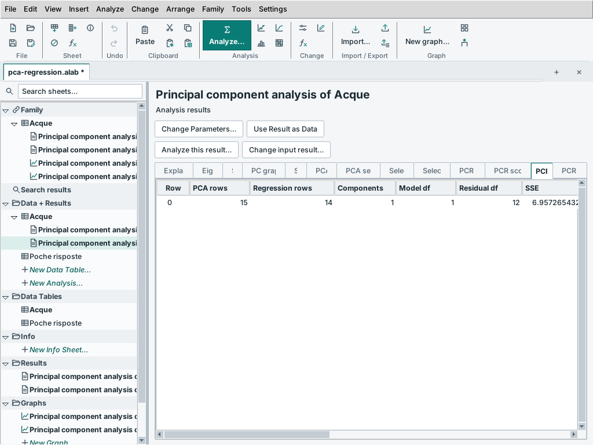
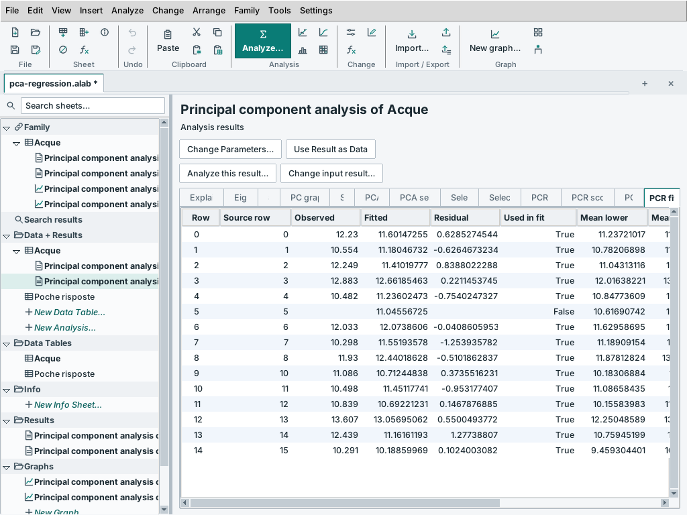
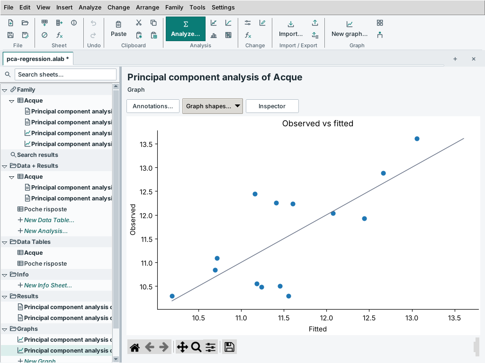
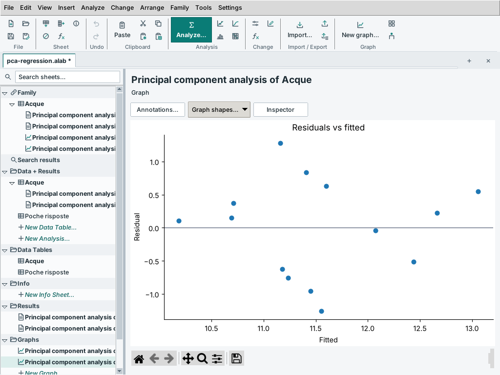
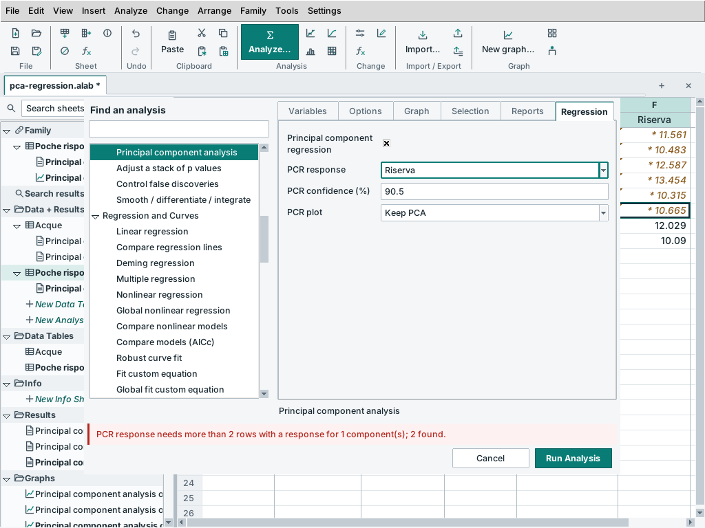

# Regressione sulle componenti principali (PCR)

In **Analyze → Principal component analysis**, scegli due o più colonne numeriche come predittori e apri la scheda **Regression** (in italiano **Regressione**). Con **Principal component regression** attivo l'analisi stima la PCA come sempre e, in più, regredisce una risposta numerica sulle componenti trattenute. Coefficienti, stime per riga, intervalli e grafici si leggono nelle unità delle colonne originali.



## Opzioni

Le chiavi della ricetta sono canoniche inglesi in entrambe le lingue; la lingua cambia solo etichette e messaggi.

| Chiave canonica | Italiano | Valore iniziale |
| --- | --- | --- |
| `Principal component regression` | Regressione sulle componenti principali | `false` |
| `PCR response` | Risposta PCR | vuoto |
| `PCR confidence (%)` | Confidenza PCR (%) | `95` |
| `PCR plot` | Grafico PCR | `Keep PCA` |

`PCR plot` vale `Keep PCA`, `Observed vs fitted` o `Residuals vs fitted` (in italiano *Mantieni grafico PCA*, *Osservati rispetto agli stimati*, *Residui rispetto agli stimati*; nella ricetta resta il valore inglese).

- **Con PCR spenta** (o senza le chiavi) il risultato è identico a quello della 0.87: stessi fogli, coordinate, legenda e titoli, anche con i report opzionali e i gruppi colorati. Le tre opzioni dipendenti restano visibili ma disabilitate, e un valore salvato non valido non blocca l'analisi.
- **La risposta** è una colonna numerica diversa dai predittori. Il nome resta letterale (spazi, valuta e caratteri Unicode compresi). Celle vuote o escluse sono ammesse; testo o infinito su una riga altrimenti utilizzabile danno un errore sul campo risposta.
- **La confidenza** accetta la virgola decimale e deve essere finita e strettamente fra 0 e 100.



Gli errori che il dialogo può già conoscere (risposta vuota, uguale a un predittore o assente, livello fuori dominio, selezione senza componenti) restano nel dialogo, con il messaggio che nomina il campo e il focus su di esso.

## Calcolo

1. **PCA.** Si stima una sola volta, con la procedura già pubblicata, su tutte le righe complete nei predittori, nell'ordine della tabella e con le maschere di esclusione. La risposta non entra nella PCA: una risposta mancante o esclusa lascia la riga nella PCA se i predittori sono completi.
2. **Componenti.** Valgono la selezione e l'ordine scelti nella scheda **Selection**. Con `All` si usano tutte le componenti di rango numerico positivo (stessa soglia relativa della PCA); con un altro criterio si seguono i flag *Retained* del foglio **PCA selection**. Zero componenti è un errore sul campo **Selection**.
3. **Regressione.** OLS con intercetta e *k* punteggi sulle righe con punteggi e risposta completi. Servono *n* > *k* + 1 e rango *k* + 1 su quel sottoinsieme; la decomposizione è una SVD della matrice di progetto con le colonne equilibrate, quindi le varianze sono somme di quadrati e non possono uscire negative per arrotondamento. Una violazione dà un errore sul campo **PCR response**. Nel sottocampione con risposta osservata i punteggi possono perdere l'ortogonalità: la covarianza usa il disegno effettivamente adattato.
4. **Unità originali.** Con medie dei predittori μ, scale campionarie *s* (1 per la PCA centrata), autovettori *V*ₖ e coefficienti sui punteggi *b*, si pone *B* = diag(1/*s*) *V*ₖ; le pendenze sono β = *B b* e l'intercetta *b*₀ − μᵀβ. La trasformazione ha prima riga [1, −μᵀ*B*] e blocco inferiore [0, *B*], e la covarianza si propaga come *J C Jᵀ*.
5. **Inferenza.** Intervalli e test usano la *t* con *n* − *k* − 1 gradi di libertà. L'inferenza è **condizionata alla proiezione stimata**: gli autovettori della PCA sono trattati come fissi.
6. **Stime per riga.** Per ogni riga con predittori completi, anche se la risposta è vuota, si calcolano stima e due intervalli **puntuali**: per la media della risposta (semilarghezza *t*·√*v*) e per una nuova osservazione (*t*·√(*v* + MSE)), con *v* = *z C zᵀ* e *z* = [1, score₁ … scoreₖ]. Non sono bande simultanee.

Identità e posizione delle righe sono tenute separate. **Source row** conserva l'indice della tabella anche se è testuale, ripetuto o non consecutivo; predittori, punteggi e risposta si associano per posizione nella maschera delle righe complete, senza join per indice che moltiplicherebbero le righe. Nessuna imputazione: le righe con almeno un predittore mancante restano fuori dai risultati per osservazione.

## Fogli aggiunti

Si accodano dopo gli output PCA esistenti, in inglese come gli altri report PCA. Colonne aggiuntive sono documentate qui.

| Foglio | Contenuto |
| --- | --- |
| `PCR coefficients` | `Term, Estimate, SE, Lower, Upper, t, p`: `Intercept` e i nomi delle variabili, nelle unità originali. |
| `PCR scores coefficients` | Gli stessi campi per `Intercept` e le etichette canoniche `PC1`, `PC2`, … selezionate. |
| `PCR model` | Una riga: `PCA rows, Regression rows, Components, Model df, Residual df, SSE, MSE, R squared, Adjusted R squared, F, p, Confidence (%)`, più `Note` (la nota qui sotto). |
| `PCR fitted values` | `Source row, Observed, Fitted, Residual, Used in fit, Mean lower, Mean upper, Prediction lower, Prediction upper`. |

> La PCA è stimata una sola volta, su ogni riga completa nei predittori, e la risposta non vi entra. La regressione usa i punteggi trattenuti sulle righe che hanno anche la risposta. L'inferenza è condizionata a quella proiezione. Gli intervalli per la media e per la previsione sono puntuali: descrivono una riga alla volta e non sono bande simultanee.

Le righe escluse dalla stima (risposta vuota o esclusa) hanno `Observed` e `Residual` vuoti e `Used in fit = False`, ma ricevono stima e intervalli.





## Grafici

- **Keep PCA** conserva la figura PCA con tutte le sue proprietà.
- **Observed vs fitted** mostra solo le righe usate nel fit: stimati su X, osservati su Y e retta di identità.
- **Residuals vs fitted** usa le stesse righe, con i residui (osservato − stimato) su Y e il riferimento a zero.

I grafici si aprono nelle viste normali di Trama e supportano Inspector, esportazione vettoriale e raster, salvataggio nel progetto e ricalcolo.





## Casi limite

- **Risposta costante** (SST = 0): `R squared`, `Adjusted R squared`, `F` e `p` globale restano vuoti.
- **Fit esatto** (SSE = 0): gli intervalli si riducono alla stima, gli errori standard sono zero, `t` e `p` dei coefficienti restano vuoti dove il rapporto non è definito. Con SST positivo, `F` è infinito e `p` è 0. La soglia di arrotondamento usa 64 volte l’epsilon macchina per la scala della risposta dopo aver sottratto il primo valore usato nel fit.
- **Rango**: la matrice di progetto è rifiutata quando il valore singolare minimo scalato scende sotto 16·max(*n*, *k* + 1) volte l'epsilon macchina. Nel caso *pcr-response-rank* il rango basta nella PCA e si perde solo sul sottoinsieme con risposta.
- **Dominio numerico**: dati che escono dal campo finito danno un errore esplicito sul campo risposta, non risultati non finiti.

## Errore noto solo dopo il calcolo

Gradi di libertà e rango dipendono dal sottoinsieme con risposta. Con l'analisi parallela, e quando una modifica dei dati rende la regressione non stimabile, l'errore arriva dal worker: l'app riapre il dialogo esistente di recupero sul campo **PCR response**, mantiene i parametri proposti e il risultato precedente (segnato come obsoleto) e permette di correggere. Con le altre selezioni lo stesso errore compare già nel dialogo, prima di accettare.



## File di progetto e compatibilità

Le opzioni PCR sono opt-in: un `.alab` della 0.87 si riapre con gli stessi fogli e la stessa figura, e non serve nessuna migrazione. Un progetto con PCR attiva salva le quattro chiavi canoniche sopra e, riaperto da un grafico, riproduce la stessa ricetta.

## Fuori dal pacchetto

Validazione incrociata, PLS, classi multiple, pesi, intervalli simultanei e import di ricette di altri formati.

## Prove Linux

Le immagini sono della finestra Tk reale sotto Xvfb con dati sintetici (`Acque`, 16 righe; `Poche risposte`, 8 righe). Non sono una sessione col puntatore nativo né una prova su Windows o con DPI di sistema reali.

```sh
python verify.py --repo . --json candidate.json   # oracolo indipendente, 24 casi
python -m unittest tests.test_pca_regression tests.test_pca_regression_dialog
TRAMASTAT_SMOKE_ONLY=pca-regression python tramastat.py --smoke /tmp/trama-pca-regression
```

Lo smoke mirato gira a 1024×768; la fase a 1600×1000 richiede uno schermo di almeno 1680×1050 e viene saltata su uno schermo più piccolo. Il tema Modern si prova con `{"theme": "modern"}` nelle preferenze isolate (`~/.config/tramastat/preferences.json`).
