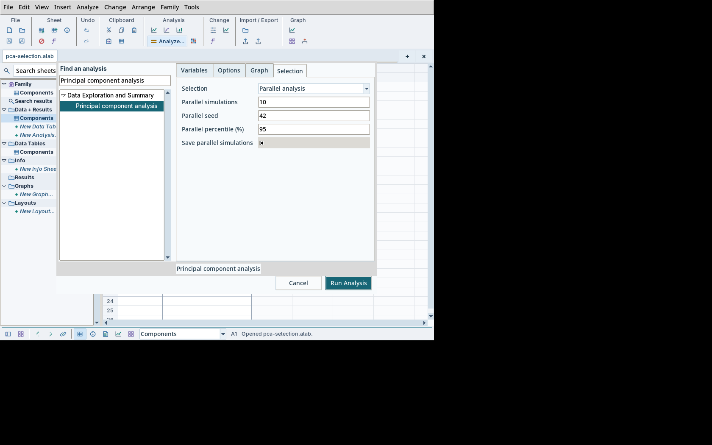
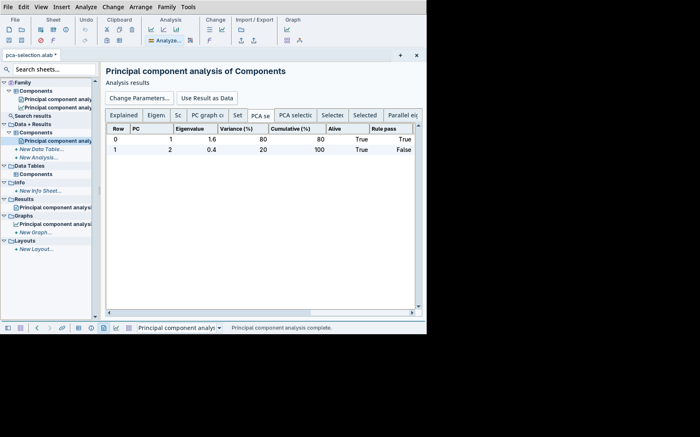
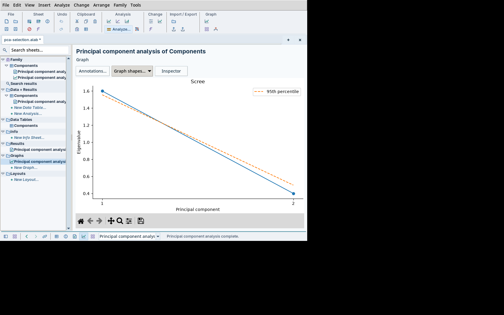
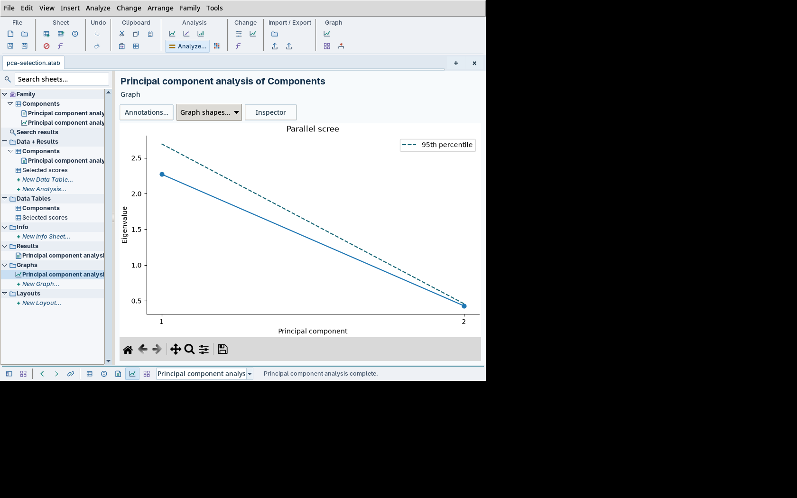
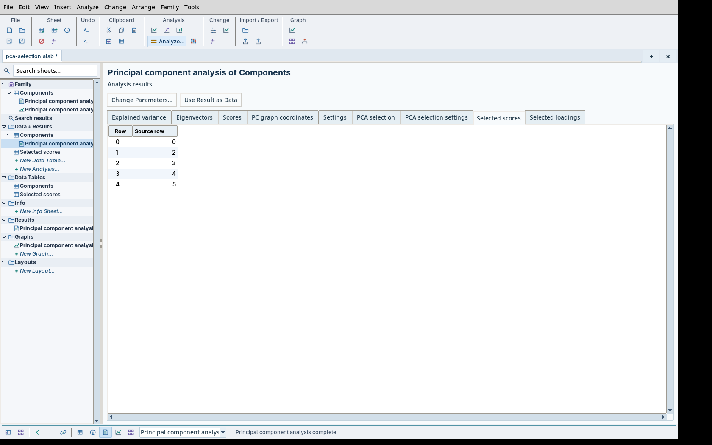

# Selezione delle componenti PCA

Nota del ramo `grok/pca-retention-070`. Non è una release: `analisi/_version.py` resta `0.70.0`. Pubblicazione, merge e portabile Windows restano al coordinatore.

Nel dialogo **Principal component analysis** la scheda **Selection** decide quali componenti trattenere. **Variables**, **Standardize** e le viste grafiche già presenti restano. Una ricetta senza le chiavi nuove produce gli stessi fogli **Explained variance**, **Eigenvectors** e **Scores**, e lo scatter PC1/PC2.

## Criteri

| Selection | Campo usato | Regola |
| --- | --- | --- |
| All | nessuno | Nessun foglio nuovo. I valori nascosti, anche invalidi, non bloccano l'analisi. |
| Fixed number | Retained components | Le prime k componenti vive, con 1 ≤ k ≤ rango. |
| Eigenvalue threshold | Eigenvalue threshold | Componenti vive con autovalore strettamente maggiore della soglia. Soglia 1 sui dati standardizzati è il criterio di Kaiser. |
| Cumulative variance | Cumulative variance (%) | Il prefisso più corto di componenti vive che raggiunge la percentuale. 100% trattiene il rango e non aggiunge una componente numericamente nulla. |
| Parallel analysis | Simulations, seed, percentile, save | Vedi sotto. |

Una componente è viva se il suo autovalore è strettamente sopra il massimo dello spettro per 1e-10. Il rango è il numero di componenti vive. I fogli storici e le coordinate del grafico restano completi: la selezione non li tronca e non impedisce di esplorare un'altra componente viva.

## Fogli aggiunti

Compaiono solo con un criterio attivo.

- **PCA selection**: una riga per componente, con Alive, Rule pass e Retained. Per l'analisi parallela include la media, il percentile usato per selezionare le componenti e i due limiti dell'intervallo di riferimento.
- **PCA selection settings**: criterio, conteggio, N, P, rango, standardize e i parametri della simulazione quando servono.
- **Selected scores**: Source row è l'indice reale, senza rinumerare dopo mancanti o esclusioni. Zero componenti lasciano solo questa colonna.
- **Selected loadings**: le stesse coordinate della vista loadings, cioè V√λ, con le componenti morte a zero.
- **Parallel eigenvalues**: solo se Save parallel simulations è attivo. Simulation parte da 1, poi PC1…PCm, una riga per replicato nell'ordine di estrazione.

Source row e Variable permettono **Use Result as Data** anche con zero componenti.

## Analisi parallela

È una convenzione di Trama, non la riproduzione del generatore di un altro programma. I replicati escono in ordine da `Generator(PCG64(seed)).standard_normal((N, P))`. Ogni matrice è centrata. Se Standardize è attivo, ogni colonna è divisa per la deviazione standard campionaria del replicato; altrimenti è moltiplicata per la deviazione standard osservata.

La componente viva passa se l'autovalore osservato è strettamente maggiore del percentile scelto. **Rule pass** registra ogni confronto. **Retained** include le componenti fino al primo fallimento. Lo scree mostra la media e la fascia fra i percentili simmetrici `p` e `100 − p`, insieme alla soglia usata per la selezione. La soglia mantiene il gid `trama-pca-parallel-reference` e la serie osservata mantiene la chiave di stile `line:1:`.

I progetti importati con PCA standardizzata al 95° percentile possono conservare la media e i limiti salvati se coincidono misure, autovalori e impostazioni. Il foglio **PCA selection settings** indica quando usa quel riferimento. Modificando i dati o le impostazioni di calcolo, oppure richiedendo l'esportazione dei singoli replicati, Trama simula il riferimento con il seme della ricetta.

La simulazione gira sul worker corrente, dopo il controllo dei campi. Il dialogo rifiuta un input invalido prima di allocare i replicati e tiene il focus sul campo. Per la sola analisi parallela valgono P ≤ 64 e N×P×B ≤ 2.000.000 valori simulati. B è un intero da 10 a 10.000, il seme un intero da 0 a 2^32−1, il percentile un numero finito strettamente fra 0 e 100. Il seme si salva nella ricetta; le matrici simulate e lo stato del generatore no.

## Lingua

Le etichette e le scelte visibili sono in inglese o in italiano (`pca.select.*`). In ricetta chiavi e valori restano canonici, per esempio `Selection = Parallel analysis`. I nomi di colonne e di serie restano in inglese.

## Prove Linux

Gli screenshot in `docs/media/pca-selection-070/` sono della finestra Tk reale sotto Xvfb, distinti dall'export della sola figura (`pca-selection.png`, `.svg`, `.pdf`) e dal CSV dei punteggi. Windows non è stato eseguito.

```sh
TRAMASTAT_SMOKE_ONLY=pca-selection python tramastat.py --smoke /tmp/trama-pca-selection
```












