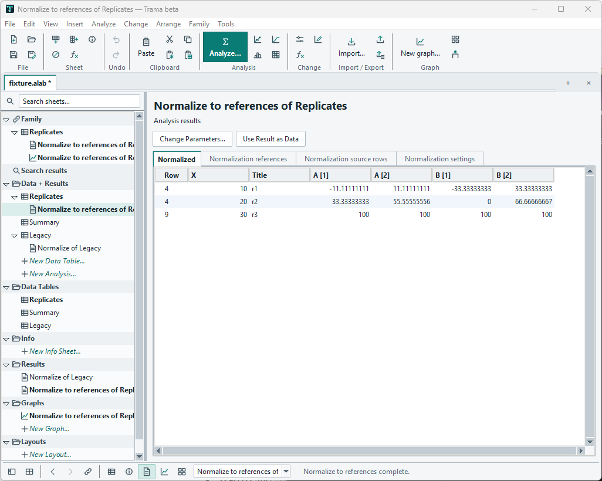
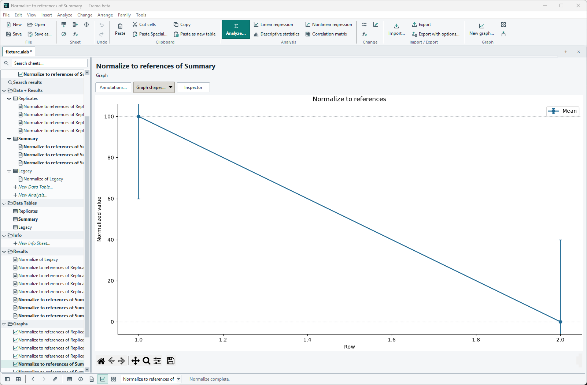

# Normalize to references

**Data Processing → Normalize to references** rescales each series between a zero reference and a one reference. It is a separate analysis from **Normalize**. The older command still calls `operations.normalize`, still writes one sheet named Normalized, and still keeps its recipes.

The source table is not overwritten. Editing or excluding a source cell recalculates the result. A failed recalculation of this analysis keeps the last result that succeeded and reports the error in the status bar.

## Formula

For each finite observation *y*, with zero reference *a*, one reference *b* and scale *M*:

`normalized = M * (y - a) / (b - a)`

*M* is 1 for Fractions and 100 for Percentages. Values are not clipped to 0 or *M*, so a point below *a* is negative and a point above *b* is above *M*. Sum is the sum of the reference values, not the sum of *(y − a)*. The normalized values are not expected to add up to *M* unless *a* is 0.

*a = b* is an error on **One reference**. *b < a* is an error unless **Allow reversed references** is on. With that option the same formula keeps the negative scale. The two references are not swapped, and the absolute range is not used.

Constants and row numbers accept a decimal comma in Italian. The row selector does not: its comma separates rows. The grammar is 1-based, for example `1,3-5,8`. Spaces are ignored, duplicates are removed, and empty items, zero, fractions, descending ranges, rows outside the table and lists longer than 100000 rows are rejected. Provenance in the result sheets stays 0-based.

## What the references use

| Reference | Meaning |
|---|---|
| Minimum, Maximum | Extreme finite values. Tied positions all count. |
| First-last lower, First-last higher | The lower or higher of the first and last finite values, in physical row order, not in X order. |
| Sum, Mean | The sum or the mean of every finite value in the reference vector. |
| Constant | One finite number for every series. It has no contributor rows. |
| Selected rows mean | The mean of the finite values in the selected rows. |

Missing cells are not text and are not infinite values. Text or an infinite value in a column that is used is an error. An aggregate that cannot be represented, or a normalized value that is not finite, is an error. There is no absolute tolerance that rejects a small gap between *a* and *b*.

**Blank reference values** hides the normalized cells, and the matching errors and N, on the rows that defined *a* or *b* for that series. It does not delete rows. X and row titles stay. Blank together with Sum or Mean would hide every value that defined the reference, so that combination is refused.

## Replicates and summaries

**Independent columns** gives each selected column its own *a* and *b*.

**Normalize row means** groups columns with the worksheet roles, or with the existing `A [1]`, `A [2]` titles when the sheet has no roles. Each row contributes the mean of the replicates that are present. Those row means define *a* and *b*, and the result has one column per series. A row with no replicate present stays missing.

**Each replicate, common references** uses those same row means for *a* and *b*, then applies them to every replicate. The output keeps the original column names.

At most 24 series are accepted, and the global table limit of 2,000,000 cells is checked before a large result is built.

**Summary values** ignores Variables and Replicates. It normalizes one Mean column. SD and SEM must be zero or greater and are multiplied by the absolute scale `|M / (b - a)|`. They are not rebuilt from N. Distances must be zero or greater. Limits must satisfy lower ≤ mean ≤ upper on the original values, then each limit is transformed. When the scale is negative, the two sides are exchanged so the lower output stays the lower one. N, when present, must be a whole number of at least 1 and is copied, not used to invent a standard error. A missing error can stay missing. An error without a mean does not create a mean.

The graph, when requested, plots the normalized series against X when X is numeric, otherwise against the physical positions 1..n. Summary graphs draw the selected error bars. Dotted guides mark 0 and *M*. They are drawing only.

## Result sheets

1. **Normalized** — X and row titles when selected, then the normalized columns. Summary output is Mean, the error columns that were requested, and N.
2. **Normalization references** — one row per series: the two references, the scale factor, the contributor counts and the 0-based source rows. A constant leaves the row list empty and the count at 0. A scale factor that is not representable is left blank and noted in Settings.
3. **Normalization source rows** — Source row (0-based position) and Source index (the index value, including duplicates).
4. **Normalization settings** — the active options and this note: zero and one references are fixed observed values, and their uncertainty is not propagated.

The project file stores the cells, not the pandas index. A duplicate index is visible in Normalization source rows until the project is saved and opened again. After reopening, the index is a new range and Source index becomes 0, 1, 2, ….

## Example

The screenshot is a real window at 1024×768. The series are synthetic. Row means of A are 1, 5 and 10, so the zero reference is 1 and the one reference is 10. Percentages then put the replicates at −100/9, 100/3 and 100 for A [1], and at 100/9, 500/9 and 100 for A [2]. B uses 20 and 50.

A summary with limits uses the same window. Means 10 and 20, limits 8–14 and 16–22, zero reference 20 and one reference 10, with reversed references allowed. The means become 100 and 0. Because the scale is negative, the first interval is drawn from 60 to 120 and the second from −20 to 40.

