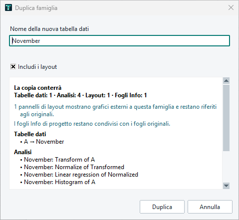
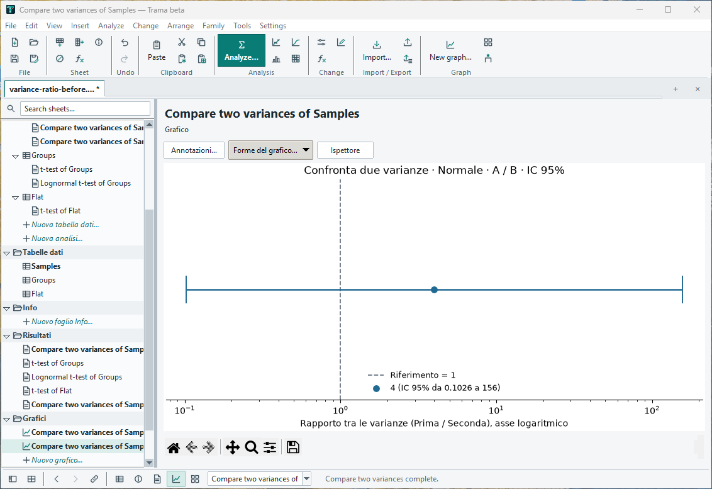

# Trama 0.81.0 beta

## Famiglie di esperimenti

Duplica dati, analisi collegate, grafici, layout e Info pertinenti come una famiglia indipendente. L’anteprima mostra cosa viene copiato e quali pannelli restano condivisi. Puoi salvare la famiglia in un progetto autonomo e dare alle analisi nomi persistenti. Copia e salvataggio lavorano in background e supportano Annulla.

[Guida alle famiglie](experiment-families.md).

## Confronto delle varianze

Il nuovo confronto di due campioni indipendenti riporta rapporti delle varianze e delle deviazioni standard, test F bilaterale e intervalli esatti. La figura facoltativa mantiene l’orientamento dei campioni. Il confronto è disponibile anche come diagnostica nei test t non appaiati normale e lognormale: resta disattivato di default e non sceglie automaticamente il test delle medie. Le assunzioni del metodo sono esplicite nella [guida](variance-ratio-079.md).

La revisione corregge due casi numerici: valori finiti di grandezza estrema e livelli di confidenza immediatamente sotto il 100%.

Trama resta in beta. Consulta le [verifiche e i limiti](validation-081.md) prima dell’uso.
