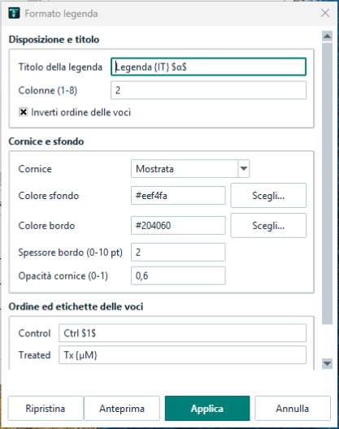
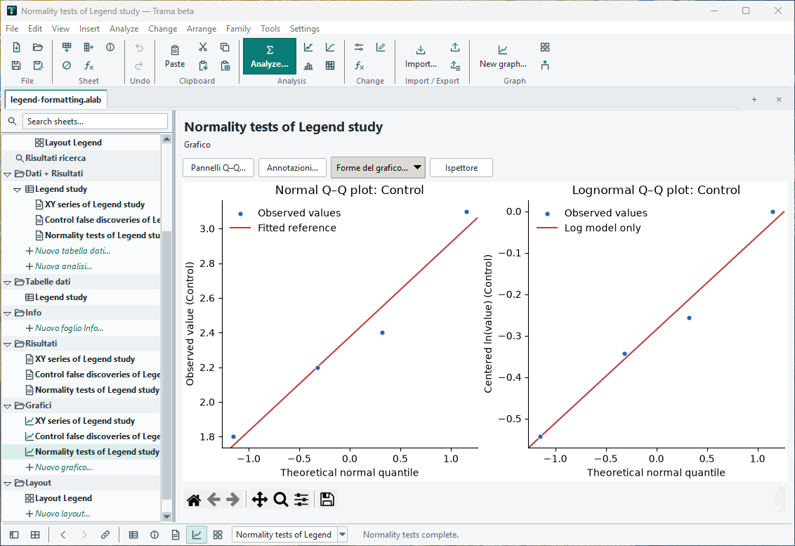

# Trama 0.82.0 beta

Personalizza le legende dei grafici nativi da **Formatta grafico** o dall’**Inspector**. Puoi modificare titolo e testo delle singole voci, invertire l’ordine, impostare fino a otto colonne e scegliere cornice, sfondo, bordo e opacità.

L’anteprima mostra la modifica sul grafico. Puoi annullarla o salvare lo stile nel progetto. La legenda si aggiorna con il grafico e mantiene le personalizzazioni nei layout e negli export. Nei grafici Q–Q affiancati puoi rinominare le voci dei due pannelli separatamente.

[Guida alle legende](graph-legends.md) · [Verifiche e limiti](validation-082.md)
