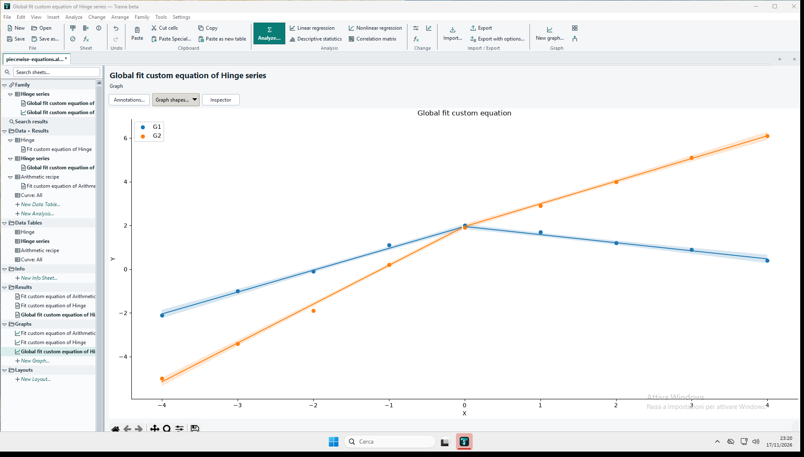
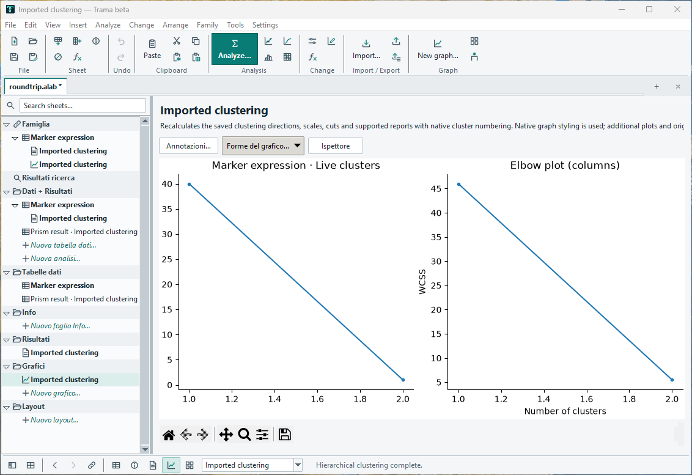

# Trama 0.83.0 beta

## Equazioni condizionali

Nei fit personalizzati, anche globali, puoi scegliere una formula con condizioni e soglie fissate. Linee e bande si interrompono fra punti campionati che appartengono a rami diversi. Apri la [guida alle equazioni](conditional-equations-081.md) per la sintassi e gli esempi.

## Clustering gerarchico

Apri la mappa delle fusioni e confronta la somma dei quadrati entro i gruppi, WCSS, ai diversi tagli dell'albero. Il grafico del gomito usa lo stesso albero dell'analisi. Le impostazioni riconosciute si ripristinano nei [progetti compatibili](hierarchical-import.md).

[Verifiche e limiti del collaudo](validation-083.md).
