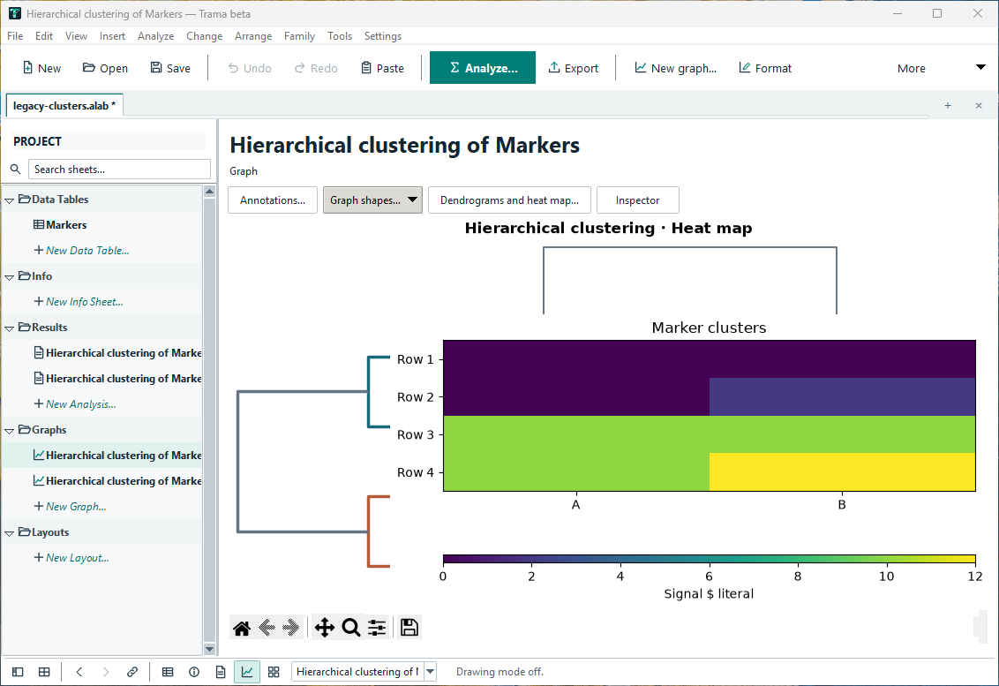
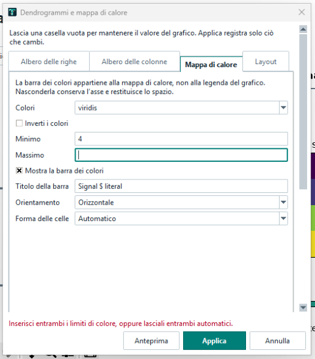

# Trama 0.84.0 beta

## Formato gerarchico

Apri l’editor dal grafico, dall’Inspector o da **Format Graph**. Puoi cambiare colori e spessori dei rami, etichette, assi delle distanze, proporzioni, palette e barra dei colori. L’anteprima agisce sulla figura già calcolata. [Guida all’editor](hierarchical-style-081.md).

## Importazioni compatibili

Nei progetti compatibili, Trama può recuperare la presentazione salvata della mappa gerarchica quando il grafico è collegato al foglio dell’analisi. Sono supportate alcune impostazioni per rami, assi delle distanze e barra dei colori. L’importazione dell’ANOVA multifattoriale ordinaria riconosce la richiesta delle dimensioni dell’effetto quando il rapporto salvato è completo e il livello di significatività è coerente. [Compatibilità](compatibility.md) · [Importazione del clustering](hierarchical-import.md).

[Verifiche del portabile](validation-084.md).
