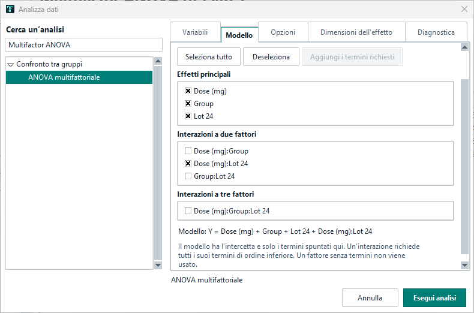
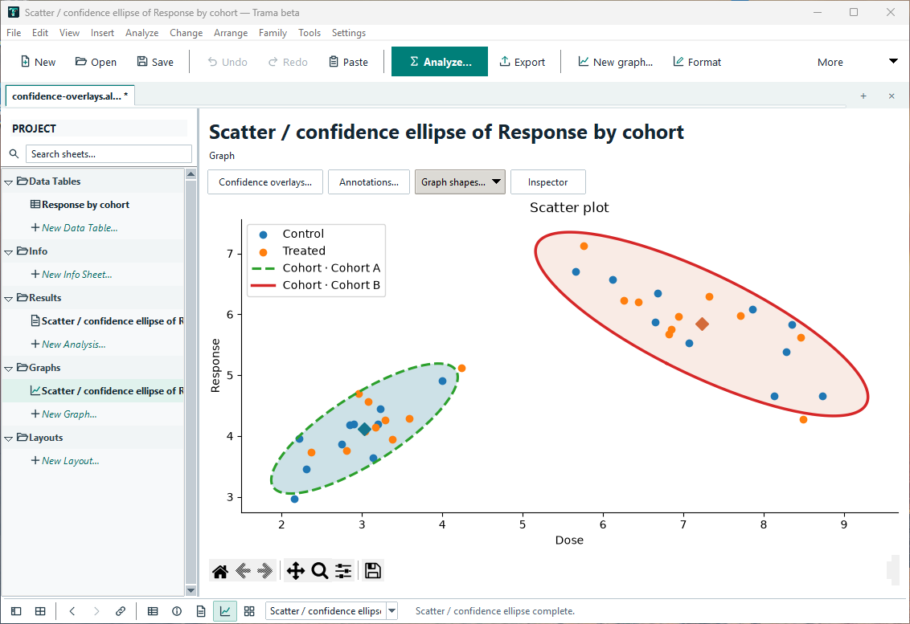

# Trama 0.85.0 beta

## Scegli i termini dell’ANOVA multifattoriale

Apri la scheda **Modello**. Puoi partire dalla gerarchia completa e scegliere gli effetti principali e le interazioni da mantenere. Il foglio **Model terms** elenca i termini attivi e i gradi di libertà. Le analisi possono usare fino a otto fattori e interazioni fino al terzo ordine. [Guida](anova-terms-083.md).

## Personalizza le ellissi per gruppo

Nella scheda **Riempimento e bordo**, scegli gli stili per gruppo. Puoi regolare colori, opacità, spessore e tratteggio. Il progetto conserva le impostazioni quando riapri il grafico. Il calcolo delle ellissi gestisce meglio le differenze di scala fra gli assi. [Guida](confidence-ellipses.md).

[Verifiche del portabile](validation-085.md).
