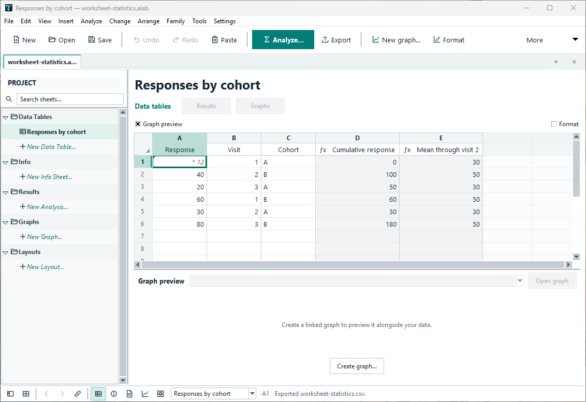
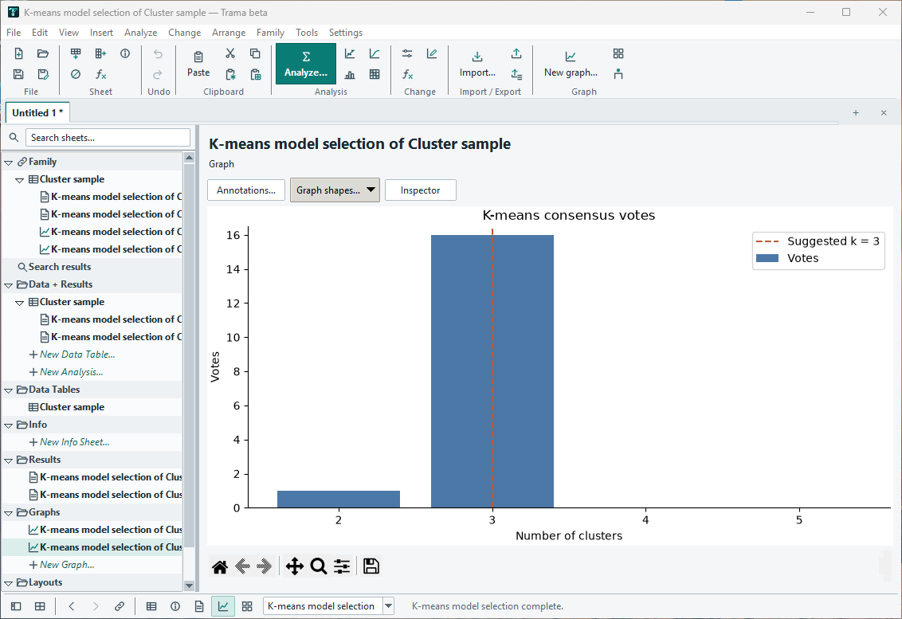

# Trama 0.86.0 beta

## Statistiche nel foglio

Usa **Formula di colonna** per calcolare medie, somme e altre statistiche per gruppo, con condizioni facoltative sulle righe. Definisci l’ordine di calcolo per ottenere medie mobili e totali cumulati. La formula resta modificabile nel progetto e si aggiorna quando cambiano i dati. [Guida con esempi](formula-windows.md).

## Consenso K-means

Il dialogo del consenso offre anche il rapporto fra due cali consecutivi della somma dei quadrati entro i cluster. La scelta standard con correzione dimensionale resta disponibile. Le due varianti occupano il medesimo posto fra i 17 indici del consenso.

[Verifiche del portabile](validation-086.md).
