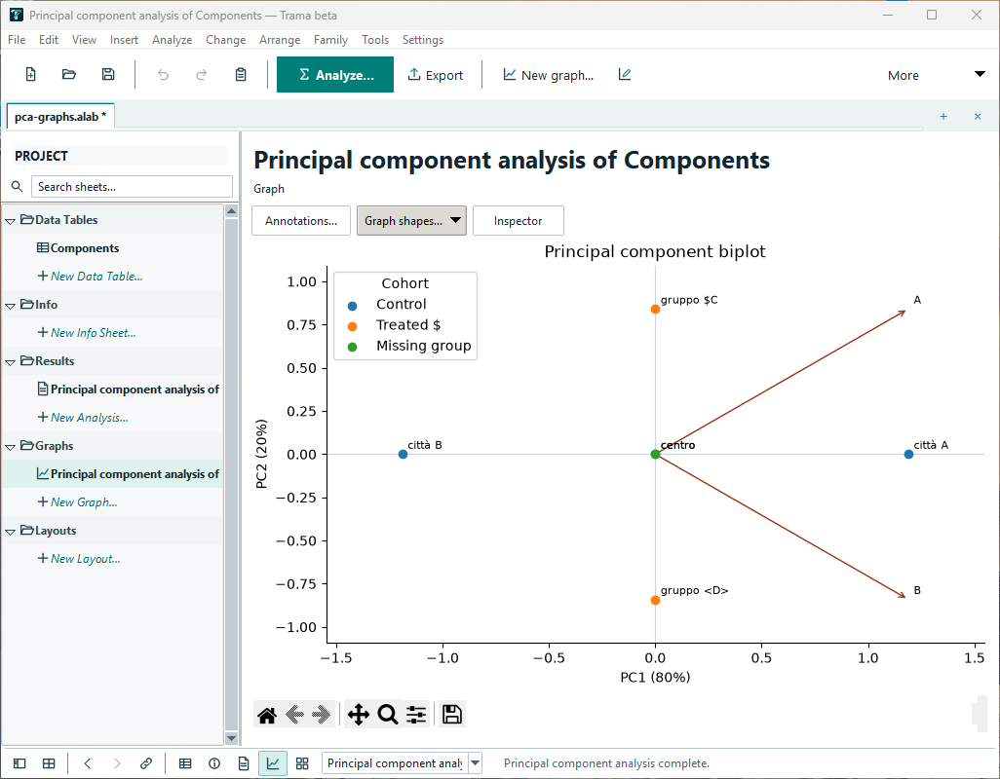
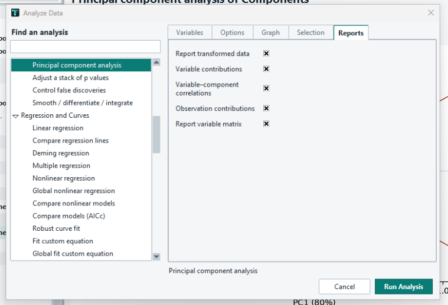

# Trama 0.87.0 beta

## Colori per gruppo nei grafici PCA

Scegli una colonna di raggruppamento per distinguere fino a 40 categorie nei grafici dei punteggi e nel biplot. La legenda identifica i gruppi, mentre le coordinate restano quelle calcolate dalla PCA.

## Cinque report facoltativi

La scheda Risultati aggiunge i dati trasformati, i contributi di variabili e osservazioni, le correlazioni variabili–componenti e la matrice delle variabili. Puoi scegliere quali report salvare nella ricetta. [Guida ai grafici e ai report](pca-reports.md).

[Verifiche del portabile](validation-087.md).
