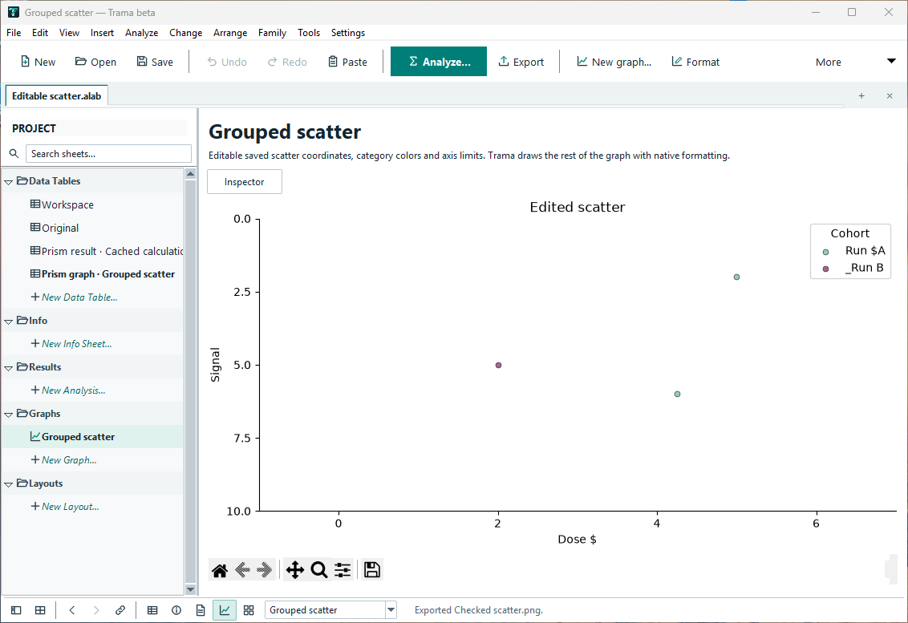

# Trama 0.88.0 beta

## Grafici a dispersione modificabili dopo l’importazione

I grafici compatibili si aprono con una tabella di coordinate modificabile. Colori e opacità per categoria, dimensioni e bordi dei simboli, titoli degli assi, limiti e tacche lineari vengono letti dal progetto. Dopo una modifica delle coordinate, il grafico si aggiorna. I controlli di Trama permettono di regolare il titolo e di esportare in PNG e SVG.

La compatibilità di questa versione copre i grafici a punti con una coppia XY, categorie, simboli circolari e assi lineari. Le viste con livelli aggiuntivi possono richiedere un altro percorso di importazione. [Compatibilità](compatibility.md).

[Verifiche del portabile](validation-088.md).
