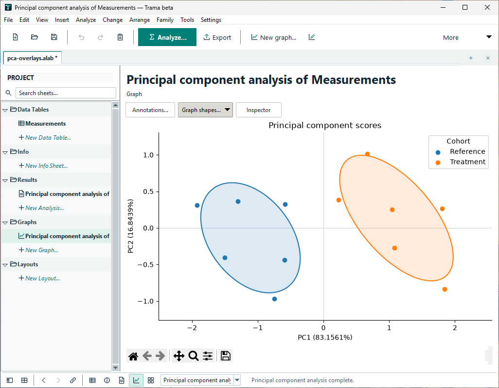

# Trama 0.89.0 beta

Nei grafici PCA dei punteggi e nel biplot puoi aggiungere una regione di confidenza della media, un’ellisse dei dati o un inviluppo convesso. Applica il contorno a tutti i punti oppure a ciascuna categoria. Il foglio Confidence overlays riporta la numerosità, il centro e lo stato di ciascun gruppo. I report selezionati rimangono disponibili anche in Scree e Proporzione di varianza.

[Guida ai grafici e ai report PCA](pca-reports.md) · [Verifiche del portabile](validation-089.md).
