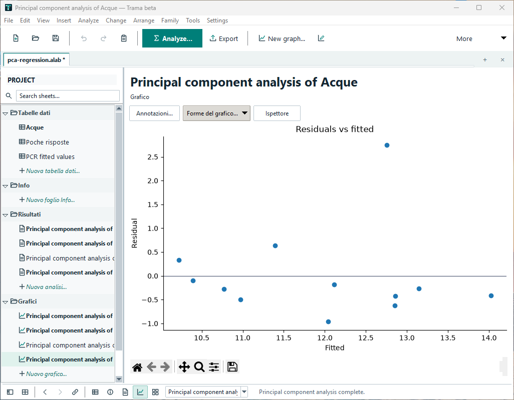

# Trama 0.90.0 beta

Con la **regressione sulle componenti principali** scegli una risposta e adatti la regressione ai punteggi delle componenti trattenute. Trama riporta i coefficienti sia per componente sia per variabile originale, il riepilogo del modello e gli intervalli puntuali per media e previsione. Puoi aprire il grafico osservati contro stimati o dei residui. La selezione parallela accetta fino a sei milioni di valori simulati.

[Guida alla regressione sulle componenti principali](pca-regression-087.md) · [Verifiche del portabile](validation-090.md).
