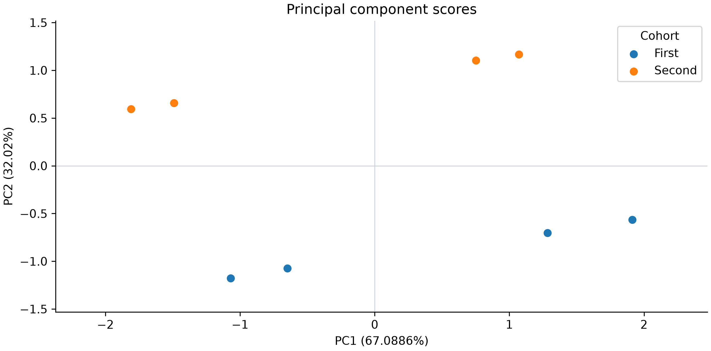

# Trama 0.91.0 beta

Apri un progetto ZIP compatibile con una PCA standardizzata salvata. Quando la ricetta è supportata, Trama ricostruisce l'analisi e ripristina parametri e seme dell'analisi parallela, report e gruppi di colore del grafico dei punteggi. L'input può essere un foglio multivariabile proveniente da un risultato archiviato. Modifica i dati, ricalcola e conserva il progetto in formato .alab.

Trama usa il proprio motore, generatore casuale e stile dei grafici. Le tabelle salvate e i quantili originali dell'analisi parallela restano consultabili dove disponibili.

[Compatibilità dei progetti](compatibility.md) · [Verifiche del portabile](validation-091.md).
