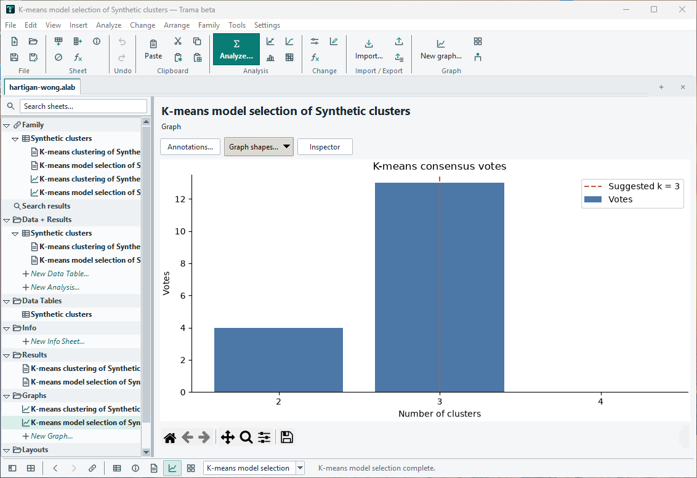

# Trama 0.92.0 beta

Scegli **Hartigan–Wong** nel raggruppamento k-means e nella selezione del numero di gruppi. Puoi impostare il limite di iterazioni, usare un seme ripetibile e, per un singolo fit, indicare le righe da usare come centri iniziali. Nella ricerca di k, lo stesso algoritmo si applica anche ai campioni Gap.

Le ricette compatibili recuperano algoritmo, intervallo di k, seme e limite dal progetto importato. Trama genera le proprie partenze e i campioni Gap. Le partizioni archiviate sono consultabili dove disponibili.

[Algoritmi K-means](kmeans-algorithms.md) · [Verifiche del portabile](validation-092.md).
