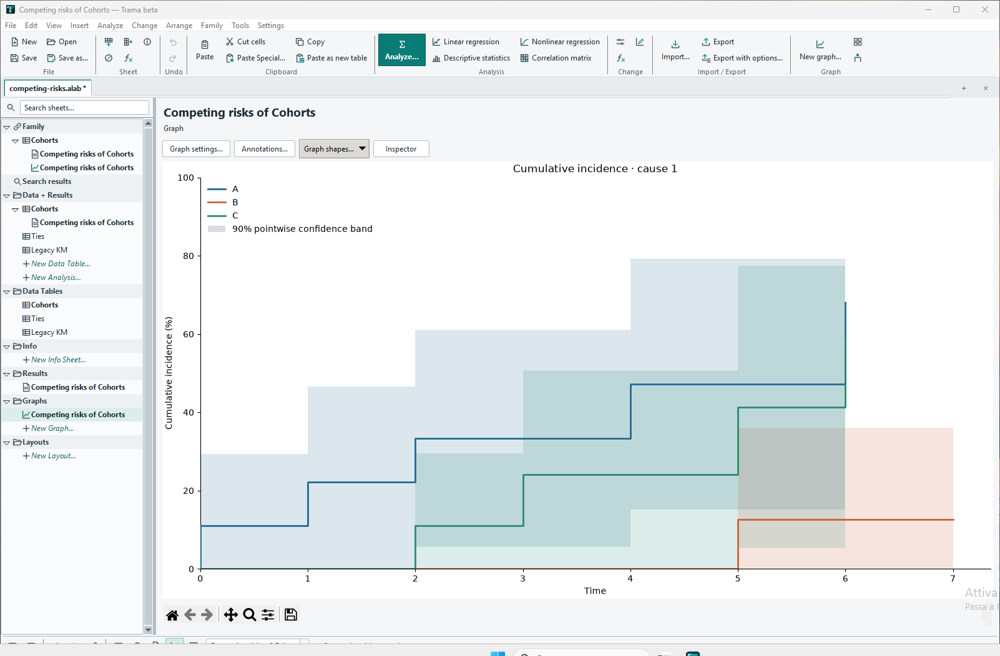
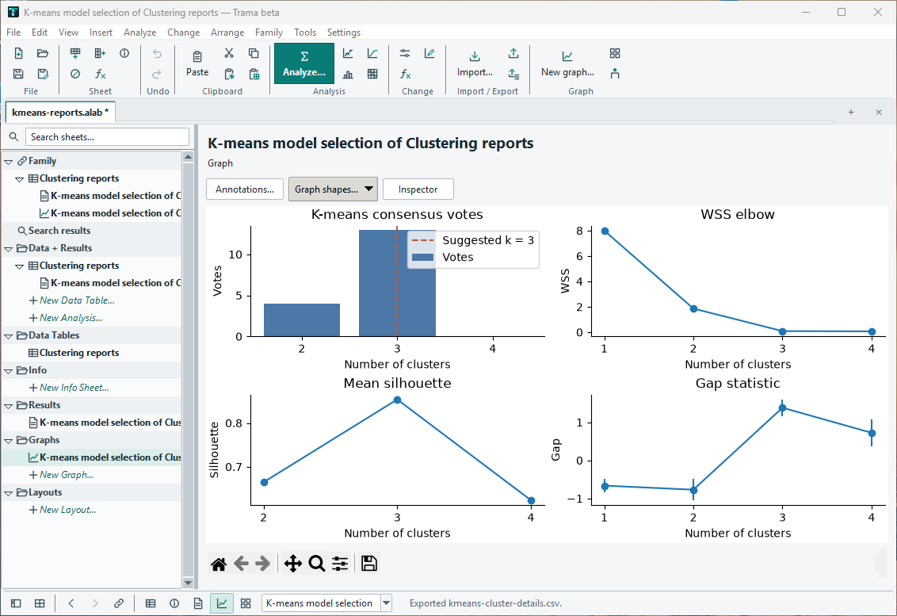

# Trama 0.93.0 beta

- **Rischi competitivi.** Stima l’incidenza cumulativa di Aalen–Johansen per causa, visualizza gli intervalli puntuali e confronta i gruppi con il test di Gray.
- **Report K-means.** Consulta assegnazioni, centri e metriche per ciascun k valutato e affianca WSS, Silhouette e Gap nella stessa figura.
- **PCA collegata.** Nei progetti compatibili, una PCA sulle assegnazioni K-means si ricalcola a partire dalla tabella dei risultati dopo una modifica. Le tabelle storiche importate restano consultabili.

[Guida ai rischi competitivi](competing-risks.md) · [Algoritmi K-means](kmeans-algorithms.md) · [Verifiche del portabile](validation-093.md).
