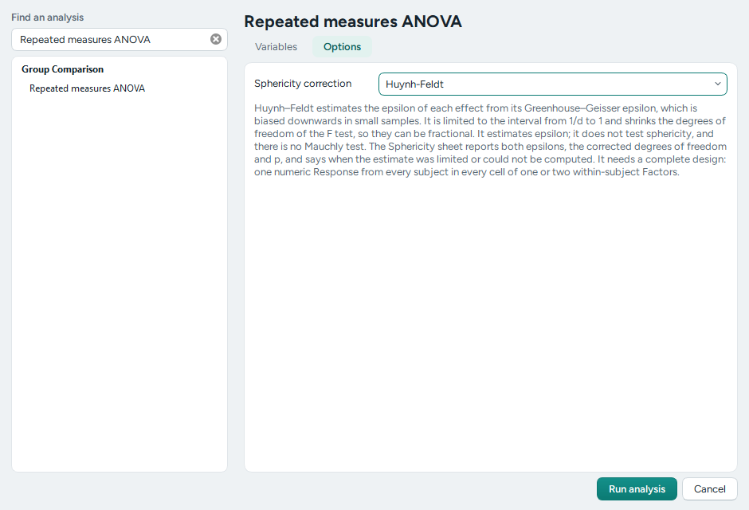
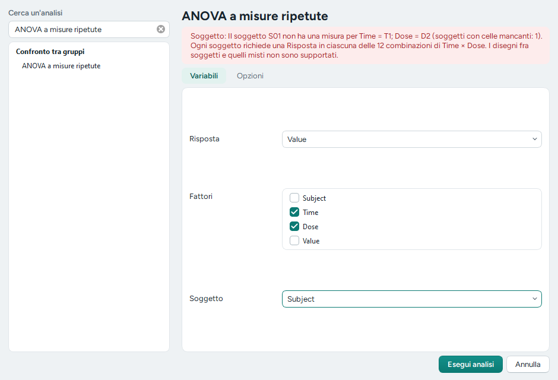

# Repeated measures ANOVA with sphericity corrections for one or two factors — Greenhouse–Geisser (0.93), Huynh–Feldt and lower bound (0.97)

Choose **Group Comparison → Repeated measures ANOVA** and open the **Options** tab. The canonical option `Sphericity correction` corrects one *or two* within-subject Factors. Since 0.93 it offers Greenhouse–Geisser; the **Huynh–Feldt** and **Lower bound** corrections are added on top of it and are the subject of the second half of this page.

| Option | Values | Default |
| --- | --- | --- |
| `Sphericity correction` | `None`, `Geisser–Greenhouse`, `Huynh-Feldt`, `Lower bound` | `None` |

`None` is the behaviour of every earlier version. A saved recipe from before this change gives the same sheet, to the last digit. The spelling `Geisser–Greenhouse (one-way)` of the earlier one-factor choice stays readable in a saved recipe and keeps its own numbers and its own error messages. The dialog offers it, labelled *saved recipe*, only when the recipe being edited already uses it. A new recipe uses `Geisser–Greenhouse`.

```json
{"Response": "Response", "Factors": ["Visit", "Condition"], "Subject": "Participant",
 "Sphericity correction": "Geisser–Greenhouse"}
```

Recipe values stay canonical English in both languages (`Geisser–Greenhouse`, `Huynh-Feldt` with an ASCII hyphen (the en-dash spelling `Huynh–Feldt` is not a recipe value and is refused), `Lower bound`, never an Italian caption such as `Limite inferiore`), and the factor and subject names are the literal column names. A choice that is not one of the four is refused with `Choose None, Geisser–Greenhouse, Huynh-Feldt or Lower bound.`


## What is corrected

The F test of every effect compares a mean square with its own subject-by-effect error. The ordinary test assumes *sphericity*: the differences between the cells of the effect have equal variance. Greenhouse–Geisser shrinks the degrees of freedom of that F test by an estimate ε of how far the data are from sphericity, `1/q ≤ ε ≤ 1`.

For one effect with `q` contrasts and `n` subjects:

1. Each subject's cell means are reduced to `q` **contrast scores** with an orthonormal Helmert basis: the Visit effect uses the contrasts of Visit on the subject's mean over Conditions, the Condition effect uses the contrasts of Condition on the mean over Visits, and the interaction uses the Visit × Condition contrasts. A subject's own average is removed first, so adding a constant to every response of a subject changes nothing.
2. `S` is the covariance matrix of the scores between subjects (`n − 1` in the denominator) and `ε = (tr S)² / (q · tr S²)`, limited to `[1/q, 1]`. An effect with `q = 1` has `ε = 1`.
3. The F ratio is unchanged. Its degrees of freedom become `q·ε` and `(n − 1)·q·ε`, and p is the upper tail of the F distribution with those degrees of freedom.

The sums of squares, mean squares, F ratios and error terms are computed once, by the same loop as the uncorrected analysis. The correction touches only the degrees of freedom of the test and p. Each effect gets **its own** ε: Visit, Condition and Visit:Condition are not forced to share one.

## An example: 5 subjects, 3 visits, 3 conditions

Synthetic data, one row per measurement (45 rows): `Participant` P1–P5, `Visit` 1–3, `Condition` 1–3, `Response`. The [example project](examples/rm-two-way-sphericity.alab) contains the recipe. The ANOVA sheet with the correction:

| Term | SS | df | F | F df1 | F df2 | GG ε | p | uncorrected p |
| --- | ---: | ---: | ---: | ---: | ---: | ---: | ---: | ---: |
| Visit | 572.93 | 2 | 123.06 | 1.959 | 7.836 | 0.9795 | 1.25e-06 | 9.82e-07 |
| Condition | 320.53 | 2 | 85.35 | 1.135 | 4.541 | 0.5677 | 3.72e-04 | 4.02e-06 |
| Visit:Condition | 19.73 | 4 | 1.232 | 2.586 | 10.345 | 0.6466 | 0.3418 | 0.3364 |

* `df` is the degrees of freedom of the sum of squares (2, 2 and 4), as without the correction. `F df1` and `F df2` are the degrees of freedom **of the test** and are the only ones that become fractional.
* Visit is almost spherical (ε ≈ 0.98), so its p hardly moves. Condition is far from spherical (ε ≈ 0.57): the same F of 85.35 is judged against an F distribution with `1.135` and `4.541` degrees of freedom instead of 2 and 8, and p is about a hundred times larger (3.7e-04 instead of 4.0e-06).
* The `Sphericity` sheet repeats these figures, one row per effect, with the number of contrasts (`Contrast dimension`) and the uncorrected p next to the corrected one.


### What fractional degrees of freedom mean

A mean square is a chi-square variable divided by its degrees of freedom only when the covariance has the sphericity structure. When it does not, the ratio is approximately an F ratio, and the approximation is better with fewer, fractional degrees of freedom. A value such as `1.135` is not a counting error and is not rounded: p is computed with it exactly. Do not round it to 1 by hand.

## Huynh–Feldt and Lower bound

The two new choices change only the number that shrinks the degrees of freedom. The F ratio, the sums of squares and the error terms are those of the uncorrected analysis, and the contrast scores and `GG ε` are the ones described above. Both are available for **one or two** within-subject Factors, with the same complete-design requirement as Greenhouse–Geisser.

For an effect with `d` contrasts (the `Contrast dimension` column) and `n` subjects, with `ε_GG` the Greenhouse–Geisser epsilon of that effect:

| Choice | Applied epsilon | Degrees of freedom of the F test |
| --- | --- | --- |
| `Geisser–Greenhouse` | `ε_GG` | `d·ε` and `(n − 1)·d·ε` |
| `Huynh-Feldt` | `(n·d·ε_GG − 2) / (d·(n − 1 − d·ε_GG))`, limited to the interval `[1/d, 1]` | `d·ε` and `(n − 1)·d·ε` |
| `Lower bound` | `1/d` | `1` and `n − 1` |

`Lower bound` is the classical conservative test: the F ratio judged against an F distribution with one and `n − 1` degrees of freedom, whatever the data. It needs no estimate, so it never fails and never depends on the covariance of the scores. Huynh–Feldt exists because `ε_GG` is biased downwards in small samples; its estimate can land above 1, and a value above 1 cannot be a degrees-of-freedom multiplier.

### Estimating epsilon is not testing sphericity

All three corrections **estimate ε** and apply it. None of them tests whether the data are spherical, and Trama has no Mauchly test: ε close to 1 is a description of the data, not a hypothesis test. The sheet and the dialog say what was done and leave the choice of correction to you; they do not pick one by a rule such as "use Huynh–Feldt when ε_GG is above 0.75".

### Limits, and effects where the estimate does not exist

* **An estimate above 1 is limited to 1.** The F test is then not corrected, and the `Note` column says `Huynh–Feldt estimate 1.11786 is above 1 and was limited to 1: no correction of the test.` The unlimited value stays in the note, so it is not lost. From a Greenhouse–Geisser epsilon in its own interval the formula cannot go below `1/d`; if rounding ever put an estimate below it, it is limited to `1/d` with a note of its own.
* **One contrast (`d = 1`)** has `ε = 1` exactly, for every correction: with a single contrast there is nothing to correct, and the note says `One contrast (d = 1): epsilon is exactly 1, so the F test is not corrected.`
* **Huynh–Feldt can be undefined.** The denominator `n − 1 − d·ε_GG` is zero when, for example, `n = 2`, or when all the eigenvalues of the covariance of the scores are equal and `n − 1 ≤ d`. For that effect `Applied epsilon`, `F df1`, `F df2` and `p` are empty (`NaN`) and the note says `Huynh–Feldt is undefined for this effect: its denominator n − 1 − d εGG is zero`. The other effects of the table keep their numbers, the `ANOVA` sheet keeps `F`, and `Lower bound` still works on the same data. Nothing is replaced by another correction without saying so.
* **A corrected p is not always larger than the uncorrected one.** Shrinking the degrees of freedom raises p for a large F, but for an F near 1 or below it can lower it. The interaction of the second dataset below has F = 0.39, an uncorrected p of 0.881 and a Huynh–Feldt p of 0.752; the interaction of the five-subject example (F = 1.23) has 0.3364 uncorrected and 0.3292 with the lower bound. That is the shape of the F distribution, not a fault.

### An example: 5 subjects, 3 visits, 3 conditions

The same synthetic data as the Greenhouse–Geisser example above. Applied epsilon and p, for each choice:

| Term | F | `d` | ε GG | ε HF | ε lower bound | p uncorrected | p GG | p HF | p lower bound |
| --- | ---: | ---: | ---: | ---: | ---: | ---: | ---: | ---: | ---: |
| Visit | 123.1 | 2 | 0.9795 | 1 (estimate 1.9096, limited) | 0.5 | 9.82e-07 | 1.25e-06 | 9.82e-07 | 3.76e-04 |
| Condition | 85.35 | 2 | 0.5677 | 0.6418 | 0.5 | 4.02e-06 | 3.72e-04 | 1.70e-04 | 7.63e-04 |
| Visit:Condition | 1.232 | 4 | 0.6466 | 1 (estimate 1.9332, limited) | 0.25 | 0.3364 | 0.3418 | 0.3364 | 0.3292 |

With only five subjects the Huynh–Feldt estimate of two of the three effects is far above 1 and is limited, so the test is not corrected for them; for Condition it corrects less than Greenhouse–Geisser (`F df1` 1.284 against 1.135, p 1.7e-04 against 3.7e-04). The lower bound is the most conservative for the two main effects, and for the interaction it is the one that moves p below the uncorrected value.

### A second dataset: 8 subjects, 4 times, 3 doses

`tests/data/rm_sphericity/second-dataset.csv` (synthetic, 96 rows): `Subject` S01–S08, `Time` T1–T4, `Dose` D1–D3, `Value`. Applied epsilon and p, for each choice:

| Term | F | `d` | ε GG | ε HF | ε lower bound | p uncorrected | p GG | p HF | p lower bound |
| --- | ---: | ---: | ---: | ---: | ---: | ---: | ---: | ---: | ---: |
| Time | 17.21 | 3 | 0.6831 | 0.9692 | 0.3333 | 7.12e-06 | 1.44e-04 | 9.53e-06 | 4.30e-03 |
| Dose | 9.047 | 2 | 0.8622 | 1 (estimate 1.1179, limited) | 0.5 | 3.01e-03 | 5.02e-03 | 3.01e-03 | 1.97e-02 |
| Time:Dose | 0.3897 | 6 | 0.3371 | 0.4749 | 0.1667 | 0.8814 | 0.6865 | 0.7519 | 0.5522 |

With `Huynh-Feldt` the `Sphericity` sheet reads, for Time: `Correction` Huynh-Feldt, `Contrast dimension` 3, `GG ε` 0.6831, `Applied epsilon` 0.9692, `F` 17.21, `F df1` 2.908, `F df2` 20.353, `p` 9.53e-06, `Uncorrected p` 7.12e-06, and an empty `Note`; for Dose the `Note` is the sentence about the estimate above 1.

These numbers were compared with R 4.3.3, `stats::anova.mlm(test = "Spherical")`: `tests/test_rm_sphericity_hf.py` requires a relative difference below 1e-7 for epsilon, degrees of freedom, F and the three p values, and the Qt smoke script compares the six digits it prints. The frozen reference is `tests/data/rm_sphericity/reference-r.json` and the script that produced it is `tests/data/rm_sphericity/reference.R`. The five-subject example above is checked against the closed formulas of the test, not against R.




Both screenshots come from the Qt smoke script on a Windows 10 desktop at 96 DPI (100% scale).

## GLM correction or mixed model

This is a **correction of the univariate repeated-measures GLM**. It keeps the design of the classical analysis: every subject has one measurement in every cell, the error terms are the subject-by-effect terms, and the only change is how many degrees of freedom the F test gets.

It is not a mixed model and does not give the same p values as **Mixed-effects model (REML)**, which models the covariance of the repeated measurements directly, accepts subjects with missing cells, takes between-subject factors and offers Satterthwaite and Kenward–Roger degrees of freedom. If the design is incomplete, or has between-subject factors, use the mixed model. The dialog's note says so, and the incomplete-design error repeats it.

## Result sheets

* `ANOVA`: `SS`, `df`, `MS`, `F`, `F df1`, `F df2` and `p`, one row per effect and one error row per effect (`Participant:Visit`, `Participant:Condition`, `Participant:Visit:Condition`). With `Geisser–Greenhouse` a `GG ε` column follows `F df2`; with `Huynh-Feldt` or `Lower bound` the `GG ε` and `Applied epsilon` columns follow it.
* `Sphericity` (with `Geisser–Greenhouse` and two Factors): `Term`, `Contrast dimension`, `GG ε`, `F`, `F df1`, `F df2`, `p`, `Uncorrected p`.
* `Sphericity` with `Huynh-Feldt` or `Lower bound`, one *or* two Factors: `Term`, `Correction`, `Contrast dimension`, `GG ε`, `Applied epsilon`, `F`, `F df1`, `F df2`, `p`, `Uncorrected p`, `Note`. The `ANOVA` sheet gets an `Applied epsilon` column after `GG ε`.

Sheet and column names stay canonical English in both languages, so a saved project, an exported CSV and **Use Result as Data** do not depend on the language. One Factor with `Geisser–Greenhouse` keeps the single `ANOVA` sheet and gives the numbers of the one-way choice of before.

The corrected p values are for the **omnibus** tests. The corrections do not add post-hoc comparisons or a Mauchly test of sphericity.

## A complete design, checked before the fit

Every correction other than `None` needs one numeric, finite Response from every subject in every combination of the levels of one or two within-subject Factors. Nothing is imputed, nothing is excluded pairwise, and a missing cell is an error, never a silently smaller analysis. The checks run in the dialog, before the analysis starts, and each names the field to correct:

| Problem | Field |
| --- | --- |
| a choice other than the four above, the one-way spelling with two Factors | `Sphericity correction` |
| no Factor, or more than two; an empty Factor or one with a single level; a blank level; every subject incomplete (a level that occurs only for some subjects, such as a between-subject column) | `Factors` |
| a blank, non-numeric or infinite Response; no residual variance for an effect; values beyond about ±1e153, or differences within a subject below about 1e-137 | `Response` |
| a blank Subject label, fewer than two subjects, a subject with two measurements in one cell, a subject missing a cell | `Subject` |

A column chosen for two roles (the same column as Response and Subject, say) is refused on the field of the later role.

An error found in the dialog keeps the dialog open, keeps everything typed, shows the message and puts the focus on the field. For example, with a mistyped Subject label the dialog says `Subject S1 has no measurement for Visit = Visit 1; Condition = Condition 2 (subjects with missing cells: 2). Each subject needs one Response in each of the 9 combinations of Visit × Condition.` Choosing the right column in the same dialog and pressing **Run Analysis** again runs it. An error that is first known after the dialog closed, for example in a project reopened on data that changed, reopens the existing analysis-recovery dialog the same way, with the confirmed analysis kept.

Excluding one cell of the data leaves the design incomplete: the analysis shows no result and the status bar says so. Including the cell again restores the result.

## Project file

A `.alab` project keeps the recipe above. Reopening the project, editing the data, excluding a cell and recalculating refit the same recipe. The other ANOVA dialogs (One-way ANOVA, Multifactor ANOVA with its Model tab, Mixed-effects model (REML)) are untouched: the smoke script compares their controls and tabs with the version before this change, and their existing tests pass unchanged.

## Choices made

* Huynh–Feldt is computed from the Greenhouse–Geisser epsilon of the same effect with the formula of the literature (`(n·d·ε − 2) / (d·(n − 1 − d·ε))`, the form used by R's `stats::anova.mlm`), then limited, instead of from a second estimate of the covariance. An effect where it is undefined stays undefined and says so: another number would hide that the data cannot support the estimate.
* The lower bound is not a statistic estimated from the data. It is offered because it is the one correction that always exists and that a reader of an older paper may expect.
* The `Sphericity` sheet of the new choices has its own columns (`Correction`, `Applied epsilon`, `Note`) and is written for one Factor as well, so the limit or the undefined estimate always has a place to be explained. The Greenhouse–Geisser sheet keeps its columns, so a saved recipe, an exported CSV and Use Result as Data of the earlier choice do not change.
* One ε per effect, from that effect's own contrast scores. A single ε for the whole table would be wrong for an interaction whose contrasts differ in covariance from the main effects.
* The canonical choice is strict and the legacy one-way spelling is not changed: the same numbers for one Factor, but the old errors stay on the old spelling, so a saved recipe never starts to fail with a new message.
* The correction is a choice of the existing option, not a new analysis, so a saved recipe, the dialog and Use Result as Data need no new concepts. Only the `Sphericity` sheet is new.
* Scores are rescaled by their peak before the Gram matrix is formed, so ε does not depend on the units of the Response and large responses do not overflow. Beyond the limits in the table above the dialog asks for different units instead of returning a doubtful number.

## Not covered

* Mauchly's test of sphericity (the three corrections estimate ε, they do not test it), and post-hoc comparisons or estimated marginal means for the corrected design.
* Three or more within-subject Factors with a correction, between-subject factors, missing cells (use Mixed-effects model (REML)).
* The Greenhouse–Geisser part of this page was written without Windows. The Huynh–Feldt and lower-bound work was run on a Windows 10 machine: the tests, the verifier and the Qt smoke are listed in the pull request, with which of them ran offscreen and which on the real desktop. Anything the pull request does not list as run on Windows is **NON PROVATO** there.

## Checks

`tests/test_rm_sphericity_hf.py` (27 tests) compares the corrections with closed forms written out from Helmert bases (one and two Factors), with the frozen R output of the second dataset, and on degenerate designs: two levels, a singular covariance with residual variance, equal eigenvalues, two subjects, and an undefined effect next to estimable ones. It also checks that offsets, scale, row order and factor order change nothing, that very small and very large numbers keep epsilon, that a large design stays finite, the field and sentence of every design error, the refusal of unknown tokens, and the wording in both languages. `tests/test_qt_rm_sphericity.py` (12 tests) drives the Qt dialog and window: the four choices, the note under the field, the keyboard, the saved one-way recipe, the design error on its field before any worker, 1024 × 768 in light and dark, and run, export, edit, save and reopen with each correction. The Qt smoke script `trama_qt/rm_sphericity_smoke.py` runs the real dialog and window in English and Italian (and with `--dark`), compares epsilon, degrees of freedom and p with R, reads back the exported CSV, refuses an incomplete design on the Subject field, edits a measurement and reopens the saved project. The Tk script below is the older one.

Widgets were driven by the smoke script `rm-two-way-sphericity` (`analisi/rm_sphericity_smoke.py`): `Combobox`/`Entry` variables, `Listbox` selection and `event_generate`, `ok()` and `cancel()` on the real dialog. These are events sent to real widgets, not the mouse or keyboard of a person. Screenshots are the whole X screen from ImageMagick `import`, taken on synthetic data. The error message box is patched out by the script, so the error screenshots show the dialog afterwards, with the focus on the field; the recovered dialog screenshots show the message in the dialog itself.

The numbers are checked against an independent Helmert/Kronecker calculation in `tests/test_rm_sphericity.py` (ε, F and p of the 3 × 3 matrix and of other shapes), against plain numpy sums of squares in the smoke script, and against the earlier one-way correction.
