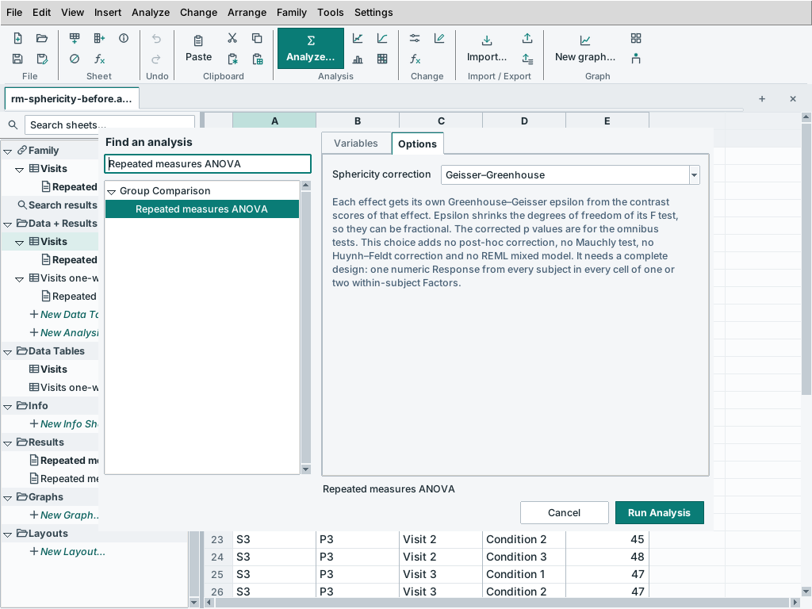
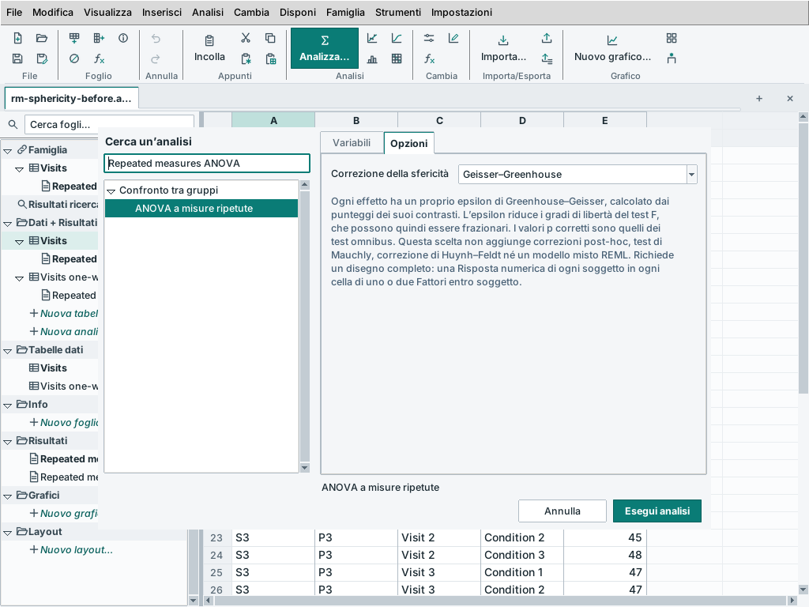
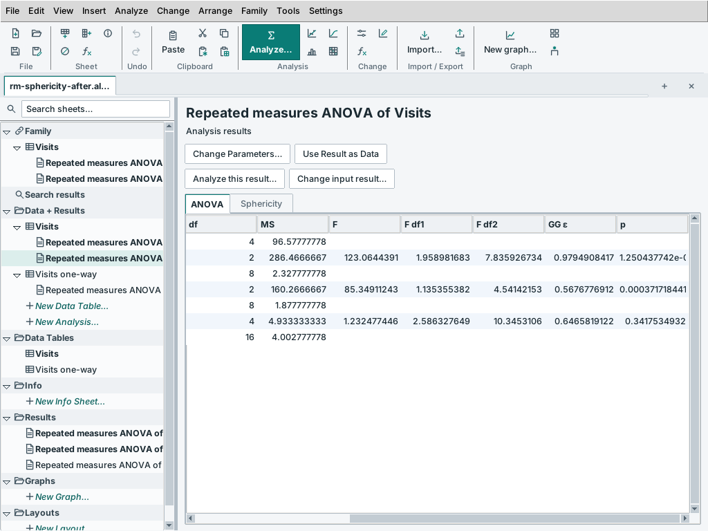

# Repeated measures ANOVA with Greenhouse–Geisser for two factors — 0.93

Choose **Group Comparison → Repeated measures ANOVA** and open the **Options** tab. The canonical option `Sphericity correction` now corrects one *or two* within-subject Factors.

| Option | Values | Default |
| --- | --- | --- |
| `Sphericity correction` | `None`, `Geisser–Greenhouse` | `None` |

`None` is the behaviour of every earlier version. A saved recipe from before this change gives the same sheet, to the last digit. The spelling `Geisser–Greenhouse (one-way)` of the earlier one-factor choice stays readable in a saved recipe and keeps its own numbers and its own error messages. The dialog offers it, labelled *saved recipe*, only when the recipe being edited already uses it. A new recipe uses `Geisser–Greenhouse`.

```json
{"Response": "Response", "Factors": ["Visit", "Condition"], "Subject": "Participant",
 "Sphericity correction": "Geisser–Greenhouse"}
```

Recipe values stay canonical English in both languages (`Geisser–Greenhouse`, not an Italian caption), and the factor and subject names are the literal column names.




## What is corrected

The F test of every effect compares a mean square with its own subject-by-effect error. The ordinary test assumes *sphericity*: the differences between the cells of the effect have equal variance. Greenhouse–Geisser shrinks the degrees of freedom of that F test by an estimate ε of how far the data are from sphericity, `1/q ≤ ε ≤ 1`.

For one effect with `q` contrasts and `n` subjects:

1. Each subject's cell means are reduced to `q` **contrast scores** with an orthonormal Helmert basis: the Visit effect uses the contrasts of Visit on the subject's mean over Conditions, the Condition effect uses the contrasts of Condition on the mean over Visits, and the interaction uses the Visit × Condition contrasts. A subject's own average is removed first, so adding a constant to every response of a subject changes nothing.
2. `S` is the covariance matrix of the scores between subjects (`n − 1` in the denominator) and `ε = (tr S)² / (q · tr S²)`, limited to `[1/q, 1]`. An effect with `q = 1` has `ε = 1`.
3. The F ratio is unchanged. Its degrees of freedom become `q·ε` and `(n − 1)·q·ε`, and p is the upper tail of the F distribution with those degrees of freedom.

The sums of squares, mean squares, F ratios and error terms are computed once, by the same loop as the uncorrected analysis. The correction touches only the degrees of freedom of the test and p. Each effect gets **its own** ε: Visit, Condition and Visit:Condition are not forced to share one.

## An example: 5 subjects, 3 visits, 3 conditions

Synthetic data, one row per measurement (45 rows): `Participant` P1–P5, `Visit` 1–3, `Condition` 1–3, `Response`. The project with the recipe is `docs/examples/rm-two-way-sphericity.alab`. The ANOVA sheet with the correction:

| Term | SS | df | F | F df1 | F df2 | GG ε | p | uncorrected p |
| --- | ---: | ---: | ---: | ---: | ---: | ---: | ---: | ---: |
| Visit | 572.93 | 2 | 123.06 | 1.959 | 7.836 | 0.9795 | 1.25e-06 | 9.82e-07 |
| Condition | 320.53 | 2 | 85.35 | 1.135 | 4.541 | 0.5677 | 3.72e-04 | 4.02e-06 |
| Visit:Condition | 19.73 | 4 | 1.232 | 2.586 | 10.345 | 0.6466 | 0.3418 | 0.3364 |

* `df` is the degrees of freedom of the sum of squares (2, 2 and 4), as without the correction. `F df1` and `F df2` are the degrees of freedom **of the test** and are the only ones that become fractional.
* Visit is almost spherical (ε ≈ 0.98), so its p hardly moves. Condition is far from spherical (ε ≈ 0.57): the same F of 85.35 is judged against an F distribution with `1.135` and `4.541` degrees of freedom instead of 2 and 8, and p is about a hundred times larger (3.7e-04 instead of 4.0e-06).
* The `Sphericity` sheet repeats these figures, one row per effect, with the number of contrasts (`Contrast dimension`) and the uncorrected p next to the corrected one.




### What fractional degrees of freedom mean

A mean square is a chi-square variable divided by its degrees of freedom only when the covariance has the sphericity structure. When it does not, the ratio is approximately an F ratio, and the approximation is better with fewer, fractional degrees of freedom. A value such as `1.135` is not a counting error and is not rounded: p is computed with it exactly. Do not round it to 1 by hand.

## GLM correction or mixed model

This is a **correction of the univariate repeated-measures GLM**. It keeps the design of the classical analysis: every subject has one measurement in every cell, the error terms are the subject-by-effect terms, and the only change is how many degrees of freedom the F test gets.

It is not a mixed model and does not give the same p values as **Mixed-effects model (REML)**, which models the covariance of the repeated measurements directly, accepts subjects with missing cells, takes between-subject factors and offers Satterthwaite and Kenward–Roger degrees of freedom. If the design is incomplete, or has between-subject factors, use the mixed model. The dialog's note says so, and the incomplete-design error repeats it.

## Result sheets

* `ANOVA`: `SS`, `df`, `MS`, `F`, `F df1`, `F df2` and `p`, one row per effect and one error row per effect (`Participant:Visit`, `Participant:Condition`, `Participant:Visit:Condition`). With `Geisser–Greenhouse` a `GG ε` column follows `F df2`.
* `Sphericity` (only with the correction and two Factors): `Term`, `Contrast dimension`, `GG ε`, `F`, `F df1`, `F df2`, `p`, `Uncorrected p`.

Sheet and column names stay canonical English in both languages, so a saved project, an exported CSV and **Use Result as Data** do not depend on the language. One Factor with `Geisser–Greenhouse` keeps the single `ANOVA` sheet and gives the numbers of the one-way choice of before.

The corrected p values are for the **omnibus** tests. The correction does not add post-hoc comparisons, a Mauchly test of sphericity or a Huynh–Feldt correction.

## A complete design, checked before the fit

`Geisser–Greenhouse` needs one numeric, finite Response from every subject in every combination of the levels of one or two within-subject Factors. Nothing is imputed, nothing is excluded pairwise, and a missing cell is an error, never a silently smaller analysis. The checks run in the dialog, before the analysis starts, and each names the field to correct:

| Problem | Field |
| --- | --- |
| a choice other than `None` or `Geisser–Greenhouse`, the one-way spelling with two Factors | `Sphericity correction` |
| no Factor, or more than two; an empty Factor or one with a single level; a blank level; every subject incomplete (a level that occurs only for some subjects, such as a between-subject column) | `Factors` |
| a blank, non-numeric or infinite Response; no residual variance for an effect; values beyond about ±1e153, or differences within a subject below about 1e-137 | `Response` |
| a blank Subject label, fewer than two subjects, a subject with two measurements in one cell, a subject missing a cell | `Subject` |

A column chosen for two roles (the same column as Response and Subject, say) is refused on the field of the later role.

An error found in the dialog keeps the dialog open, keeps everything typed, shows the message and puts the focus on the field. For example, with a mistyped Subject label the dialog says `Subject S1 has no measurement for Visit = Visit 1; Condition = Condition 2 (subjects with missing cells: 2). Each subject needs one Response in each of the 9 combinations of Visit × Condition.` Choosing the right column in the same dialog and pressing **Run Analysis** again runs it. An error that is first known after the dialog closed, for example in a project reopened on data that changed, reopens the existing analysis-recovery dialog the same way, with the confirmed analysis kept.

Excluding one cell of the data leaves the design incomplete: the analysis shows no result and the status bar says so. Including the cell again restores the result.

## Project file

A `.alab` project keeps the recipe above. Reopening the project, editing the data, excluding a cell and recalculating refit the same recipe. The other ANOVA dialogs (One-way ANOVA, Multifactor ANOVA with its Model tab, Mixed-effects model (REML)) are untouched: the smoke script compares their controls and tabs with the version before this change, and their existing tests pass unchanged.

## Choices made

* One ε per effect, from that effect's own contrast scores. A single ε for the whole table would be wrong for an interaction whose contrasts differ in covariance from the main effects.
* The canonical choice is strict and the legacy one-way spelling is not changed: the same numbers for one Factor, but the old errors stay on the old spelling, so a saved recipe never starts to fail with a new message.
* The correction is a choice of the existing option, not a new analysis, so a saved recipe, the dialog and Use Result as Data need no new concepts. Only the `Sphericity` sheet is new.
* Scores are rescaled by their peak before the Gram matrix is formed, so ε does not depend on the units of the Response and large responses do not overflow. Beyond the limits in the table above the dialog asks for different units instead of returning a doubtful number.

## Not covered

* Mauchly's test, Huynh–Feldt and lower-bound corrections, and post-hoc comparisons or estimated marginal means for the corrected design.
* Three or more within-subject Factors with a correction, between-subject factors, missing cells (use Mixed-effects model (REML)).
* Windows and native Windows DPI were not available while this was written: **NON PROVATO**. Linux/Xvfb runs are not a Windows result.

## Checks

Widgets were driven by the smoke script `rm-two-way-sphericity` (`analisi/rm_sphericity_smoke.py`): `Combobox`/`Entry` variables, `Listbox` selection and `event_generate`, `ok()` and `cancel()` on the real dialog. These are events sent to real widgets, not the mouse or keyboard of a person. Screenshots are the whole X screen from ImageMagick `import`, taken on synthetic data. The error message box is patched out by the script, so the error screenshots show the dialog afterwards, with the focus on the field; the recovered dialog screenshots show the message in the dialog itself.

The numbers are checked against an independent Helmert/Kronecker calculation in `tests/test_rm_sphericity.py` (ε, F and p of the 3 × 3 matrix and of other shapes), against plain numpy sums of squares in the smoke script, and against the earlier one-way correction.
