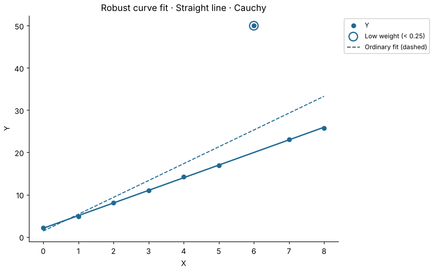

# Robust curve fit — 0.73

Choose **Regression and Curves → Robust curve fit** to fit a curve that a few extreme points cannot drag away. An ordinary least-squares fit gives every point the same vote, so one wild value can bend the whole curve. A robust fit lets the points near the curve decide and lowers the influence of the ones far from it. Nothing is deleted: every observation stays in the worksheet, in the tables and in the graph.

The ordinary **Linear regression**, **Nonlinear regression**, **Fit custom equation** and **Global** analyses are unchanged and keep their recipes.

## Choices

| Field | Meaning |
|---|---|
| X, Y columns, Group | One X column, one or more Y columns and an optional Group. Each Y column and each group level is its own fit, on its own complete (X, Y) pairs. Up to 24 fits, 12 parameters per model and 100,000 pairs. |
| Model | **Straight line** by default, or any model of the catalog that does not need a fixed or shared parameter (Browse…). |
| Initial parameters | **Catalog starting values** by default, proposed from the data of the first fit. **Edit…** opens a table: the proposed value, your own value, the limits of the parameter. You override all of them or none (Reset returns to the catalog). Apply stores them, Cancel keeps the previous ones; an invalid entry stays in the table with the error on that parameter. |
| Loss | **Cauchy** (default), **Huber** or **Soft L1**. |
| Scale method | **Fixed** (default) or **Pilot MAD**. |
| Residual scale | The scale of the **Fixed** method, a finite number greater than 0 (default 1). Hidden under Pilot MAD, where an old value of it is ignored even when it is invalid. |
| Maximum evaluations | Whole number from 50 to 100,000 (default 20,000) per optimisation stage. |
| Low weight threshold | Number between 0 and 1, exclusive (default 0.25): points whose influence weight is below it are circled. |
| Compare ordinary fit | Adds the ordinary least-squares fit of the same pairs to the tables and a dashed line to the Curve view. |
| Graph display | **Curve**, **Residuals** or **Weights**. All three read the same fit; changing it never changes a parameter. **Graph settings…** on the graph page reopens this choice. |

## How it is computed

A vertical residual *r* = Y − f(X; θ) is divided by a scale *s* and *u* = *r*/*s* is penalised by Σ ρ(*u*²), with *s* fixed during the final fit:

* **Cauchy:** ρ(z) = log(1 + z), influence weight 1/(1 + z).
* **Soft L1:** ρ(z) = 2(√(1 + z) − 1), weight 1/√(1 + z).
* **Huber:** ρ(z) = z for |*u*| ≤ 1 and 2|*u*| − 1 otherwise, weight 1 or 1/|*u*|.

**Pilot MAD** first fits the same model by ordinary least squares from the same starting values and takes *s* = 1.4826 × median(|*r* − median(*r*)|) from those residuals. If that is zero it uses the 0.6827 quantile of |*r*| (Scale source "Absolute residual quantile fallback"), then the median of the nonzero |*r*| ("Positive residual fallback"). If every computed pilot residual is zero, the pilot is the result (scale 0, objective 0, weights 1, Status "Exact pilot"). Representable nonzero residuals are retained even when the response has a large offset. A pilot that does not converge is reported as an error; Trama never silently falls back to ordinary least squares.

The optimiser is `scipy.optimize.least_squares` on parameters scaled by their starting values, so the tolerances do not depend on units. A model whose parameters cannot be told apart from the data is refused instead of returning an arbitrary curve.

## Results

Always, in this order:

1. **Robust parameters** — Series, Group, Parameter, Estimate (catalog order).
2. **Robust fit** — one row per fit: N, free parameters, loss, residual scale and its source, robust objective, raw residual SS, RSDR, number of low-weight points, evaluations, status.
3. **Robust residuals** — one row per observation: Series, Group, **Source row** (the original zero-based position), **Source index** (the original index value, even when it repeats), X, observed, predicted, residual, standardised residual, **Influence weight** and **Low weight** (true/false).
4. **Robust curve** — 201 points over the observed X range (logarithmic when the model asks for it).
5. **Ordinary comparison** (only when requested) — parameters and raw residual SS of both fits on identical pairs and the status of the ordinary fit. If the ordinary fit fails while the robust one succeeds, the comparison says "Not available" with the reason and the robust result is kept.

The graph circles low-weight points without removing them. Residuals shows the raw residual against X with the zero line; Weights shows the influence weight with the threshold line on an axis from 0 to 1. The legend names every Series and Group.

## What it is not

The influence weights describe how strongly a point was down-weighted. They are **not** probabilities, **not** an outlier test and **not** weights for a second regression. No standard error, covariance, confidence interval, p value, AICc or robust R² is reported; RSDR is a descriptive spread, not a standard error. For intervals and model comparison use **Nonlinear regression** or **Fit custom equation**.

## Errors

Every problem names its field and keeps the dialog open: scale, evaluations, threshold, columns, the starting values (down to the exact parameter), a model that needs positive X, too few pairs, an undefined model at the starting values. A failure found only while fitting (no convergence, an unidentifiable model) reopens the dialog with every value you entered, a banner and the field to change; the previous result stays untouched until a new fit succeeds.

