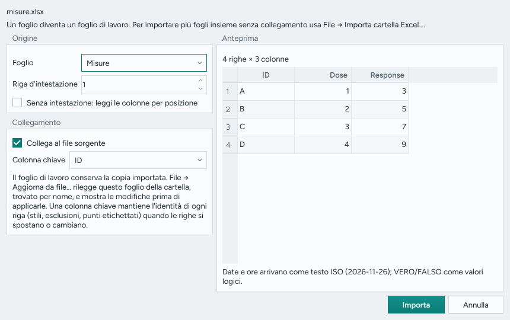
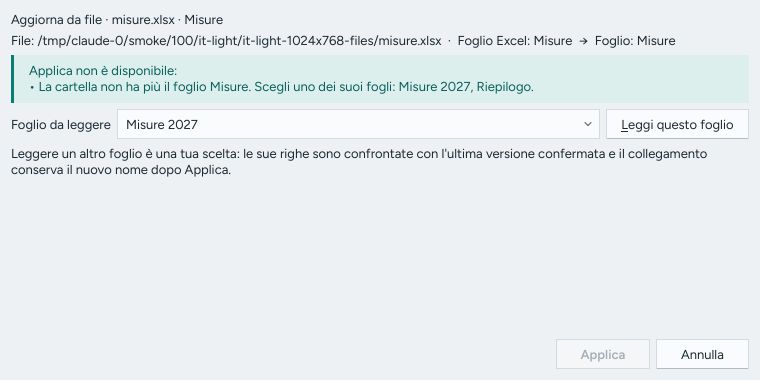

# Linked Excel sheets: update a worksheet from one sheet of an .xlsx workbook

A worksheet can stay linked to **one sheet of an .xlsx workbook**, exactly as it can to a CSV or TSV file
([source-link.md](source-link.md)): the worksheet keeps the last confirmed copy of the cells, the project opens and
calculates without the workbook, nothing is read again until you ask, every change is shown before it is applied,
and the workbook is only ever opened for reading. This page lists only what differs for a workbook.



## Commands

| Command (IT) | What it does with a workbook |
|---|---|
| File → Import data… (*Importa dati…*) on an `.xlsx` | **Sheet** (*Foglio*, by its exact name, in workbook order), **Header row** (*Riga d'intestazione*) or **No header: read the columns by position** (*Senza intestazione: leggi le colonne per posizione*), the preview with the names in Trama, **Link to the source file** (*Collega al file sorgente*) and the **Key column** (*Colonna chiave*). One sheet becomes one worksheet; File → Import Excel workbook… still imports several sheets at once, without a link |
| File → Update from file… (*Aggiorna da file…*), `Ctrl+Shift+U` | Reads the linked sheet again and opens the usual preview, with conflicts decided row by row |
| File → Source link… (*Collegamento sorgente…*) | Shows **Excel sheet** (*Foglio Excel*) and *Read as* (`Excel workbook · sheet Misure · header row 1`). **Link to a file…** (*Collega a un file…*) and **Change source…** (*Cambia sorgente…*) accept an `.xlsx` and open the same sheet dialog, also for an existing compatible worksheet |

## How the workbook is read

- **Read-only, no calculation.** The workbook is opened read-only with the values Excel stored for its formulas.
  Nothing is evaluated, and links to other workbooks are never followed or refreshed (their stored result is used).
  The sheet is read from the very bytes whose SHA-256 the link confirms.
- **The sheet by name.** Moving the sheet among the others changes nothing. When the sheet was **renamed or
  removed**, the preview says so, lists the sheets the workbook has now, and offers **Sheet to read** (*Foglio da
  leggere*) with **Read this sheet** (*Leggi questo foglio*). That sheet is compared with the last confirmed version
  (your edits stay edits, conflicts stay conflicts) and, after Apply, the link keeps the new name, also after saving
  and reopening.
- **Cells.** Numbers stay numbers (an integer written as `4` or `4.0` is the same value, every digit is kept), text
  stays literal (`007` stays text), an empty cell is a missing value. **TRUE/FALSE** arrive as logical values.
  **Dates and times** arrive as ISO text: `2026-11-26`, `2026-11-26T08:30:00`, `08:30:00`.
- **Apply stays off** — besides the reasons of a CSV link (empty or repeated keys, a missing column, text in a
  numeric column, open conflicts, a file changed while the preview is open) — when a linked cell holds a **formula
  without a stored result** or an **Excel error value** (`#DIV/0!`…). The panel names the sheet and the cells:
  open the workbook in Excel, let it calculate, save it and update again. Without a link the import keeps such cells
  empty and says which.
- **Limits.** As for File → Import Excel workbook…: `.xlsx` only (no macros, no `.xls`/`.xlsb`), 32 MiB on disk and
  the worksheet size limits. Reading 50 000 rows × 10 columns takes a few seconds (openpyxl); Cancel stops the read.
  A workbook has no exclusion mark: the cells keep the exclusions made in the worksheet.



## The saved record and older versions

A workbook link is saved in the `.alab` project under its own key, `source_link_workbook` (format 1): the path,
the path relative to the project, the sheet name, the header row (`null` = by position), the columns, the key and
the last confirmed version. CSV/TSV links keep their `source_link` record unchanged.

**An older Trama** (0.110–0.117, which knows only CSV links, and anything before) ignores the new key: the project
opens, the worksheet keeps its last confirmed cells and has no link. Saving the project there drops the link;
link the worksheet again with File → Source link… → Link to a file….

## Checking it

```sh
python -m unittest tests.test_source_link_xlsx tests.test_qt_source_link_xlsx
python -m tests.bench_source_link_xlsx 50000 10 [FOLDER]
xvfb-run -a -s '-screen 0 1600x1000x24' python -m trama_qt.source_link_xlsx_smoke OUT --lang it --theme dark
```

The synthetic workbooks of the case are in `tests/data/source_link_xlsx` (`iniziale.xlsx` with the decoy sheet
`Riepilogo`, `aggiornato.xlsx`, `duplicato.xlsx`, `rinominato.xlsx`, `formula-senza-cache.xlsx`, and the expected
results `atteso-progetto.csv` and `atteso-excel.csv`). `docs/examples/source-link-xlsx/` holds a reopenable project
linked to its workbook.
