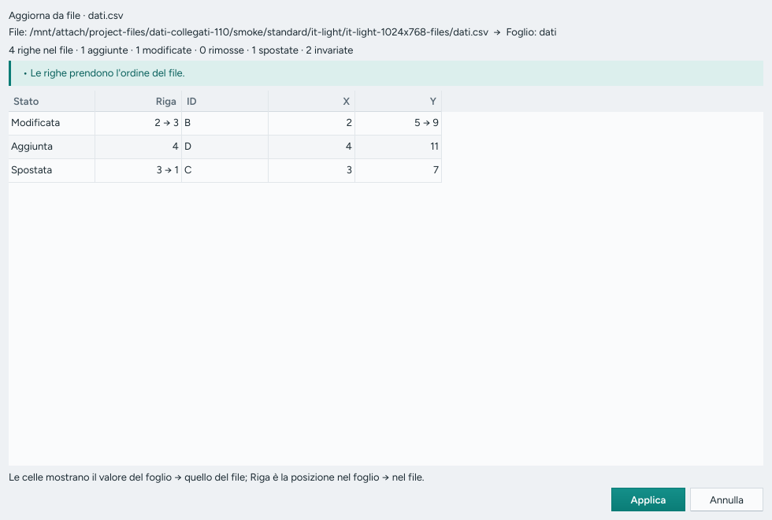

# Linked CSV and TSV files: update a worksheet from its source file

A worksheet imported from a delimited text file (CSV, TSV, TXT) can stay **linked** to that file. The worksheet keeps
the last confirmed copy of the cells, so the project opens and calculates without the file; nothing is read again
until you ask, and every change is shown before it is applied. The file is only ever opened for reading.



## Commands

| Command (IT) | What it does |
|---|---|
| File → Import data… (*Importa dati…*), group **Link** (*Collegamento*) | **Link to the source file** (*Collega al file sorgente*) and an optional **Key column** (*Colonna chiave*) |
| File → Update from file… (*Aggiorna da file…*), `Ctrl+Shift+U` | Reads the linked file again with the saved options and opens the preview; **Apply** changes the worksheet |
| File → Source link… (*Collegamento sorgente…*) | Where the file is, how it is read, the key, imported and project columns, the last confirmed version; **Update from file…**, **Change source…** (*Cambia sorgente…*), **Unlink** (*Scollega*). On a worksheet without a link: **Link to a file…** (*Collega a un file…*) |

*Update from file…* is on only for an editable worksheet with a link. *Source link…* is on for a linked worksheet
and for an ordinary (multivariable) worksheet, which it can link to a file.

## What the link stores

- **Where**: the absolute path and, after a save, the path relative to the project folder. Trama never searches for
  the file and never takes another file with the same name by itself. When the absolute path is gone but the
  relative one exists (the project folder was moved or copied together with the file), the preview shows that file
  and **Apply stays off until you tick "Use this file"**. When neither exists, Trama asks you to **Locate…** the file
  (or Cancel: nothing changes); the preview then says *File chosen by you*.
- **How it is read**: UTF-8, the delimiter actually used (also when *Automatic* chose it), the decimal mark, the
  header choice, the row range and step, the missing code and the trailing `*` exclusion mark of the import. The
  column range becomes the list of linked file columns: by header text when it is unique, by position otherwise. On
  the worksheet side each linked column is followed by its stable column identity, so renaming a worksheet column
  keeps the link.
- **The key**: an optional column whose values identify a row. With a key, reordering, inserting and deleting rows in
  the file are recognised row by row.
- **The last confirmed version**: size and SHA-256 of the file and, for each row, 16 bytes (8 for the key, 8 for the
  imported cells) with the worksheet row identity that row had. No second copy of the values is stored.

The link is saved in the `.alab` project as a `source_link` record of the worksheet (format 1). A project written by
an older Trama has no record: its worksheets simply have no link. An older Trama opening a newer project ignores the
record and keeps the cells. A damaged record is refused when the project is opened, never guessed.

## The preview

*Update from file…* reads and compares on the worker thread, with progress and **Cancel** (the read stops within a
few milliseconds; nothing changes). The preview then lists, conflicts first:

| State | Meaning |
|---|---|
| Modified (*Modificata*) | Changed in the file only: the file value is taken |
| Added (*Aggiunta*) | A key (or row) that the file did not have: added in the file order |
| Removed (*Rimossa*) | In the confirmed version, no longer in the file: removed; the notice says what it takes with it (excluded cells, backgrounds, row heights, text styles, styled or labelled graph points, values of project columns) |
| Moved (*Spostata*) | Unchanged, but in another place: the rows take the order of the file |
| Project edit kept (*Modifica del progetto tenuta*) | Changed in the worksheet only: your edit stays |
| Conflict (*Conflitto*) | Changed in the worksheet **and** in the file, or edited here and removed there |

Cells show `worksheet value → file value`; the *Row* column shows `place in the worksheet → place in the file`. At most
1 000 changes are drawn (the summary counts all of them).

**Apply is off, with the reason in the panel**, when:

- the key column is empty or repeats a value in the file (or in the worksheet);
- a linked header is no longer in the file, a positional column is missing, or a header appears twice;
- a linked column now holds text where the worksheet has numbers (or another kind of value);
- a linked worksheet column was deleted or replaced by a calculated column;
- there are conflicts and no choice was made;
- without a key, the rows cannot be matched one by one (see below) and *Replace all rows* is not ticked;
- the file changed while the preview was open (*Apply* re-checks size and modification time and refuses).

Enter applies only when *Apply* is on.

### Conflicts

A row is a conflict only when both sides changed it since the last confirmed version. The panel **Changed in the
project and in the file** asks one decision for all of them, with **no default**: *Keep the project values* or *Use
the file values*. Rows changed on one side only are never in question. This keeps the decision explicit without
asking row by row; when a per-row choice is needed, Cancel, fix the few rows in the worksheet (or in the file) and
update again.

### Without a key

Rows are matched only when their identity can be proven: every confirmed row is found again, unchanged, each exactly
once (rows appended at the end, or unchanged rows in a new order with distinct content). If a value changed or a row
was removed, the preview says why matching is impossible and offers **Replace all rows of the worksheet**: every row
gets a new identity and the notice lists what is lost. Choose a key with *Change source…* to avoid this.

### Project rows and project columns

Rows inserted in the worksheet that were never in the file stay, at the bottom. Rows deleted in the worksheet stay
deleted (unless the file changed them, which is a conflict). Columns added in the worksheet are project columns: the
file never touches them, and their values follow the row identity. *Source link…* lists imported and project columns
separately.

## Apply, Undo, Redo

**Apply is one worksheet edit**: data, row order, link and the metadata that follows rows (excluded cells, cell
backgrounds, row heights, text styles, point styles and observation labels of graphs, which use the row identity)
change together, and the analyses that read the worksheet recalculate **once**. **Undo** restores the previous cells,
order, metadata and the previous confirmed version of the link in one step; **Redo** applies it again. Unlink is one
Undo step too and keeps cells and results. Cancel, an unreadable file or a file that changed during the preview leave
the data and the history as they were. With the trailing `*` exclusion mark in the import options, the marks in the
file decide the exclusions of the cells the file sends.

Exports (Excel workbook, figures, PDF, report) always use the worksheet as it is: the last confirmed version.

## Change source

*Change source…* opens the import dialog on a file you choose, preset with the current options, and reads it into
the same worksheet with the same preview. Columns are matched to worksheet columns by name; new file columns are
added at the right; worksheet columns no longer read become project columns. The worksheet as it is stands for the
confirmed version, so only real differences are shown.

## Limits

- Local and network files only: a URL is refused, nothing is fetched from the web, nothing updates by itself.
- Files up to 32 MiB; UTF-8 (with or without BOM, as the import).
- Classic Qt interface only.

## Performance

`python -m tests.bench_source_link` (50 000 rows × 20 columns, 19 MB) in the cloud container: import with link about
1.5 s, preview of an unchanged file about 2.5 s, preview with 1 % modified, removed and added rows in reverse order
about 2.2 s, preview table 0.7 s (1 000 rows drawn), Apply 0.3 s, Undo/Redo immediate, Cancel during the read stops
in a few milliseconds.

## Checks

```
python -m unittest tests.test_source_link tests.test_qt_source_link
python -m trama_qt --smoke OUT --only qt-source-link      # EN/IT, light/dark, 1024×768 and 1600×1000
QT_SCALE_FACTOR=1.5 python -m trama_qt.source_link_smoke OUT --size 1024x768   # 150 % emulated
python -m tests.bench_source_link
```

The smoke drives the real dialogs (import with the link, preview confirmed with Enter, duplicated keys, a conflict,
Source link, a project moved with its file) and writes `casi-dati-collegati.alab` with its `dati.csv`, which reopen
together. The data are the synthetic files of `tests/data/source_link`.
