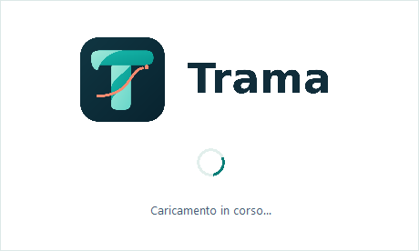

# Schermata di avvio

Quando avvii Trama, il logo è accompagnato da un cerchio animato mentre vengono
caricati i componenti dell'applicazione. La schermata si chiude quando la
finestra principale è pronta. La lingua segue la preferenza italiano/inglese.

Il cerchio è un indicatore indeterminato: mostra che il caricamento è in corso.
Non viene imposto un tempo minimo di visualizzazione. L'animazione viene
aggiornata dal thread dell'interfaccia mentre un worker carica le definizioni
dei moduli; l'apertura dei progetti e l'inizializzazione delle finestre avvengono
poi sul thread dell'interfaccia. Un errore di caricamento chiude la schermata e
mostra il messaggio corrispondente.

Le esecuzioni di collaudo `--smoke` e l'importazione del modulo da altri script
restano prive di schermata di avvio.

[Novità 0.76](release-076.md) · [Verifiche](validation-076.md)
