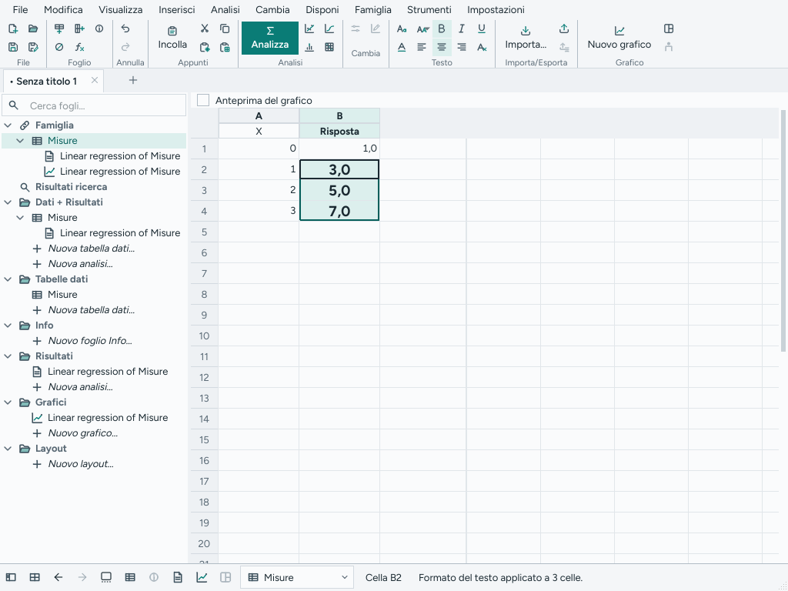
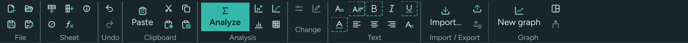
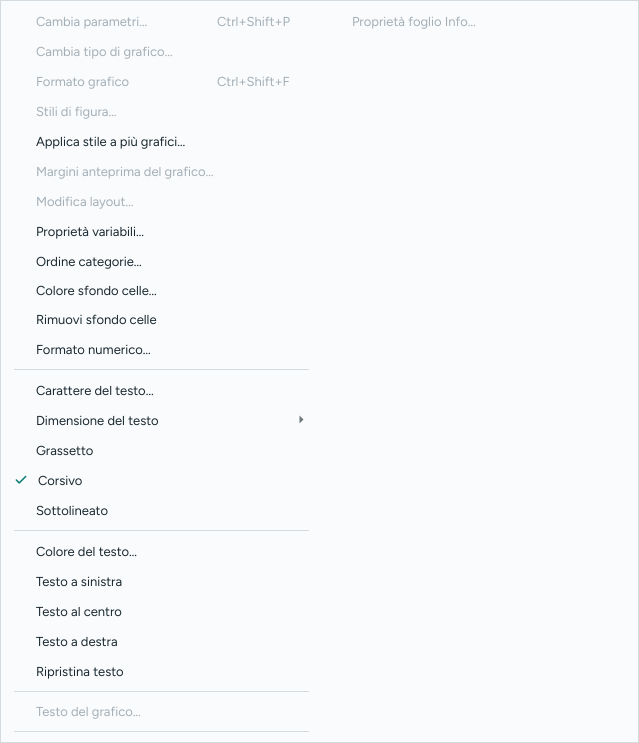
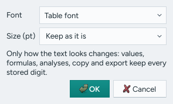
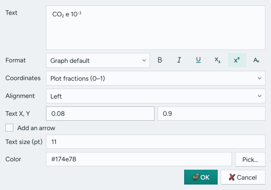
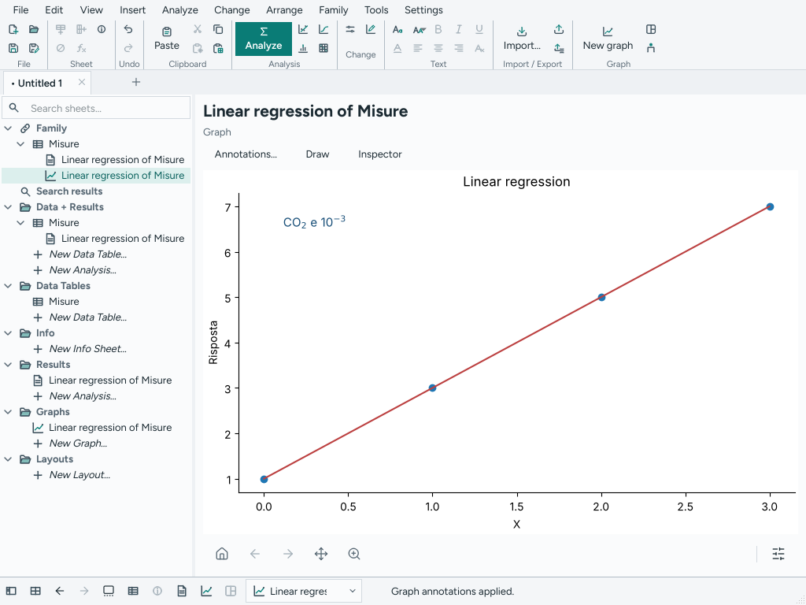

# Text group: font, size, color, bold, italic, underline, alignment, subscript and superscript

The **Text** group of the Classica Qt toolbar (Italian: *Testo*) changes how the text of the selected cells **looks**, on data tables and on result tables. It is also in the **Change** menu (*Cambia*), in the context menu of the grid under *Text*, and, in a narrow window, in the *More* (*Altro*) menu of the toolbar. Values, formulas, analyses, editing, Copy, CSV/XLSX export and *Use Result as Data* never see the style: a styled `7` is still the number 7.



## Commands

| Command (IT) | What it does |
|---|---|
| Text font… (*Carattere del testo…*) | Family and size in one dialog; each can be left as it is or sent back to the table default |
| Text size (*Dimensione del testo*) | Menu of common sizes, *Other size…* (6–72 pt, steps of 0.5) and *Table size* |
| Bold / Italic / Underline (*Grassetto, Corsivo, Sottolineato*) | Toggles |
| Text color… (*Colore del testo…*) | Six-digit colour; it wins over the automatic contrast on a coloured background |
| Align text left / Center text / Align text right | Toggles; pressing the active one goes back to the default alignment (numbers right, text left) |
| Restore text (*Ripristina testo*) | Removes **only** the text attributes: backgrounds, number formats and exclusions stay |
| Graph text… (*Testo del grafico…*) | On a native graph: opens the existing **Format Graph** window, which owns the fonts of titles, axes and tick labels. On a graph page *Text font…* and *Text size* open it too |

The commands are enabled only when a data table or a result table is the active sheet, it is not frozen, nothing is calculating and a cell is selected. Result values stay read-only: only their look changes.

## Inherited, uniform, mixed

For every attribute the selection shows one of three states:

- **inherited** — no cell sets it; the table font, the number format and the default alignment apply;
- **uniform** — every selected cell has the same value (the button is checked, the tooltip says the value);
- **mixed** — the cells differ, or only some have it (the button gets a dashed border and the tooltip says *mixed*).

A toggle on a mixed selection turns the attribute on everywhere; on a uniform *on* selection it goes back to inherited. Changing one attribute keeps the others of each cell: formatting B2 and B3 differently, selecting both and turning italic on leaves each cell's other settings alone.



## Menu and dialog





## Annotations: subscript and superscript

The annotation editor of a native graph (*Insert → Annotations…*, *Annotazioni…*) has the same commands for the label being edited: font, bold, italic and underline reach the whole annotation; **Subscript** and **Superscript** reach the selected characters (or what is typed next); the **Normal text** button next to them — *Restore text* — gives the annotation the default look of a new one. To clean up only the scripts, select the text (or nothing, for all of it) and press the active script button again.

The text of an annotation stays plain: `CO2` and `10-3` are what is stored in the project, searched and copied. The editor keeps the portions as `[start, end, mask]` spans, with Python character positions (the editor converts from Qt's UTF-16 units, so characters outside the basic plane do not shift them); spans never cross a line break and never overlap. The graph draws them as `CO₂` and `10⁻³` (matplotlib math text, with the text spelled out inside the script so `%`, `_` and `$` are never read as markup).





PNG, SVG and PDF export the same drawing. In a PDF the text is a vector: extracting it gives `CO2` and `10` / `−3` on two lines because the PDF stores the raised characters as separate text. An underline is a vector line drawn with the text, so it follows the font size in every format.

An annotation change is now one Undo step (it had none), as a cell format is.

## Storage

Cell styles are **row runs per column**, never one entry per cell: a style applied to 50 000 × 20 cells is 20 runs. Data tables key the runs by column name, so a style follows its column when columns are reordered or renamed and disappears when the column is deleted. Result tables key them by analysis, sheet and column position (0 is the row-title column), as the number formats do. Inserted and deleted rows move the runs (`Project.insert_rows` and `delete_rows` call `TextStyles.insert_rows` and `delete_rows`: one remap point beside the row identities of the worksheet); recalculation keeps result styles.

The project file gets two optional keys, `text_styles` (per table) and `result_text_styles` (per analysis and sheet), absent when there is no style. Projects without them open and save as before; older versions ignore them. Reading is validated: unknown columns, rows outside the table, overlapping runs, a size outside 6–72, a colour that is not `#rrggbb` or an unknown attribute make the file refuse to open instead of drawing something wrong. Annotations keep the optional `font`, `bold`, `italic`, `underline` and `spans` of their own record.

Family duplication, *Repeat analysis on other sheets*, sheet duplication and recovery copies carry the styles with the cells.

## What it costs

`python -m tests.bench_text_style` (Linux, offscreen, 4 cores): a 50 000 × 20 sheet, every cell selected.

| Step | Time |
|---|---|
| Select all, read the state | 36 ms |
| Apply bold to 1 000 000 cells | 44 ms |
| Colour and size on top | 46 ms |
| Undo / redo | 42 / 30 ms |
| Restore text | 33 ms |
| Worksheet recalculations, model reloads | 0, 0 |
| Reference: the same selection with the cell background colour | 235–253 ms and 1 000 000 dictionary entries |

Rows get the height of the largest explicit size in the table (rows are uniform); an explicit size follows the table zoom.

## Tests

```
python -m unittest tests.test_worksheet_text tests.test_qt_worksheet_text -v
python -m trama_qt.text_style_smoke OUT [--lang en|it] [--theme light|dark]    # real window, screenshots, .alab
TRAMASTAT_SMOKE_ONLY=qt-text-style python tramastat.py --smoke OUT              # the four language/theme combinations
```

Windows was **not** exercised: the screenshots come from Linux (Xvfb 1024 × 768 and 150 % emulated with `QT_SCALE_FACTOR=1.5`, which is not a native DPI setting).
