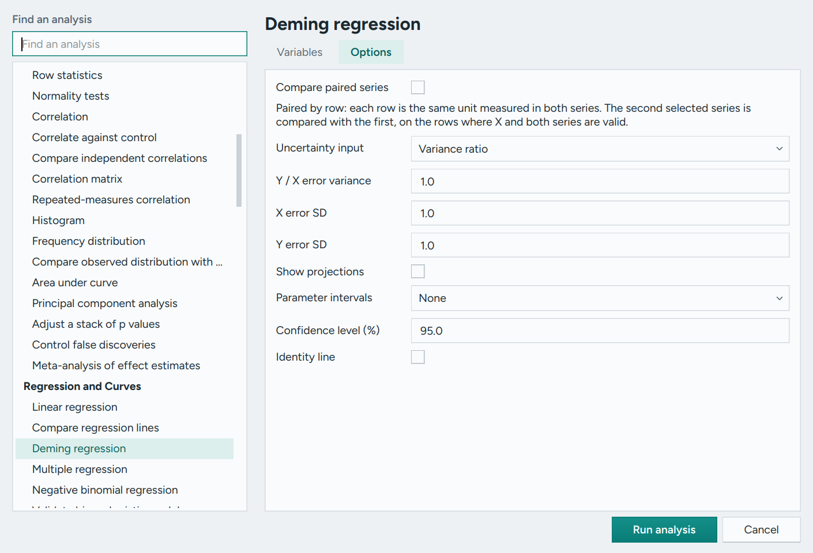

# Verifica del confronto appaiato Deming

Base pubblica `v0.107.0`, commit `fa9d945f2568a4e891ae29ab2c13b882a48f7b25`. Macchina del notebook: Linux 7.3.5-2-cachyos x86_64, Python 3.14.10, PySide6 6.12.0. I comandi partono dal worktree, con `uv run --no-project python`. Il codice verificato è `354dcdb380ffdff5c724696e3e503d71fc5b36b8`, sul branch `deming-confronto-appaiato`. Questo commit nomina quella revisione e non cambia il calcolo.

## Test

```
python -m unittest tests.test_deming_paired tests.test_deming_multiseries tests.test_deming_intervals tests.test_catalog
```

70 test, 0 errori, 7.447 s. Esito OK.

```
python -m unittest discover -s tests
```

5274 test in 2467.169 s. 34 saltati. 0 failure. 79 error, ed esito di processo 1. 78 traceback nominano `ImportError: libtk8.6.so`. L’altro è `test_startup_import_does_not_load_the_analysis_stack_or_open_a_window`: il processo figlio importa `tkinter` e termina con stato 1. Lo stesso import, su questa macchina, fallisce con `libtk8.6.so`. Nessuna asserzione è fallita. Tk non è stato installato.

## Venti mila righe

Primo calcolo dopo l’import dei moduli, seme 3, opzione accesa, 20 000 righe appaiate: 0.1133 s. Errori standard 0.000341498 e 0.00198647. Una ripetizione nello stesso processo: 0.0576 s. Il test dedicato richiede meno di 5 s ed è fra i 70 sopra.

## Display

Smoke nativo, inglese e italiano, temi chiaro e scuro: **PASS**. Piattaforma Wayland, schermo eDP-1, area utile 1920×1080, device pixel ratio 1.0, DPI logico 96. `QT_SCALE_FACTOR` non impostato.

Lo stesso smoke, solo tema chiaro, con la finestra portata a 1680×900: **PASS**, sullo stesso schermo. Gli screenshot del foglio nella guida vengono da questa esecuzione.

Scala 150% emulata, non nativa: `QT_QPA_PLATFORM=xcb` e `QT_SCALE_FACTOR=1.5`. Inglese e italiano, tema chiaro: **PASS**. Piattaforma xcb, area utile 1280×720, device pixel ratio 1.5, DPI logico 96. La nota e i pulsanti restano nel dialogo.



Lo smoke apre `tests/data/deming-paired/deming-appaiato.alab`, rifiuta una sola serie, calcola `Paired comparison`, salva, riapre e ricalcola dopo la modifica di una cella. Il progetto riapribile con l’opzione accesa è [deming-paired-confronto.alab](examples/deming-paired-confronto.alab).

## Windows

Nessuna interfaccia Windows è stata avviata. Il 2026-11-25, con `BatchMode` e timeout di 6 secondi:

- `santabianca-hcok`: `Connection timed out` su `accorsiluca-altai.nord` porta 22
- `santabianca-hcok-lan`: `Could not resolve hostname santabianca-hcok.local`
- `dev` (`192.168.0.15`): `Connection timed out` sulla porta 22
- `win-test`: `Connection closed by UNKNOWN port 65535`

## Numeri

Il foglio sul progetto di esempio riproduce `tests/data/deming-paired/oracolo.json` (rapporto 1, confidenza 95%, 8 righe appaiate, 7 gradi di libertà). Il calcolo pubblicato usa `leave_one_out_coefficients`. `oracolo.py` resta un controllo di test e non entra nel programma.
